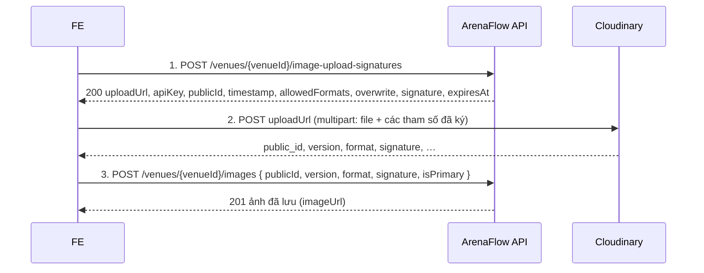

# API Specification — Quản lý địa điểm sân

<!-- File này được publish cho FE (ADR-0010). Viết theo design-standards.md §11:
     không tên class/bảng/cột/migration/transaction/khoá/số truy vấn; không trỏ Component_Class_Design.md,
     Processing_Flow.md, docs/database/. Chi tiết nội bộ BE ghi ở hai file đó. -->

| Mục | Giá trị |
|---|---|
| Mã chức năng | `VENUE-001` |
| Phạm vi tầng | Backend (Spring Boot REST API). Frontend: ngoài phạm vi repo này |
| Repo | ArenaFlow-be |
| Quy ước áp dụng | `api-convention.md` (envelope, phân trang, định dạng lỗi, kiểu dữ liệu); USER-001 `API_Spec.md` §1.1 "Quy ước chung" và §1.2 "Lỗi chung" |
| Quyết định liên quan | [ADR-0009](../../decisions/0009-cloudinary-signed-direct-upload.md) (`Proposed`) — ảnh lưu trên Cloudinary, FE upload thẳng lên Cloudinary bằng chữ ký backend cấp |
| Spec nghiệp vụ | `docs/agent/business-spec/SYSTEM-001/` (v1.2) — UC-V01..V06, BR-V01..V10, BC-V01..V07, Business_Rules §2.6, §5.1/§5.4, AC-V01..V05 |
| Tác giả / Ngày / Phiên bản | solution-architect · 2026-11-09 · v1.0 (baseline) · hiện tại **v1.3** (solution-architect · 2026-11-11) — lịch sử thay đổi: `CHANGELOG.md` |

## 1. Tổng quan

Người dùng thêm địa điểm sân (có hiệu lực ngay, không chờ duyệt), tìm địa điểm, thêm ảnh sân (tối đa 5 ảnh, đúng 1 ảnh chính khi có ảnh) và report địa điểm sai thông tin / đã đóng cửa. Người tạo địa điểm hoặc Admin sửa thông tin và xoá ảnh. Admin xử lý report, đánh dấu địa điểm ngừng hoạt động và kích hoạt lại. Kèo chỉ tham chiếu địa điểm nên luôn hiển thị thông tin địa điểm mới nhất (BR-V10); sửa địa điểm không bị chặn khi đã có kèo.

**Ngoài phạm vi:** frontend · gửi thông báo cho admin/người dùng (NOTIFICATION-001; API này chưa gửi thông báo) · `lastSelectedAt` được cập nhật khi địa điểm được chọn cho kèo (MATCH-001), không có endpoint riêng · sắp xếp lại thứ tự ảnh · header `Idempotency-Key` (`api-convention.md` §13) chưa hỗ trợ.

**Quy ước chung cho mọi endpoint của mã này:**
- Mọi endpoint cần `Authorization: Bearer <access token>`; không có endpoint public. Token thiếu/sai/hết hạn → `401 AUTH_001`. Endpoint `/api/v1/admin/**` mà tài khoản không phải admin → `403 AUTH_004` → ẩn chức năng quản trị.
- Cách xử lý `401 AUTH_001` và lỗi hệ thống `SYS_*`: theo USER-001 `API_Spec.md` §1.2 "Lỗi chung".
- **Admin** = tài khoản có role `ADMIN` trong access token. **Người tạo** = user có id bằng `createdById` của địa điểm. FE so `createdById` với id user đang đăng nhập và role để quyết định hiện nút (§3); backend vẫn kiểm lại.
- Id là UUID dạng chuỗi. Thời gian là chuỗi ISO-8601 UTC (vd `"2026-11-09T03:00:00Z"`). Toạ độ là số thập phân.
- Enum viết UPPERCASE, phân biệt hoa thường (§4.1); riêng `format` ảnh viết thường.
- Chuỗi được cắt khoảng trắng đầu/cuối trước khi lưu. Field tuỳ chọn gửi `""`: ở request tạo coi như không nhập (lưu `null`, không báo lỗi); ở `PATCH /venues/{venueId}` (2.12) nghĩa là xoá giá trị.
- Danh sách: `page` (≥ 1, mặc định 1), `pageSize` (1..100, mặc định 20); response có `pagination` (`api-convention.md` §7). Thứ tự sắp xếp cố định, ghi ở từng endpoint; không có tham số `sort`.
- Lỗi trả theo envelope `error` (`api-convention.md` §4.4). Sai định dạng / độ dài / enum / thiếu field bắt buộc / id trên path không phải UUID → `400 VALIDATION_ERROR` kèm `validationErrors[].field` (`api-convention.md` §11).
- Khi một request vi phạm nhiều điều kiện, backend trả **lỗi đầu tiên** theo thứ tự: `401`/`403 AUTH_*` → `400 VALIDATION_ERROR` → các dòng trong bảng lỗi của endpoint, **từ trên xuống**.
- `201` không kèm header `Location`; lấy id trong body.

## 2. Endpoints

| # | Method + Path | Dùng khi | Ai gọi được | Thành công |
|---|---|---|---|---|
| 2.1 | `POST /api/v1/venues` | Thêm địa điểm | Mọi user | 201 |
| 2.2 | `GET /api/v1/venues` | Danh sách / tìm / gợi ý địa điểm gần | Mọi user | 200 |
| 2.3 | `GET /api/v1/venues/{venueId}` | Xem chi tiết địa điểm | Mọi user | 200 |
| 2.4 | `POST /api/v1/venues/{venueId}/image-upload-signatures` | Thêm ảnh — Bước 1: xin chữ ký upload | Mọi user (địa điểm `INACTIVE`: chỉ Admin) | 200 |
| 2.5 | `POST /api/v1/venues/{venueId}/images` | Thêm ảnh — Bước 3: lưu ảnh đã upload | Chính người đã xin chữ ký ở 2.4 | 201 |
| 2.6 | `PATCH /api/v1/venues/{venueId}/images/{imageId}/set-primary` | Đặt ảnh làm ảnh chính | Mọi user (địa điểm `INACTIVE`: chỉ Admin) | 200 |
| 2.7 | `POST /api/v1/venues/{venueId}/reports` | Report địa điểm | User không phải Admin | 201 |
| 2.8 | `GET /api/v1/admin/venue-reports` | Admin xem report | Admin | 200 |
| 2.9 | `PATCH /api/v1/admin/venue-reports/{reportId}/resolve` | Admin chốt report | Admin | 200 |
| 2.10 | `PATCH /api/v1/admin/venues/{venueId}/mark-inactive` | Admin đánh dấu ngừng hoạt động | Admin | 200 |
| 2.11 | `PATCH /api/v1/admin/venues/{venueId}/reactivate` | Admin kích hoạt lại | Admin | 200 |
| 2.12 | `PATCH /api/v1/venues/{venueId}` | Sửa thông tin địa điểm | Người tạo, Admin | 200 |
| 2.13 | `DELETE /api/v1/venues/{venueId}/images/{imageId}` | Xoá ảnh | Người tạo, Admin | 200 (có body) |

### 2.1. Thêm địa điểm — `POST /api/v1/venues`

**Dùng khi:** người dùng mở màn "Thêm địa điểm", nhập thông tin sân rồi lưu (UC-V01, AC-V01). Địa điểm có hiệu lực ngay (`ACTIVE`), hiện trong gợi ý, không chờ admin duyệt.
**Ai gọi được:** mọi user đã đăng nhập, kể cả Admin.

**Request body**

| Field | Kiểu | Bắt buộc | Ràng buộc | Ví dụ |
|---|---|---|---|---|
| `venueName` | string | Có | Không rỗng / không chỉ khoảng trắng; ≤ 200 ký tự (BR-V01) | `"Sân bóng Hoa Lư"` |
| `address` | string | Có | Không rỗng / không chỉ khoảng trắng; ≤ 500 ký tự `[cần xác nhận #5]` | `"2 Đinh Tiên Hoàng, Phường Đa Kao, TP.HCM"` |
| `latitude` | number | Có | -90..90; tối đa 7 chữ số thập phân | `10.7881234` |
| `longitude` | number | Có | -180..180; tối đa 7 chữ số thập phân | `106.6991234` |
| `venueType` | string | Không | `FIVE_A_SIDE` \| `SEVEN_A_SIDE` \| `ELEVEN_A_SIDE` (BR-V05); vắng / `null` / `""` = không chọn | `"SEVEN_A_SIDE"` |
| `phone` | string | Không | Khớp `^0[0-9]{9,10}$` (10–11 chữ số, bắt đầu bằng 0) `[cần xác nhận #5]`; `""` = không nhập | `"0281234567"` |
| `website` | string | Không | URL bắt đầu `http://` hoặc `https://`; ≤ 500 ký tự; `""` = không nhập | `"https://example.com"` |

```json
{
  "venueName": "Sân bóng Hoa Lư",
  "address": "2 Đinh Tiên Hoàng, Phường Đa Kao, TP.HCM",
  "latitude": 10.7881234,
  "longitude": 106.6991234,
  "venueType": "SEVEN_A_SIDE",
  "phone": "0281234567",
  "website": "https://example.com"
}
```

**Response 201** — Venue (§4.2), `images` rỗng. `createdByType` = `ADMIN` nếu tài khoản người tạo có role `ADMIN`, ngược lại `USER`; `createdById` luôn là người gọi `[cần xác nhận #6]`.

```json
{
  "data": {
    "venueId": "01936a1c-4b2e-7f3a-9c5d-2e8f4a6b1c01",
    "venueName": "Sân bóng Hoa Lư",
    "address": "2 Đinh Tiên Hoàng, Phường Đa Kao, TP.HCM",
    "latitude": 10.7881234,
    "longitude": 106.6991234,
    "venueType": "SEVEN_A_SIDE",
    "phone": "0281234567",
    "website": "https://example.com",
    "status": "ACTIVE",
    "createdByType": "USER",
    "createdById": "01935e10-2b7c-7a44-9e15-6c3d8f2b1a90",
    "createdByName": "Nguyễn Văn A",
    "lastSelectedAt": null,
    "adminVerifiedInactiveAt": null,
    "createdAt": "2026-11-09T03:00:00Z",
    "updatedAt": "2026-11-09T03:00:00Z",
    "images": []
  }
}
```

**Lỗi**

| HTTP | Mã | Khi nào | FE nên làm gì |
|---|---|---|---|
| 400 | `VALIDATION_ERROR` | Field sai ràng buộc ở bảng trên | Hiện lỗi dưới từng field theo `validationErrors[].field` |
| 404 | `USER_001` | Tài khoản đang đăng nhập không còn tồn tại (đã xoá) | Đăng xuất, về màn đăng nhập |

Backend không chặn gửi lặp (chưa hỗ trợ `Idempotency-Key`) → FE khoá nút "Lưu" khi request đang chạy.

---

### 2.2. Danh sách / tìm địa điểm — `GET /api/v1/venues`

**Dùng khi:** màn danh sách / tìm địa điểm; gợi ý địa điểm gần khi chọn sân cho kèo (AC-V01, BC-V04); Admin xem cả địa điểm ngừng hoạt động.
**Ai gọi được:** mọi user đã đăng nhập.

**Query params**

| Tên | Kiểu | Bắt buộc | Ràng buộc | Ví dụ |
|---|---|---|---|---|
| `q` | string | Không | ≤ 100 ký tự; khớp một phần, không phân biệt hoa thường, trong tên **hoặc** địa chỉ | `hoa lư` |
| `status` | string | Không | `ACTIVE` \| `INACTIVE` \| `ALL`; mặc định `ACTIVE` | `ACTIVE` |
| `lat` | number | Không | -90..90, tối đa 7 chữ số thập phân; phải gửi cùng `lng` | `10.78` |
| `lng` | number | Không | -180..180, tối đa 7 chữ số thập phân; phải gửi cùng `lat` | `106.70` |
| `radiusKm` | number | Không | 0.1..50; mặc định 5 khi có `lat`/`lng`; chỉ được gửi khi có `lat`/`lng` | `3` |
| `page` | integer | Không | ≥ 1; mặc định 1 | `1` |
| `pageSize` | integer | Không | 1..100; mặc định 20 (SRS AC §3.4 ghi tối đa 50 — API nhận tới 100, đã chốt 2026-11-09) | `20` |

**Thứ tự sắp xếp:** có `lat`/`lng` → chỉ trả địa điểm trong bán kính `radiusKm`, gần nhất trước (`distanceKm` tăng dần), bằng nhau → `venueId` tăng dần. Không có toạ độ → `venueName` A→Z, bằng nhau → `venueId` tăng dần.

```http
GET /api/v1/venues?lat=10.78&lng=106.70&radiusKm=3&page=1&pageSize=20
```

**Response 200** — mảng VenueSummary (§4.3) + `pagination`.

```json
{
  "data": [
    {
      "venueId": "01936a1c-4b2e-7f3a-9c5d-2e8f4a6b1c01",
      "venueName": "Sân bóng Hoa Lư",
      "address": "2 Đinh Tiên Hoàng, Phường Đa Kao, TP.HCM",
      "latitude": 10.7881234,
      "longitude": 106.6991234,
      "venueType": "SEVEN_A_SIDE",
      "status": "ACTIVE",
      "primaryImageUrl": "https://res.cloudinary.com/demo-cloud/image/upload/v1794193260/arenaflow-dev/venues/01936a1c-4b2e-7f3a-9c5d-2e8f4a6b1c01/1794193200-q8Zr0vKd3XyWm5TnBf7LhA-Jc4Np2Qs9Rt6Uv1Wx3Yz5a.jpg",
      "distanceKm": 1.24,
      "lastSelectedAt": "2026-11-08T12:30:00Z"
    }
  ],
  "pagination": { "page": 1, "pageSize": 20, "totalPages": 1, "totalItems": 1 }
}
```

**Lỗi**

| HTTP | Mã | Khi nào | FE nên làm gì |
|---|---|---|---|
| 400 | `VALIDATION_ERROR` | Tham số sai miền giá trị; chỉ gửi một trong `lat`/`lng` (`field` = `lat`); gửi `radiusKm` mà thiếu toạ độ (`field` = `radiusKm`) | Sửa bộ lọc; luôn gửi `lat` và `lng` cùng nhau |

---

### 2.3. Xem chi tiết địa điểm — `GET /api/v1/venues/{venueId}`

**Dùng khi:** màn chi tiết địa điểm; tải lại sau khi gặp lỗi xung đột ở các thao tác ghi. Xem được cả địa điểm `INACTIVE` (kèo cũ vẫn mở được địa điểm).
**Ai gọi được:** mọi user đã đăng nhập.

**Path params**

| Tên | Kiểu | Bắt buộc | Ràng buộc | Ví dụ |
|---|---|---|---|---|
| `venueId` | UUID | Có | — | `"01936a1c-4b2e-7f3a-9c5d-2e8f4a6b1c01"` |

**Response 200** — Venue (§4.2), `images` sắp theo `displayOrder` tăng dần.

```json
{
  "data": {
    "venueId": "01936a1c-4b2e-7f3a-9c5d-2e8f4a6b1c01",
    "venueName": "Sân bóng Hoa Lư",
    "address": "2 Đinh Tiên Hoàng, Phường Đa Kao, TP.HCM",
    "latitude": 10.7881234,
    "longitude": 106.6991234,
    "venueType": "SEVEN_A_SIDE",
    "phone": "0281234567",
    "website": "https://example.com",
    "status": "ACTIVE",
    "createdByType": "USER",
    "createdById": "01935e10-2b7c-7a44-9e15-6c3d8f2b1a90",
    "createdByName": "Nguyễn Văn A",
    "lastSelectedAt": "2026-11-08T12:30:00Z",
    "adminVerifiedInactiveAt": null,
    "createdAt": "2026-11-09T03:00:00Z",
    "updatedAt": "2026-11-09T03:05:00Z",
    "images": [
      {
        "imageId": "01936a20-7d11-7b5c-8e2f-3a4b5c6d7e01",
        "venueId": "01936a1c-4b2e-7f3a-9c5d-2e8f4a6b1c01",
        "imageUrl": "https://res.cloudinary.com/demo-cloud/image/upload/v1794193260/arenaflow-dev/venues/01936a1c-4b2e-7f3a-9c5d-2e8f4a6b1c01/1794193200-q8Zr0vKd3XyWm5TnBf7LhA-Jc4Np2Qs9Rt6Uv1Wx3Yz5a.jpg",
        "isPrimary": true,
        "displayOrder": 1,
        "uploadedById": "01935e10-2b7c-7a44-9e15-6c3d8f2b1a90",
        "createdAt": "2026-11-09T03:01:00Z"
      }
    ]
  }
}
```

**Lỗi**

| HTTP | Mã | Khi nào | FE nên làm gì |
|---|---|---|---|
| 404 | `VENUE_001` | Địa điểm không tồn tại | Báo "Không tìm thấy địa điểm", quay về danh sách |

---

### Luồng thêm ảnh (2.4 → Cloudinary → 2.5)

Ảnh không đi qua backend: FE xin chữ ký ở backend, upload file **thẳng lên Cloudinary**, rồi gửi kết quả Cloudinary trả về cho backend để lưu (ADR-0009). Mỗi file ảnh = một lượt đủ 3 bước.



**Trước khi bắt đầu:** địa điểm còn dưới 5 ảnh; người dùng được thêm ảnh (§3.1); file có định dạng `jpg`, `jpeg`, `png` hoặc `webp` (FE tự kiểm — `[cần xác nhận #9]`).

**Bước 1 — Xin chữ ký (2.4):** nhận UploadSignature (§4.5). Mỗi chữ ký dùng cho **một** file.

**Bước 2 — Upload lên Cloudinary:** `POST` `multipart/form-data` tới `uploadUrl` với **đúng** các field sau, giá trị lấy nguyên từ response 2.4. Gửi sai dạng giá trị thì chữ ký không khớp và Cloudinary từ chối.

| Field multipart gửi Cloudinary | Lấy từ response 2.4 | Ghi chú |
|---|---|---|
| `file` | — | File ảnh người dùng chọn |
| `api_key` | `apiKey` | |
| `timestamp` | `timestamp` | Số nguyên thập phân, giữ nguyên giá trị nhận từ 2.4 (vd `1794193200`) |
| `public_id` | `publicId` | Không sửa, không thêm đuôi file |
| `allowed_formats` | `allowedFormats` | Nguyên chuỗi, vd `jpg,jpeg,png,webp` |
| `overwrite` | `overwrite` | Đúng chuỗi `false` (chữ thường) |
| `signature` | `signature` | |

**Không gửi thêm tham số nào khác** (vd `folder`, `tags`, `upload_preset`, `transformation`): Cloudinary kiểm chữ ký trên mọi tham số gửi kèm (trừ `file`, `cloud_name`, `resource_type`, `api_key`), thêm tham số làm chữ ký không khớp ([Cloudinary — Authentication signatures](https://cloudinary.com/documentation/authentication_signatures)). Upload phải thực hiện trước `expiresAt` (chữ ký hết hạn 1 giờ sau `timestamp`).

Từ JSON Cloudinary trả về, lấy `public_id`, `version`, `format`, `signature` (các field khác bỏ qua). `signature` này là chữ ký của Cloudinary, **khác** `signature` ở 2.4.

**Bước 3 — Lưu ảnh (2.5):** gọi ngay, bằng **chính tài khoản đã xin chữ ký**, trong hạn xác nhận (hiện là 6 giờ kể từ `timestamp`). FE không tự dựng hay gửi URL ảnh; dùng `imageUrl` trong response 2.5.

Cloudinary trả lỗi ở Bước 2 (không có mã lỗi ArenaFlow; vd quá `expiresAt`, chữ ký không khớp) → FE xin chữ ký mới (Bước 1) rồi upload lại. Cloudinary có chặn định dạng ngoài `allowedFormats` hay không chưa chạy thử `[cần xác nhận #9]` — FE vẫn tự kiểm định dạng trước khi upload. File đã lên Cloudinary nhưng không lưu được ở Bước 3 (bỏ ngang, quá hạn, bị từ chối) không hiện ở địa điểm; FE không cần và không thể xoá ảnh trên Cloudinary.

### 2.4. Xin chữ ký upload ảnh — `POST /api/v1/venues/{venueId}/image-upload-signatures`

**Dùng khi:** người dùng chọn file ảnh để thêm vào địa điểm (Bước 1 của luồng thêm ảnh; UC-V02 bước 1–2).
**Ai gọi được:** mọi user khi địa điểm `ACTIVE`; chỉ Admin khi địa điểm `INACTIVE` (BR-V07).

**Path params:** `venueId` (UUID, bắt buộc). **Request body:** không có.

Không tạo dữ liệu; gọi lặp an toàn (mỗi lần nhận `publicId` mới). Giới hạn 5 ảnh được kiểm ở đây và kiểm lại ở 2.5. `publicId` là chuỗi do backend sinh, gắn với địa điểm trên path và với người gọi — FE không phân tích hay sửa chuỗi này.

**Response 200** — UploadSignature (§4.5).

```json
{
  "data": {
    "uploadUrl": "https://api.cloudinary.com/v1_1/demo-cloud/image/upload",
    "cloudName": "demo-cloud",
    "apiKey": "123456789012345",
    "publicId": "arenaflow-dev/venues/01936a1c-4b2e-7f3a-9c5d-2e8f4a6b1c01/1794193200-q8Zr0vKd3XyWm5TnBf7LhA-Jc4Np2Qs9Rt6Uv1Wx3Yz5a",
    "timestamp": 1794193200,
    "allowedFormats": "jpg,jpeg,png,webp",
    "overwrite": false,
    "signature": "3f9c1e7a5b2d4c6e8f0a1b3c5d7e9f1a2b4c6d8e",
    "expiresAt": "2026-11-09T04:00:00Z"
  }
}
```

**Lỗi**

| HTTP | Mã | Khi nào | FE nên làm gì |
|---|---|---|---|
| 503 | `VENUE_012` | Dịch vụ lưu ảnh chưa sẵn sàng ở server | Báo "tạm thời không thêm được ảnh", cho thử lại sau; không chặn các chức năng khác |
| 404 | `VENUE_001` | Địa điểm không tồn tại | Báo, quay về danh sách |
| 422 | `VENUE_002` | Địa điểm `INACTIVE` và người gọi không phải Admin | Ẩn nút thêm ảnh; tải lại chi tiết (2.3) |
| 422 | `VENUE_003` | Địa điểm đã có 5 ảnh (BR-V02) | Báo "Tối đa 5 ảnh mỗi địa điểm"; ẩn nút thêm ảnh |

---

### 2.5. Lưu ảnh đã upload — `POST /api/v1/venues/{venueId}/images`

**Dùng khi:** ngay sau khi upload lên Cloudinary thành công (Bước 3 của luồng thêm ảnh; UC-V02 bước 3–5).
**Ai gọi được:** chính user đã gọi 2.4 để lấy chữ ký cho `publicId` này; địa điểm `INACTIVE` → chỉ Admin.

**Path params:** `venueId` (UUID, bắt buộc) — phải là địa điểm đã xin chữ ký.

**Request body**

| Field | Kiểu | Bắt buộc | Ràng buộc | Ví dụ |
|---|---|---|---|---|
| `publicId` | string | Có | Không rỗng; ≤ 255 ký tự; = `public_id` Cloudinary trả về | `"arenaflow-dev/venues/01936a1c-…/1794193200-q8Zr…-Jc4N…"` |
| `version` | integer | Có | > 0; = `version` Cloudinary trả về | `1794193260` |
| `format` | string | Có | `jpg` \| `jpeg` \| `png` \| `webp` (chữ thường, như Cloudinary trả) | `"jpg"` |
| `signature` | string | Có | Không rỗng; ≤ 128 ký tự; = `signature` Cloudinary trả về | `"b7e2c4a9d1f3e5a7c9b1d3f5a7c9e1b3d5f7a9c1"` |
| `isPrimary` | boolean | Không | Mặc định `false` | `true` |

```json
{
  "publicId": "arenaflow-dev/venues/01936a1c-4b2e-7f3a-9c5d-2e8f4a6b1c01/1794193200-q8Zr0vKd3XyWm5TnBf7LhA-Jc4Np2Qs9Rt6Uv1Wx3Yz5a",
  "version": 1794193260,
  "format": "jpg",
  "signature": "b7e2c4a9d1f3e5a7c9b1d3f5a7c9e1b3d5f7a9c1",
  "isPrimary": true
}
```

**Ảnh chính (BR-V03):** địa điểm chưa có ảnh → ảnh mới luôn là ảnh chính (bất kể `isPrimary`). Đã có ảnh và `isPrimary = true` → ảnh mới thành ảnh chính, ảnh chính cũ thành ảnh thường. Response chỉ chứa ảnh mới → FE cập nhật cờ `isPrimary` của ảnh cũ hoặc tải lại 2.3.
**Thứ tự:** ảnh mới xếp cuối (`displayOrder` = lớn nhất hiện có + 1). `displayOrder` có thể không liên tục sau khi xoá ảnh — FE chỉ dùng để sắp xếp.

**Response 201** — VenueImage (§4.4).

```json
{
  "data": {
    "imageId": "01936a20-7d11-7b5c-8e2f-3a4b5c6d7e01",
    "venueId": "01936a1c-4b2e-7f3a-9c5d-2e8f4a6b1c01",
    "imageUrl": "https://res.cloudinary.com/demo-cloud/image/upload/v1794193260/arenaflow-dev/venues/01936a1c-4b2e-7f3a-9c5d-2e8f4a6b1c01/1794193200-q8Zr0vKd3XyWm5TnBf7LhA-Jc4Np2Qs9Rt6Uv1Wx3Yz5a.jpg",
    "isPrimary": true,
    "displayOrder": 1,
    "uploadedById": "01935e10-2b7c-7a44-9e15-6c3d8f2b1a90",
    "createdAt": "2026-11-09T03:01:00Z"
  }
}
```

**Lỗi**

| HTTP | Mã | Khi nào | FE nên làm gì |
|---|---|---|---|
| 400 | `VALIDATION_ERROR` | Thiếu field / sai kiểu / `format` ngoài danh sách | Lỗi ghép dữ liệu ở FE — kiểm lại cách lấy field từ response Cloudinary |
| 503 | `VENUE_012` | Dịch vụ lưu ảnh chưa sẵn sàng ở server | Báo thử lại sau |
| 400 | `VENUE_005` | `publicId` không phải do backend cấp cho địa điểm này; người gọi khác người đã xin chữ ký; quá hạn xác nhận (6 giờ kể từ `timestamp`); `version`/`signature` không khớp kết quả Cloudinary | Không gửi lại cùng dữ liệu; làm lại từ đầu (2.4 → upload → 2.5) |
| 404 | `VENUE_001` | Địa điểm không tồn tại | Báo, quay về danh sách |
| 422 | `VENUE_002` | Địa điểm vừa bị ngừng hoạt động và người gọi không phải Admin | Báo, tải lại chi tiết (2.3) |
| 422 | `VENUE_003` | Địa điểm đã đủ 5 ảnh (người khác vừa thêm) | Báo "Tối đa 5 ảnh mỗi địa điểm", tải lại chi tiết |
| 409 | `VENUE_006` | `publicId` này đã được lưu (gửi lặp) | Coi như đã lưu thành công; tải lại chi tiết (2.3) để hiển thị |

**Gửi lại khi lỗi mạng / timeout:** gọi lại 2.5 với cùng dữ liệu (trong hạn xác nhận). Nhận `409 VENUE_006` = lần trước đã lưu. Nếu ảnh vừa lưu là ảnh thứ 5, lần gửi lại có thể nhận `422 VENUE_003` dù lần trước đã thành công → tải lại 2.3 để biết chắc.

---

### 2.6. Đặt ảnh chính — `PATCH /api/v1/venues/{venueId}/images/{imageId}/set-primary`

**Dùng khi:** người dùng chọn "Đặt làm ảnh chính" trên một ảnh của địa điểm (BR-V03, BR-V07).
**Ai gọi được:** mọi user khi địa điểm `ACTIVE`; chỉ Admin khi địa điểm `INACTIVE`.

**Path params:** `venueId`, `imageId` (UUID, bắt buộc). **Request body:** không có.

Ảnh đã là ảnh chính → `200`, không đổi gì. Không có thao tác bỏ ảnh chính: khi địa điểm có ảnh thì luôn có đúng 1 ảnh chính.

**Response 200** — mảng VenueImage (§4.4) gồm **mọi** ảnh của địa điểm, theo `displayOrder` tăng dần → FE thay toàn bộ danh sách ảnh đang hiển thị.

```json
{
  "data": [
    {
      "imageId": "01936a20-7d11-7b5c-8e2f-3a4b5c6d7e01",
      "venueId": "01936a1c-4b2e-7f3a-9c5d-2e8f4a6b1c01",
      "imageUrl": "https://res.cloudinary.com/demo-cloud/image/upload/v1794193260/arenaflow-dev/venues/01936a1c-4b2e-7f3a-9c5d-2e8f4a6b1c01/1794193200-q8Zr0vKd3XyWm5TnBf7LhA-Jc4Np2Qs9Rt6Uv1Wx3Yz5a.jpg",
      "isPrimary": false,
      "displayOrder": 1,
      "uploadedById": "01935e10-2b7c-7a44-9e15-6c3d8f2b1a90",
      "createdAt": "2026-11-09T03:01:00Z"
    },
    {
      "imageId": "01936a22-0c3e-7a9d-b1f2-4c5d6e7f8a02",
      "venueId": "01936a1c-4b2e-7f3a-9c5d-2e8f4a6b1c01",
      "imageUrl": "https://res.cloudinary.com/demo-cloud/image/upload/v1794193500/arenaflow-dev/venues/01936a1c-4b2e-7f3a-9c5d-2e8f4a6b1c01/1794193440-Lm3Kp9Qr2St5Uv8Wx1Yz4a-Bc7De0Fg3Hi6Jk9Lm2No5p.png",
      "isPrimary": true,
      "displayOrder": 2,
      "uploadedById": "01935f77-3c2d-7e1f-8a9b-0c1d2e3f4a5b",
      "createdAt": "2026-11-09T03:05:00Z"
    }
  ]
}
```

**Lỗi**

| HTTP | Mã | Khi nào | FE nên làm gì |
|---|---|---|---|
| 404 | `VENUE_001` | Địa điểm không tồn tại | Báo, quay về danh sách |
| 422 | `VENUE_002` | Địa điểm `INACTIVE` và người gọi không phải Admin | Ẩn nút; tải lại chi tiết (2.3) |
| 404 | `VENUE_004` | Ảnh không tồn tại hoặc không thuộc địa điểm (vd vừa bị xoá) | Tải lại chi tiết (2.3) |

---

### 2.7. Report địa điểm — `POST /api/v1/venues/{venueId}/reports`

**Dùng khi:** người dùng chọn "Report địa điểm" để báo sân đã đóng cửa, thông tin sai hoặc lý do khác (UC-V03, AC-V03). Với user không phải người tạo, đây cũng là lối thay cho "Sửa địa điểm" (UC-V05 1a1).
**Ai gọi được:** user **không phải Admin** (Admin sửa trực tiếp bằng 2.12 hoặc ngừng hoạt động bằng 2.10); địa điểm `ACTIVE`.

**Path params:** `venueId` (UUID, bắt buộc).

**Request body**

| Field | Kiểu | Bắt buộc | Ràng buộc | Ví dụ |
|---|---|---|---|---|
| `reason` | string | Có | `CLOSED` \| `WRONG_INFO` \| `OTHER` | `"CLOSED"` |
| `detail` | string | Không | ≤ 1000 ký tự `[cần xác nhận #5]` | `"Sân đã đóng cửa"` |

```json
{ "reason": "CLOSED", "detail": "Sân đã đóng cửa" }
```

Report được lưu ở trạng thái `PENDING` và **không** đổi trạng thái địa điểm (BR-V04) — admin xác minh rồi xử lý. Mỗi user chỉ có tối đa 1 report `PENDING` cho mỗi cặp (địa điểm, lý do) (BR-V09); lý do khác vẫn report được; sau khi admin xử lý (2.9 / 2.10) thì report lại được cùng lý do.

**Response 201** — VenueReport (§4.6).

```json
{
  "data": {
    "reportId": "01936b05-9a8b-7c6d-a5e4-3f2e1d0c9b01",
    "venueId": "01936a1c-4b2e-7f3a-9c5d-2e8f4a6b1c01",
    "reason": "CLOSED",
    "detail": "Sân đã đóng cửa",
    "status": "PENDING",
    "createdAt": "2026-11-09T05:00:00Z"
  }
}
```

**Lỗi**

| HTTP | Mã | Khi nào | FE nên làm gì |
|---|---|---|---|
| 400 | `VALIDATION_ERROR` | `reason` thiếu / ngoài enum; `detail` quá dài | Hiện lỗi dưới field |
| 403 | `VENUE_015` | Người gọi là Admin | Không hiện nút Report cho Admin; hiện "Sửa" / "Đánh dấu ngừng hoạt động" |
| 404 | `VENUE_001` | Địa điểm không tồn tại | Báo, quay về danh sách |
| 422 | `VENUE_002` | Địa điểm đã ngừng hoạt động | Ẩn nút Report; tải lại chi tiết (2.3) |
| 409 | `VENUE_014` | User đã có report `PENDING` cùng lý do cho địa điểm này | Hiện message của lỗi; không gửi lại |

---

### 2.8. Admin xem report — `GET /api/v1/admin/venue-reports`

**Dùng khi:** màn quản trị "Report địa điểm" — hàng chờ xác minh (UC-V04 bước 1); lọc report của một địa điểm từ màn chi tiết.
**Ai gọi được:** Admin.

**Query params**

| Tên | Kiểu | Bắt buộc | Ràng buộc | Ví dụ |
|---|---|---|---|---|
| `status` | string | Không | `PENDING` \| `VERIFIED` \| `REJECTED` \| `ALL`; mặc định `PENDING` | `PENDING` |
| `venueId` | UUID | Không | Chỉ lấy report của địa điểm này | `01936a1c-4b2e-7f3a-9c5d-2e8f4a6b1c01` |
| `page` | integer | Không | ≥ 1; mặc định 1 | `1` |
| `pageSize` | integer | Không | 1..100; mặc định 20 | `20` |

**Thứ tự sắp xếp:** `createdAt` mới nhất trước, bằng nhau → `reportId` giảm dần.

```http
GET /api/v1/admin/venue-reports?status=PENDING&page=1&pageSize=20
```

**Response 200** — mảng AdminVenueReport (§4.7) + `pagination`.

```json
{
  "data": [
    {
      "reportId": "01936b05-9a8b-7c6d-a5e4-3f2e1d0c9b01",
      "venueId": "01936a1c-4b2e-7f3a-9c5d-2e8f4a6b1c01",
      "venueName": "Sân bóng Hoa Lư",
      "venueStatus": "ACTIVE",
      "reporterId": "01935f77-3c2d-7e1f-8a9b-0c1d2e3f4a5b",
      "reporterName": "Trần Thị B",
      "reason": "CLOSED",
      "detail": "Sân đã đóng cửa",
      "status": "PENDING",
      "handledById": null,
      "handledByName": null,
      "handledAt": null,
      "createdAt": "2026-11-09T05:00:00Z"
    }
  ],
  "pagination": { "page": 1, "pageSize": 20, "totalPages": 1, "totalItems": 1 }
}
```

**Lỗi**

| HTTP | Mã | Khi nào | FE nên làm gì |
|---|---|---|---|
| 403 | `AUTH_004` | Tài khoản không phải admin | Ẩn menu quản trị |
| 400 | `VALIDATION_ERROR` | `status` ngoài enum; `venueId` không phải UUID; `page`/`pageSize` ngoài miền | Sửa bộ lọc |

---

### 2.9. Admin chốt report — `PATCH /api/v1/admin/venue-reports/{reportId}/resolve`

**Dùng khi:** admin đã xác minh một report và chốt: đúng (`VERIFIED`) hoặc từ chối (`REJECTED`) (UC-V04).
**Ai gọi được:** Admin; report đang `PENDING`.

**Path params:** `reportId` (UUID, bắt buộc).

**Request body**

| Field | Kiểu | Bắt buộc | Ràng buộc | Ví dụ |
|---|---|---|---|---|
| `status` | string | Có | `VERIFIED` \| `REJECTED` | `"REJECTED"` |

```json
{ "status": "REJECTED" }
```

Không đổi trạng thái địa điểm — muốn ngừng hoạt động địa điểm thì gọi 2.10. Sau khi chốt, người report được report lại cùng lý do.

**Response 200** — AdminVenueReport (§4.7) đã có người xử lý.

```json
{
  "data": {
    "reportId": "01936b05-9a8b-7c6d-a5e4-3f2e1d0c9b01",
    "venueId": "01936a1c-4b2e-7f3a-9c5d-2e8f4a6b1c01",
    "venueName": "Sân bóng Hoa Lư",
    "venueStatus": "ACTIVE",
    "reporterId": "01935f77-3c2d-7e1f-8a9b-0c1d2e3f4a5b",
    "reporterName": "Trần Thị B",
    "reason": "CLOSED",
    "detail": "Sân đã đóng cửa",
    "status": "REJECTED",
    "handledById": "01935a02-6e7f-7a1b-9c2d-5e6f7a8b9c0d",
    "handledByName": "Admin ArenaFlow",
    "handledAt": "2026-11-09T06:00:00Z",
    "createdAt": "2026-11-09T05:00:00Z"
  }
}
```

**Lỗi**

| HTTP | Mã | Khi nào | FE nên làm gì |
|---|---|---|---|
| 403 | `AUTH_004` | Tài khoản không phải admin | Ẩn menu quản trị |
| 400 | `VALIDATION_ERROR` | `status` thiếu / ngoài `VERIFIED`, `REJECTED` | Lỗi FE — kiểm lại giá trị gửi |
| 404 | `VENUE_009` | Report không tồn tại | Tải lại danh sách (2.8) |
| 409 | `VENUE_010` | Report không còn `PENDING` (admin khác vừa chốt, hoặc địa điểm vừa bị ngừng hoạt động) | Tải lại danh sách (2.8) |
| 409 | `VENUE_011` | Có thao tác khác cùng lúc trên report/địa điểm, backend không hoàn tất được | Tải lại danh sách rồi cho admin thử lại |

---

### 2.10. Admin đánh dấu ngừng hoạt động — `PATCH /api/v1/admin/venues/{venueId}/mark-inactive`

**Dùng khi:** admin xác minh địa điểm đã ngừng hoạt động (UC-V04 bước 3–6), từ một report hoặc chủ động.
**Ai gọi được:** Admin; địa điểm `ACTIVE`. Không bắt buộc địa điểm có report `PENDING` `[cần xác nhận #3]`.

**Path params:** `venueId` (UUID, bắt buộc). **Request body:** không có.

Kết quả: `status` `ACTIVE` → `INACTIVE`, `adminVerifiedInactiveAt` = thời điểm xử lý. Các report `CLOSED` đang `PENDING` của địa điểm tự chuyển `VERIFIED` (người xử lý = admin này); report `WRONG_INFO` / `OTHER` vẫn `PENDING` `[cần xác nhận #4]`. Địa điểm bị loại khỏi danh sách mặc định (2.2), không chọn được cho kèo mới; kèo cũ vẫn giữ tham chiếu và xem được chi tiết địa điểm.

**Response 200** — Venue (§4.2).

```json
{
  "data": {
    "venueId": "01936a1c-4b2e-7f3a-9c5d-2e8f4a6b1c01",
    "venueName": "Sân bóng Hoa Lư",
    "address": "2 Đinh Tiên Hoàng, Phường Đa Kao, TP.HCM",
    "latitude": 10.7881234,
    "longitude": 106.6991234,
    "venueType": "SEVEN_A_SIDE",
    "phone": "0281234567",
    "website": "https://example.com",
    "status": "INACTIVE",
    "createdByType": "USER",
    "createdById": "01935e10-2b7c-7a44-9e15-6c3d8f2b1a90",
    "createdByName": "Nguyễn Văn A",
    "lastSelectedAt": "2026-11-08T12:30:00Z",
    "adminVerifiedInactiveAt": "2026-11-09T06:10:00Z",
    "createdAt": "2026-11-09T03:00:00Z",
    "updatedAt": "2026-11-09T06:10:00Z",
    "images": []
  }
}
```

**Lỗi**

| HTTP | Mã | Khi nào | FE nên làm gì |
|---|---|---|---|
| 403 | `AUTH_004` | Tài khoản không phải admin | Ẩn nút |
| 404 | `VENUE_001` | Địa điểm không tồn tại | Báo, quay về danh sách |
| 409 | `VENUE_007` | Địa điểm đã `INACTIVE` | Tải lại chi tiết (2.3) |
| 409 | `VENUE_011` | Có thao tác khác cùng lúc trên địa điểm, backend không hoàn tất được | Tải lại chi tiết rồi cho admin thử lại |

---

### 2.11. Admin kích hoạt lại — `PATCH /api/v1/admin/venues/{venueId}/reactivate`

**Dùng khi:** admin mở lại địa điểm đã ngừng hoạt động (địa điểm hoạt động trở lại, hoặc đánh dấu nhầm).
**Ai gọi được:** Admin; địa điểm `INACTIVE`.

**Path params:** `venueId` (UUID, bắt buộc). **Request body:** không có.

Kết quả: `status` `INACTIVE` → `ACTIVE`, `adminVerifiedInactiveAt` = `null`. Report không bị thay đổi.

**Response 200** — Venue (§4.2).

```json
{
  "data": {
    "venueId": "01936a1c-4b2e-7f3a-9c5d-2e8f4a6b1c01",
    "venueName": "Sân bóng Hoa Lư",
    "address": "2 Đinh Tiên Hoàng, Phường Đa Kao, TP.HCM",
    "latitude": 10.7881234,
    "longitude": 106.6991234,
    "venueType": "SEVEN_A_SIDE",
    "phone": "0281234567",
    "website": "https://example.com",
    "status": "ACTIVE",
    "createdByType": "USER",
    "createdById": "01935e10-2b7c-7a44-9e15-6c3d8f2b1a90",
    "createdByName": "Nguyễn Văn A",
    "lastSelectedAt": "2026-11-08T12:30:00Z",
    "adminVerifiedInactiveAt": null,
    "createdAt": "2026-11-09T03:00:00Z",
    "updatedAt": "2026-11-10T02:00:00Z",
    "images": []
  }
}
```

**Lỗi**

| HTTP | Mã | Khi nào | FE nên làm gì |
|---|---|---|---|
| 403 | `AUTH_004` | Tài khoản không phải admin | Ẩn nút |
| 404 | `VENUE_001` | Địa điểm không tồn tại | Báo, quay về danh sách |
| 409 | `VENUE_008` | Địa điểm đang `ACTIVE` | Tải lại chi tiết (2.3) |
| 409 | `VENUE_011` | Có thao tác khác cùng lúc trên địa điểm, backend không hoàn tất được | Tải lại chi tiết rồi cho admin thử lại |

---

### 2.12. Sửa thông tin địa điểm — `PATCH /api/v1/venues/{venueId}`

**Dùng khi:** người tạo hoặc Admin chọn "Sửa địa điểm" (UC-V05, AC-V04).
**Ai gọi được:** người tạo khi địa điểm `ACTIVE`; Admin ở mọi trạng thái (BR-V06). Địa điểm không có người tạo (`createdById = null`) → chỉ Admin.

**Path params:** `venueId` (UUID, bắt buộc).

**Request body** — cập nhật một phần; mọi field tuỳ chọn, cùng ràng buộc như 2.1:

| Field | Kiểu | Bắt buộc | Ràng buộc | Ví dụ |
|---|---|---|---|---|
| `venueName` | string | Không | Nếu gửi: không rỗng / không chỉ khoảng trắng, ≤ 200 ký tự | `"Sân Hoa Lư (mới)"` |
| `address` | string | Không | Nếu gửi: không rỗng / không chỉ khoảng trắng, ≤ 500 ký tự `[cần xác nhận #5]` | `"2 Đinh Tiên Hoàng, Q.1, TP.HCM"` |
| `latitude` | number | Không | -90..90, ≤ 7 chữ số thập phân; gửi riêng được, không cần kèm `longitude` | `10.7881` |
| `longitude` | number | Không | -180..180, ≤ 7 chữ số thập phân; gửi riêng được | `106.6991` |
| `venueType` | string | Không | `FIVE_A_SIDE` \| `SEVEN_A_SIDE` \| `ELEVEN_A_SIDE`; `""` = xoá giá trị | `"FIVE_A_SIDE"` |
| `phone` | string | Không | Khớp `^0[0-9]{9,10}$`; `""` = xoá giá trị | `""` |
| `website` | string | Không | URL `http(s)://`, ≤ 500 ký tự; `""` = xoá giá trị | `"https://hoalu.vn"` |

Field vắng hoặc `null` → giữ nguyên; `""` cho `venueType` / `phone` / `website` → xoá giá trị `[cần xác nhận #7]`. Không field nào thay đổi → `200` với dữ liệu hiện tại. Không sửa được `status`, người tạo, `lastSelectedAt` hay ảnh qua endpoint này.

```json
{ "venueType": "FIVE_A_SIDE", "phone": "" }
```

**Response 200** — Venue (§4.2) sau khi sửa.

```json
{
  "data": {
    "venueId": "01936a1c-4b2e-7f3a-9c5d-2e8f4a6b1c01",
    "venueName": "Sân bóng Hoa Lư",
    "address": "2 Đinh Tiên Hoàng, Phường Đa Kao, TP.HCM",
    "latitude": 10.7881234,
    "longitude": 106.6991234,
    "venueType": "FIVE_A_SIDE",
    "phone": null,
    "website": "https://example.com",
    "status": "ACTIVE",
    "createdByType": "USER",
    "createdById": "01935e10-2b7c-7a44-9e15-6c3d8f2b1a90",
    "createdByName": "Nguyễn Văn A",
    "lastSelectedAt": "2026-11-08T12:30:00Z",
    "adminVerifiedInactiveAt": null,
    "createdAt": "2026-11-09T03:00:00Z",
    "updatedAt": "2026-11-09T07:00:00Z",
    "images": []
  }
}
```

**Lỗi**

| HTTP | Mã | Khi nào | FE nên làm gì |
|---|---|---|---|
| 400 | `VALIDATION_ERROR` | Field sai ràng buộc | Hiện lỗi dưới field |
| 404 | `VENUE_001` | Địa điểm không tồn tại | Báo, quay về danh sách |
| 403 | `VENUE_013` | Không phải người tạo, không phải Admin | Ẩn nút "Sửa"; gợi ý "Report thông tin sai" (2.7, UC-V05 1a1) |
| 422 | `VENUE_002` | Địa điểm `INACTIVE` và người gọi không phải Admin | Ẩn nút "Sửa"; tải lại chi tiết (2.3) |
| 409 | `VENUE_011` | Có thao tác khác cùng lúc trên địa điểm, backend không hoàn tất được | Tải lại chi tiết rồi cho người dùng thử lại |

---

### 2.13. Xoá ảnh — `DELETE /api/v1/venues/{venueId}/images/{imageId}`

**Dùng khi:** người tạo hoặc Admin xoá một ảnh của địa điểm (UC-V06, AC-V05).
**Ai gọi được:** người tạo khi địa điểm `ACTIVE`; Admin ở mọi trạng thái (BR-V06, BR-V07).

**Path params:** `venueId`, `imageId` (UUID, bắt buộc). **Request body:** không có.

Xoá vĩnh viễn, không khôi phục được. Xoá ảnh chính khi còn ảnh khác → ảnh đứng đầu (`displayOrder` nhỏ nhất; bằng nhau → `imageId` nhỏ nhất) thành ảnh chính (BR-V08). Hết ảnh → địa điểm không có ảnh chính (`primaryImageUrl` = `null` ở 2.2). Trả `200` có body (không phải `204`) vì backend có thể đã chọn ảnh chính mới. URL ảnh đã xoá có thể vẫn mở được thêm một thời gian — FE bỏ ảnh khỏi giao diện ngay theo response.

**Response 200** — mảng VenueImage (§4.4) **còn lại**, theo `displayOrder` tăng dần (có thể `[]`).

```json
{
  "data": [
    {
      "imageId": "01936a22-0c3e-7a9d-b1f2-4c5d6e7f8a02",
      "venueId": "01936a1c-4b2e-7f3a-9c5d-2e8f4a6b1c01",
      "imageUrl": "https://res.cloudinary.com/demo-cloud/image/upload/v1794193500/arenaflow-dev/venues/01936a1c-4b2e-7f3a-9c5d-2e8f4a6b1c01/1794193440-Lm3Kp9Qr2St5Uv8Wx1Yz4a-Bc7De0Fg3Hi6Jk9Lm2No5p.png",
      "isPrimary": true,
      "displayOrder": 2,
      "uploadedById": "01935f77-3c2d-7e1f-8a9b-0c1d2e3f4a5b",
      "createdAt": "2026-11-09T03:05:00Z"
    }
  ]
}
```

**Lỗi**

| HTTP | Mã | Khi nào | FE nên làm gì |
|---|---|---|---|
| 404 | `VENUE_001` | Địa điểm không tồn tại | Báo, quay về danh sách |
| 403 | `VENUE_013` | Không phải người tạo, không phải Admin | Ẩn nút "Xoá ảnh" |
| 422 | `VENUE_002` | Địa điểm `INACTIVE` và người gọi không phải Admin | Ẩn nút; tải lại chi tiết (2.3) |
| 404 | `VENUE_004` | Ảnh không tồn tại / không thuộc địa điểm (đã bị xoá, kể cả do bấm lặp) | Tải lại chi tiết (2.3) |

---

## 3. Hành động theo trạng thái

### 3.1. Địa điểm (`ACTIVE` / `INACTIVE`)

"Người tạo" = người tạo **không phải** Admin; người tạo là Admin → cột Admin. ✅ = hiện nút / được phép; mã lỗi = ẩn nút (backend trả mã đó nếu vẫn gọi).

| Hành động (endpoint) | `ACTIVE` · Người tạo | `ACTIVE` · User khác | `ACTIVE` · Admin | `INACTIVE` · Người tạo | `INACTIVE` · User khác | `INACTIVE` · Admin |
|---|---|---|---|---|---|---|
| Xem chi tiết (2.3) | ✅ | ✅ | ✅ | ✅ | ✅ | ✅ |
| Thấy trong danh sách (2.2) | ✅ mặc định | ✅ mặc định | ✅ mặc định | chỉ khi lọc `status=INACTIVE` / `ALL` | như bên trái | như bên trái |
| Thêm ảnh (2.4 → 2.5), khi < 5 ảnh | ✅ | ✅ | ✅ | `422 VENUE_002` | `422 VENUE_002` | ✅ |
| Đặt ảnh chính (2.6) | ✅ | ✅ | ✅ | `422 VENUE_002` | `422 VENUE_002` | ✅ |
| Sửa thông tin (2.12) | ✅ | `403 VENUE_013` | ✅ | `422 VENUE_002` | `403 VENUE_013` | ✅ |
| Xoá ảnh (2.13) | ✅ | `403 VENUE_013` | ✅ | `422 VENUE_002` | `403 VENUE_013` | ✅ |
| Report (2.7) | ✅ | ✅ | `403 VENUE_015` | `422 VENUE_002` | `422 VENUE_002` | `403 VENUE_015` |
| Ngừng hoạt động (2.10) | `403 AUTH_004` | `403 AUTH_004` | ✅ | `403 AUTH_004` | `403 AUTH_004` | `409 VENUE_007` |
| Kích hoạt lại (2.11) | `403 AUTH_004` | `403 AUTH_004` | `409 VENUE_008` | `403 AUTH_004` | `403 AUTH_004` | ✅ |

### 3.2. Report (`PENDING` / `VERIFIED` / `REJECTED`)

| Trạng thái | Người report (user không phải Admin) | Admin |
|---|---|---|
| `PENDING` | Không gửi thêm report cùng địa điểm + cùng lý do (`409 VENUE_014`); lý do khác vẫn gửi được | Xem (2.8); chốt `VERIFIED` / `REJECTED` (2.9). Report `CLOSED` tự thành `VERIFIED` khi admin ngừng hoạt động địa điểm (2.10) |
| `VERIFIED` | Được report lại cùng lý do (tạo report mới) | Chỉ xem; chốt lại → `409 VENUE_010` |
| `REJECTED` | Được report lại cùng lý do (tạo report mới) | Chỉ xem; chốt lại → `409 VENUE_010` |

User không có endpoint xem lại report của mình; trạng thái report chỉ Admin thấy (2.8).

## 4. Kiểu dữ liệu dùng chung

### 4.1. Enum

| Kiểu / enum | Giá trị | Ý nghĩa |
|---|---|---|
| `status` (địa điểm) | `ACTIVE` | Đang hoạt động: có trong danh sách mặc định, chọn được cho kèo |
| | `INACTIVE` | Admin đã xác nhận ngừng hoạt động: vẫn xem được chi tiết, chỉ Admin được ghi |
| `venueType` | `FIVE_A_SIDE` \| `SEVEN_A_SIDE` \| `ELEVEN_A_SIDE` | Sân 5 / sân 7 / sân 11 (BR-V05); `null` = chưa khai báo |
| `createdByType` | `ADMIN` \| `USER` | Địa điểm do tài khoản admin / user thường tạo |
| `reason` (report) | `CLOSED` | Địa điểm đã đóng cửa / ngừng hoạt động |
| | `WRONG_INFO` | Thông tin sai |
| | `OTHER` | Lý do khác |
| `status` (report) | `PENDING` | Chờ admin xử lý |
| | `VERIFIED` | Admin xác nhận report đúng |
| | `REJECTED` | Admin từ chối report |
| Bộ lọc `status` của 2.2 | `ACTIVE` \| `INACTIVE` \| `ALL` | `ALL` = cả hai trạng thái |
| Bộ lọc `status` của 2.8 | `PENDING` \| `VERIFIED` \| `REJECTED` \| `ALL` | `ALL` = mọi trạng thái |
| `format` (ảnh, chữ thường) | `jpg` \| `jpeg` \| `png` \| `webp` | Định dạng ảnh được nhận |

### 4.2. Venue — chi tiết địa điểm (2.1, 2.3, 2.10, 2.11, 2.12)

| Field | Kiểu | Ghi chú |
|---|---|---|
| `venueId` | UUID | |
| `venueName`, `address` | string | |
| `latitude`, `longitude` | number | |
| `venueType` | enum \| `null` | §4.1 |
| `phone`, `website` | string \| `null` | |
| `status` | enum | `ACTIVE` \| `INACTIVE` |
| `createdByType` | enum | `ADMIN` \| `USER` |
| `createdById` | UUID \| `null` | `null` khi địa điểm không còn gắn người tạo — khi đó chỉ Admin sửa được |
| `createdByName` | string \| `null` | Người tạo đã xoá tài khoản → `"Người dùng đã xóa"` (quy tắc tên user đã xoá của USER-001 `API_Spec.md`); `null` khi `createdById` = `null` |
| `lastSelectedAt` | datetime \| `null` | Lần gần nhất địa điểm được chọn cho kèo |
| `adminVerifiedInactiveAt` | datetime \| `null` | Thời điểm admin đánh dấu ngừng hoạt động; `null` khi `ACTIVE` |
| `createdAt`, `updatedAt` | datetime | |
| `images` | VenueImage[] | §4.4, theo `displayOrder` tăng dần |

### 4.3. VenueSummary — một dòng danh sách (2.2)

| Field | Kiểu | Ghi chú |
|---|---|---|
| `venueId`, `venueName`, `address`, `latitude`, `longitude`, `venueType`, `status`, `lastSelectedAt` | | Cùng nghĩa §4.2 |
| `primaryImageUrl` | string \| `null` | URL ảnh chính; `null` khi chưa có ảnh |
| `distanceKm` | number \| `null` | Khoảng cách (km) tới `lat`/`lng`, làm tròn 2 chữ số thập phân; `null` khi không gửi toạ độ |

### 4.4. VenueImage — ảnh (2.3, 2.5, 2.6, 2.13)

| Field | Kiểu | Ghi chú |
|---|---|---|
| `imageId` | UUID | |
| `venueId` | UUID | |
| `imageUrl` | string | URL ảnh trên Cloudinary do backend tạo; hiển thị trực tiếp |
| `isPrimary` | boolean | Đúng 1 ảnh `true` khi địa điểm có ảnh |
| `displayOrder` | integer | Thứ tự hiển thị tăng dần; có thể không liên tục |
| `uploadedById` | UUID | Người đã thêm ảnh |
| `createdAt` | datetime | |

Không trả `publicId`.

### 4.5. UploadSignature — chữ ký upload (2.4)

| Field | Kiểu | Ghi chú |
|---|---|---|
| `uploadUrl` | string | URL FE `POST` file tới (Cloudinary) |
| `cloudName` | string | Tên cloud Cloudinary (đã có trong `uploadUrl`) |
| `apiKey` | string | Gửi Cloudinary dưới tên `api_key`; không phải bí mật |
| `publicId` | string | Gửi Cloudinary dưới tên `public_id`; FE không sửa |
| `timestamp` | integer | Unix giây; gửi Cloudinary dạng số nguyên thập phân, giữ nguyên giá trị |
| `allowedFormats` | string | Gửi Cloudinary dưới tên `allowed_formats`, vd `"jpg,jpeg,png,webp"` |
| `overwrite` | boolean | Luôn `false`; gửi Cloudinary đúng chuỗi `false` (chữ thường) |
| `signature` | string | Chữ ký backend cấp; gửi Cloudinary |
| `expiresAt` | datetime | Hạn chót upload lên Cloudinary (1 giờ sau `timestamp`) |

`timestamp` và `overwrite` giữ đúng tên tham số Cloudinary nên không theo quy ước hậu tố `…At` / tiền tố `is…` của `api-convention.md` §10; thời điểm dạng ISO là `expiresAt`.

### 4.6. VenueReport — report vừa gửi (2.7)

| Field | Kiểu | Ghi chú |
|---|---|---|
| `reportId` | UUID | |
| `venueId` | UUID | |
| `reason` | enum | §4.1 |
| `detail` | string \| `null` | |
| `status` | enum | Luôn `PENDING` khi vừa tạo |
| `createdAt` | datetime | |

### 4.7. AdminVenueReport — report cho admin (2.8, 2.9)

| Field | Kiểu | Ghi chú |
|---|---|---|
| `reportId`, `venueId` | UUID | |
| `venueName` | string | |
| `venueStatus` | enum | Trạng thái hiện tại của địa điểm |
| `reporterId` | UUID | |
| `reporterName` | string | Người report đã xoá tài khoản → `"Người dùng đã xóa"` |
| `reason`, `detail`, `status`, `createdAt` | | Cùng nghĩa §4.6 |
| `handledById`, `handledByName`, `handledAt` | UUID / string / datetime | Admin chốt report và thời điểm chốt; cả ba `null` khi `PENDING`; admin đã xoá tài khoản → `handledByName` = `"Người dùng đã xóa"` |

## 5. Mã lỗi

| Mã | HTTP | Message | Endpoint |
|---|---:|---|---|
| `VENUE_001` | 404 | "Không tìm thấy địa điểm" | 2.3–2.7, 2.10–2.13 |
| `VENUE_002` | 422 | "Địa điểm đã ngừng hoạt động" | 2.4–2.7, 2.12, 2.13 |
| `VENUE_003` | 422 | "Tối đa 5 ảnh mỗi địa điểm" | 2.4, 2.5 |
| `VENUE_004` | 404 | "Không tìm thấy ảnh" | 2.6, 2.13 |
| `VENUE_005` | 400 | "Ảnh tải lên không hợp lệ" | 2.5 |
| `VENUE_006` | 409 | "Ảnh này đã được lưu" | 2.5 |
| `VENUE_007` | 409 | "Địa điểm đã ở trạng thái ngừng hoạt động" | 2.10 |
| `VENUE_008` | 409 | "Địa điểm đang hoạt động" | 2.11 |
| `VENUE_009` | 404 | "Không tìm thấy báo cáo địa điểm" | 2.9 |
| `VENUE_010` | 409 | "Báo cáo đã được xử lý" | 2.9 |
| `VENUE_011` | 409 | "Dữ liệu vừa được cập nhật bởi thao tác khác, vui lòng thử lại" | 2.9–2.12 |
| `VENUE_012` | 503 | "Dịch vụ lưu ảnh tạm thời không khả dụng" | 2.4, 2.5 |
| `VENUE_013` | 403 | "Chỉ người tạo địa điểm hoặc quản trị viên được thực hiện" | 2.12, 2.13 |
| `VENUE_014` | 409 | "Bạn đã report địa điểm này, đang chờ admin xử lý" | 2.7 |
| `VENUE_015` | 403 | "Quản trị viên không report địa điểm; hãy sửa hoặc đánh dấu ngừng hoạt động trực tiếp" | 2.7 |

**Mã dùng lại** (message theo mục "Mã lỗi" của USER-001 `API_Spec.md`): `VALIDATION_ERROR` (400, mọi endpoint) · `AUTH_001` (401, mọi endpoint) · `AUTH_004` (403, 2.8–2.11) · `USER_001` (404, 2.1) · `SYS_*` (`api-convention.md` §6). FE nên làm gì: `AUTH_001`, `SYS_*` → theo USER-001 `API_Spec.md` §1.2 "Lỗi chung"; `AUTH_004` → ẩn chức năng quản trị. `VENUE_013` / `VENUE_015` (403) là từ chối theo quy tắc của địa điểm; `AUTH_004` (403) là endpoint chỉ dành cho admin.

## 6. Danh sách [cần xác nhận]

Số thứ tự giữ theo toàn bộ thiết kế VENUE-001; các số không có ở đây là điểm nội bộ backend, không ảnh hưởng cách FE gọi API. #3–#7 đã có mặc định như mô tả ở trên (không chặn); #9 chặn code phía backend tới khi kiểm thử trên cloud thật, FE làm theo hướng dẫn ở dòng #9.

| # | Nội dung | Loại |
|---|---|---|
| 3 | Đánh dấu ngừng hoạt động (2.10) không bắt buộc địa điểm có report `PENDING` | Không chặn |
| 4 | 2.10 chỉ chuyển report `CLOSED` → `VERIFIED`; `WRONG_INFO` / `OTHER` giữ `PENDING` | Không chặn |
| 5 | Giới hạn spec không nêu: `address` ≤ 500, `detail` ≤ 1000, `phone` `^0[0-9]{9,10}$` | Không chặn |
| 6 | Admin tạo địa điểm → `createdByType = ADMIN`, `createdById` = admin đó (admin là "người tạo") | Không chặn |
| 7 | 2.12: `""` = xoá field tuỳ chọn, `null` = giữ nguyên | Không chặn |
| 9 | (Phần ảnh hưởng FE) Upload Cloudinary chưa chạy thử trên cloud thật: giới hạn dung lượng file; Cloudinary có chặn định dạng ngoài `allowedFormats` và chặn ghi đè (`overwrite=false`) hay không. Trước khi chốt, FE tự kiểm định dạng file trước khi upload | Chặn code phía backend (kiểm thử trên cloud dev) |
