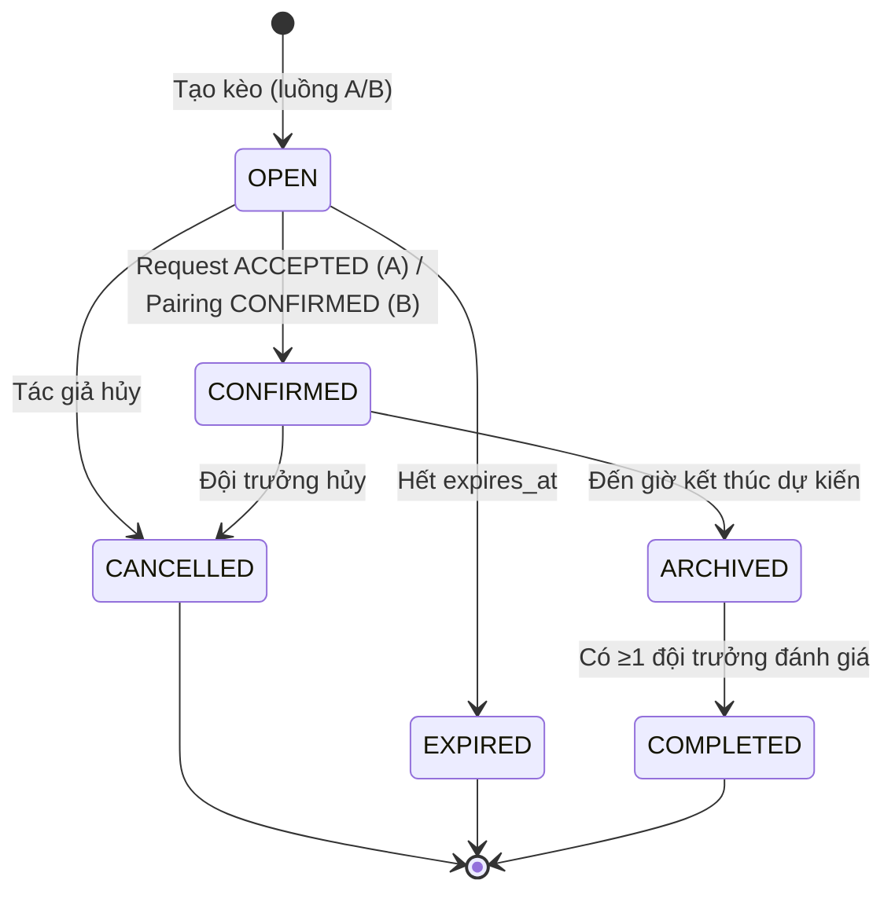
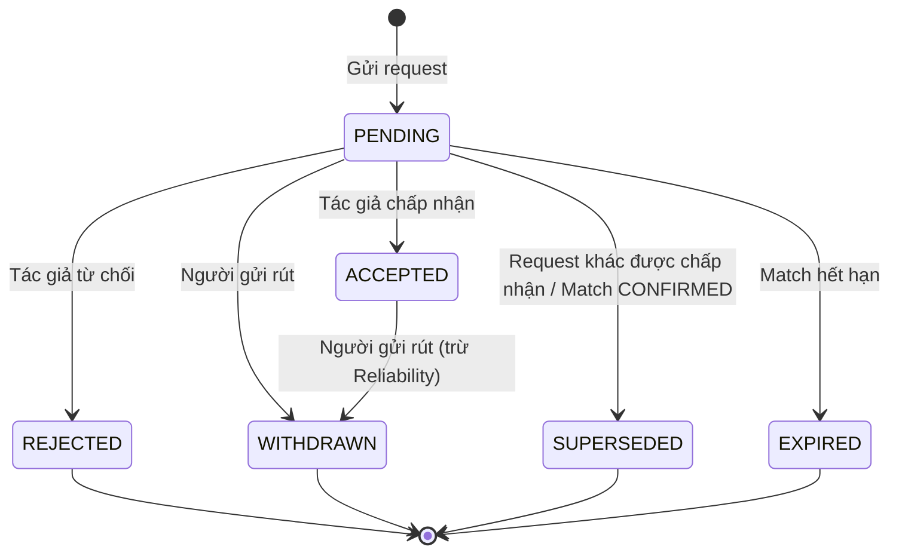
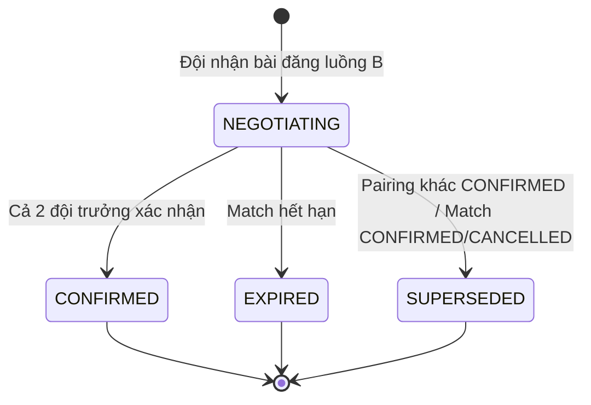
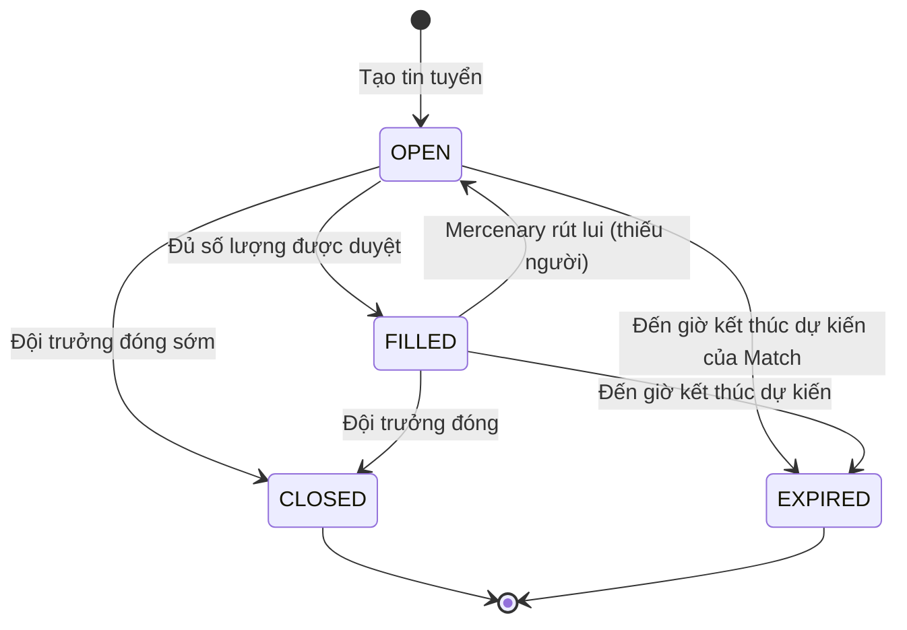
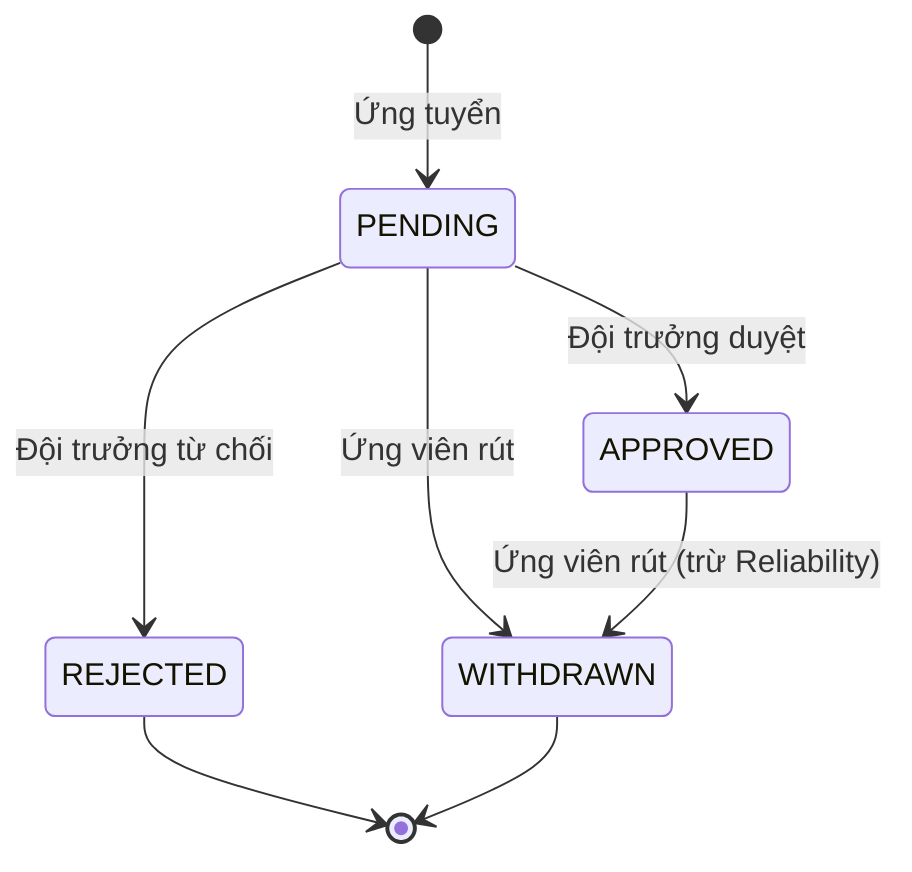
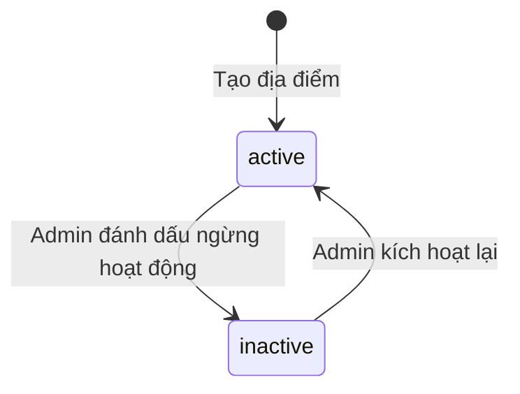

# Business Rules — ArenaFlow System

> Quy tắc nghiệp vụ, validation, state transitions, calculations, constraints, authorization.

---

## 1. Validation Rules

| Rule ID | Mô tả | Khi nào áp dụng |
|---|---|---|
| **USER** | | |
| BR-U01 | Số điện thoại phải là số VN (10 chữ số, bắt đầu 0) | Khi User đăng ký qua Phone OTP hoặc link phone |
| BR-U02 | Email phải hợp lệ (format email chuẩn); email được chuyển về chữ thường trước khi nhận diện tài khoản — khác hoa/thường không tạo tài khoản mới; email có khoảng trắng đầu/cuối không hợp lệ (2026-11-04) | Khi User đăng ký qua Google/Facebook |
| BR-U03 | Tên hiển thị không được để trống, tối đa 100 ký tự | Khi User cập nhật hồ sơ |
| BR-U04 | Ngày sinh phải trong quá khứ và User ≥13 tuổi | Khi User cập nhật hồ sơ |
| BR-U05 | Khu vực phải chọn từ danh mục Vietnam Administrative Units (phường/xã) | Khi User cập nhật hồ sơ |
| BR-U06 | Vị trí chơi ưa thích chọn từ 4 vị trí: Thủ môn, Hậu vệ, Tiền vệ, Tiền đạo | Khi User cập nhật hồ sơ |
| **TEAM** | | |
| BR-T01 | Tên đội không được để trống, tối đa 100 ký tự (cho phép trùng) | Khi tạo/sửa đội |
| BR-T02 | Trình độ đội: chọn tối đa 3 trong 9 nhãn | Khi tạo/sửa đội |
| BR-T03 | Đội trưởng chỉ có thể chuyển quyền cho thành viên đang active | Khi chuyển quyền đội trưởng |
| BR-T04 | Người được mời phải chấp nhận lời mời để trở thành thành viên | Khi mời vào đội |
| BR-T05 | Chuyển đội trưởng: người được chọn bắt buộc nhận (không có quyền từ chối) | Khi chuyển quyền |
| BR-T06 | **Sửa bởi `USER-002`:** trước khi xóa tài khoản, đội trưởng phải chuyển quyền hoặc giải tán mọi đội chưa giải tán, kể cả khi là người duy nhất — chi tiết `USER-002/Business_Rules.md` | Khi User xóa tài khoản |
| **MATCH** | | |
| BR-M01 | Giờ đá phải trong tương lai (≥ thời điểm hiện tại + 1 giờ) | Khi tạo Match |
| BR-M02 | Thời hạn bài đăng luồng A: `expires_at ≤ scheduled_start_time` (giờ bắt đầu trận). Không cho đổi ngày trận sau khi Match OPEN; muốn đổi phải hủy và tạo lại. | Khi tạo Match luồng A |
| BR-M03 | Thời hạn bài đăng luồng B: không muộn hơn giờ bắt đầu trận sớm nhất trong các lựa chọn | Khi tạo Match luồng B |
| BR-M04 | Match CONFIRMED không được sửa giờ/sân/trình độ | Khi cố gắng sửa Match CONFIRMED |
| BR-M05 | Hủy Match OPEN: phải từ chối tất cả Match_Request PENDING trước | Khi hủy Match OPEN |
| BR-M06 | Tối đa 1 Match_Request ACCEPTED mỗi Match (ràng buộc dữ liệu) | Khi chấp nhận Match_Request |
| BR-M07 | Pairing confirmation: cả 2 đội trưởng phải xác nhận qua UI riêng (không phải chat) | Khi xác nhận Pairing |
| BR-M08 | Luồng B có thể có nhiều Pairing đồng thời (Match vẫn OPEN trong lúc trao đổi) | Khi tạo Pairing |
| **REPUTATION** | | |
| BR-R01 | Mỗi cặp (Match, đội đánh giá, đội được đánh giá) chỉ được đánh giá 1 lần | Khi đánh giá đối phương |
| BR-R02 | Chỉ hiển thị Completion Rate khi ≥5 trận đã chốt; trước đó hiển thị "Mới tham gia X/5 trận" | Khi hiển thị Completion Rate |
| BR-R03 | Reliability Score chặn trong [0, 100] | Khi cập nhật Reliability Score |
| BR-R04 | Verification Badge yêu cầu: phone linked + >5 trận + rating >3 sao + Reliability ≥70 | Khi cấp Verification Badge |
| BR-R05 | Report bùng có tranh chấp trong 24h; quá 24h tự xác nhận | Khi bị report bùng |
| BR-R06 | Report khác (chơi xấu, giao tiếp tệ, không đúng trình độ) tự động chấp nhận ngay | Khi report |
| **MERCENARY** | | |
| BR-ME01 | Chỉ có thể tuyển mercenary sau khi Match đã CONFIRMED | Khi tạo tin tuyển |
| BR-ME02 | Tin tuyển tự động EXPIRED khi đến giờ kết thúc dự kiến của Match | Khi hết hạn |
| BR-ME03 | Tìm kèo mercenary: GPS ưu tiên (bán kính mặc định 3km); không có GPS → dùng khu vực hồ sơ | Khi tìm kèo |
| BR-ME04 | Không hiển thị tọa độ chính xác; chỉ hiển thị khoảng cách và khu vực chung | Khi hiển thị kèo |
| **VENUE** | | |
| BR-V01 | Tên địa điểm không được để trống, tối đa 200 ký tự | Khi thêm/sửa địa điểm |
| BR-V02 | Ảnh sân: tối đa 5 ảnh mỗi địa điểm | Khi upload ảnh |
| BR-V03 | Chỉ 1 ảnh is_primary=true mỗi venue | Khi upload ảnh hoặc đổi ảnh chính |
| BR-V04 | Report địa điểm không tự ẩn địa điểm; cần admin xác minh | Khi report địa điểm |
| BR-V05 | Loại sân (không bắt buộc) chỉ nhận: sân 5, sân 7, sân 11 | Khi thêm/sửa địa điểm |
| BR-V06 | Chỉ người tạo địa điểm hoặc Admin được sửa thông tin địa điểm và xóa ảnh sân; địa điểm đã ngừng hoạt động chỉ Admin được sửa | Khi sửa địa điểm, xóa ảnh |
| BR-V07 | Mọi user đã đăng nhập được thêm ảnh và đổi ảnh chính; địa điểm đã ngừng hoạt động chỉ Admin được thêm/đổi ảnh chính/xóa ảnh | Khi upload ảnh, đổi ảnh chính, xóa ảnh |
| BR-V08 | Xóa ảnh chính khi địa điểm còn ảnh khác → ảnh còn lại có thứ tự hiển thị nhỏ nhất thành ảnh chính | Khi xóa ảnh |
| BR-V09 | Mỗi user chỉ có tối đa 1 report chờ xử lý cho mỗi (địa điểm, lý do); không report địa điểm đã ngừng hoạt động | Khi report địa điểm |
| BR-V10 | Kèo chỉ tham chiếu địa điểm; luôn hiển thị thông tin địa điểm mới nhất (không lưu bản sao) | Khi sửa địa điểm, hiển thị kèo |
| **COST** | | |
| BR-C01 | Tiền tệ mặc định VND trong MVP | Khi nhập thỏa thuận chi phí |
| BR-C02 | Số tiền phải > 0 | Khi nhập thỏa thuận chi phí |
| **NOTIFICATION** | | |
| BR-N01 | Chat lưu 90 ngày sau khi Match kết thúc (COMPLETED/ARCHIVED/CANCELLED) | Khi lưu chat |
| BR-N02 | Notification lưu 30 ngày | Khi tạo notification |

---

## 2. State Transitions

### 2.1. Match Lifecycle



**Quy tắc chuyển trạng thái Match:**

| Từ | Đến | Điều kiện | Actor | Ghi chú |
|---|---|---|---|---|
| — | OPEN | Tạo kèo luồng A hoặc B | Team Captain | Khởi tạo |
| OPEN | CONFIRMED | 1 Match_Request ACCEPTED (A) hoặc 1 Pairing CONFIRMED (B) | Team Captain | Không sửa giờ/sân/trình độ sau CONFIRMED |
| OPEN | EXPIRED | `expires_at` ≤ now | System | Scheduled job + lazy check |
| OPEN | CANCELLED | Tác giả hủy (phải từ chối mọi request PENDING trước) | Team Captain | Không trừ uy tín |
| CONFIRMED | ARCHIVED | `scheduled_end_time` ≤ now | System | Gửi push cho 2 đội trưởng: "Trận đấu hôm nay thế nào? Hãy nhập tỷ số và đánh giá đồng đội!" |
| CONFIRMED | CANCELLED | Đội trưởng hủy | Team Captain | Trừ Reliability theo khoảng cách giờ trận |
| ARCHIVED | COMPLETED | ≥1 đội trưởng đánh giá | Team Captain | Đội trưởng còn lại vẫn có thể đánh giá sau, không giới hạn |

**Trạng thái terminal:** CANCELLED, EXPIRED, COMPLETED

---

### 2.2. Match_Request Lifecycle



**Quy tắc chuyển trạng thái Match_Request:**

| Từ | Đến | Điều kiện | Actor | Ghi chú |
|---|---|---|---|---|
| — | PENDING | Đội gửi request cho Match OPEN | Team Captain | Khởi tạo |
| PENDING | ACCEPTED | Tác giả chấp nhận | Team Captain (tác giả) | Tối đa 1 request ACCEPTED mỗi Match |
| PENDING | REJECTED | Tác giả từ chối | Team Captain (tác giả) | Không ảnh hưởng uy tín |
| PENDING | WITHDRAWN | Người gửi rút | Team Captain (người gửi) | Không trừ uy tín khi PENDING |
| PENDING | SUPERSEDED | Request khác được ACCEPTED hoặc Match chuyển CONFIRMED/CANCELLED | System | Tự động khi có request thắng |
| PENDING | EXPIRED | Match hết hạn | System | Theo expires_at của Match |
| ACCEPTED | WITHDRAWN | Người gửi rút | Team Captain (người gửi) | Trừ Reliability: -2/-5/-10 theo khoảng cách giờ trận |

**Trạng thái terminal:** REJECTED, WITHDRAWN, SUPERSEDED, EXPIRED

---

### 2.3. Pairing Lifecycle



**Quy tắc chuyển trạng thái Pairing:**

| Từ | Đến | Điều kiện | Actor | Ghi chú |
|---|---|---|---|---|
| — | NEGOTIATING | Đội nhận bài đăng luồng B | Team Captain | Khởi tạo; mở chat |
| NEGOTIATING | CONFIRMED | Cả 2 đội trưởng xác nhận qua UI riêng | Team Captain (cả 2) | Match chuyển CONFIRMED |
| NEGOTIATING | EXPIRED | Match hết hạn (`expires_at` ≤ now) | System | Theo expires_at của Match |
| NEGOTIATING | SUPERSEDED | Pairing khác CONFIRMED hoặc Match chuyển CONFIRMED/CANCELLED | System | Race condition: pairing có timestamp xác nhận cuối sớm hơn thắng |

**Race condition:** Nếu 2 pairing cùng được xác nhận gần đồng thời, pairing có **timestamp xác nhận cuối sớm hơn thắng**; pairing kia chuyển SUPERSEDED.

> **Implementation note:** Optimistic Lock với JPA `@Version` trên entity Match, retry max 3 lần khi conflict. Frontend không gửi version; backend tự đọc version hiện tại khi xử lý request.

**Trạng thái terminal:** CONFIRMED, EXPIRED, SUPERSEDED

---

### 2.4. Mercenary Posting Lifecycle



**Quy tắc chuyển trạng thái tin tuyển:**

| Từ | Đến | Điều kiện | Actor |
|---|---|---|---|
| — | OPEN | Tạo tin tuyển sau khi Match CONFIRMED | Team Captain |
| OPEN | FILLED | Đủ số lượng ứng viên APPROVED | System |
| OPEN | EXPIRED | Đến `Match.scheduled_end_time` | System |
| OPEN | CLOSED | Đội trưởng đóng tin sớm | Team Captain |
| FILLED | OPEN | Mercenary rút lui → thiếu người | System |
| FILLED | EXPIRED | Đến `Match.scheduled_end_time` | System |

**Trạng thái terminal:** CLOSED, EXPIRED

---

### 2.5. Mercenary Application Lifecycle



**Quy tắc chuyển trạng thái đơn ứng tuyển:**

| Từ | Đến | Điều kiện | Actor | Ghi chú |
|---|---|---|---|---|
| — | PENDING | Cá nhân ứng tuyển | User | Khởi tạo |
| PENDING | APPROVED | Đội trưởng duyệt | Team Captain | |
| PENDING | REJECTED | Đội trưởng từ chối | Team Captain | Không ảnh hưởng uy tín |
| PENDING | WITHDRAWN | Ứng viên rút | User | Không trừ uy tín khi PENDING |
| APPROVED | WITHDRAWN | Ứng viên rút | User | Trừ Reliability cá nhân: -1/-3/-5 theo khoảng cách giờ trận |

**Trạng thái terminal:** REJECTED, WITHDRAWN

---

### 2.6. Venue Status



**Quy tắc:**
- Địa điểm `inactive` bị loại khỏi gợi ý mặc định
- Match cũ giữ tham chiếu đến địa điểm `inactive`
- Admin cảnh báo 1 lần khi địa điểm không được chọn trong 180 ngày hoặc có báo cáo ngừng hoạt động

---

## 3. Calculation Rules

### 3.1. Reliability Score

**Thang điểm:** 0–100, điểm khởi đầu 80

**Công thức cập nhật:**
```
newScore = Math.max(0, Math.min(100, currentScore + delta))
```

**Các thay đổi điểm (delta):**

| Sự kiện | Delta | Điều kiện |
|---|---|---|
| **Cộng điểm** | | |
| Hoàn thành trận | +2 | Match chuyển COMPLETED |
| 5 trận sạch liên tiếp | +5 bonus | Cộng dồn với +2 → +7 ở trận thứ 5 |
| 10 trận sạch liên tiếp | +10 bonus | Cộng dồn với +2 → +12 ở trận thứ 10 |
| Rating ≥4.5 sao | +1 | Nhận rating từ đối phương |
| **Trừ điểm** | | |
| Hủy Match CONFIRMED (≥24 giờ trước) | -2 | Tính từ lúc hủy đến giờ bắt đầu trận |
| Hủy Match CONFIRMED (4-24 giờ) | -5 | |
| Hủy Match CONFIRMED (<4 giờ) | -10 | |
| Rút Match_Request đã ACCEPTED (≥24 giờ) | -2 | |
| Rút Match_Request đã ACCEPTED (4-24 giờ) | -5 | |
| Rút Match_Request đã ACCEPTED (<4 giờ) | -10 | |
| Mercenary rút sau khi APPROVED (≥24 giờ) | -1 | Chỉ trừ Reliability cá nhân |
| Mercenary rút sau khi APPROVED (4-24 giờ) | -3 | |
| Mercenary rút sau khi APPROVED (<4 giờ) | -5 | |
| Bị xác nhận bùng qua tranh chấp | -10 | Admin xác nhận report bùng đúng |
| Bị report (xem bảng §3.2) | -1 đến -15 | Tăng dần theo số lần |

**Trận sạch:** Trận hoàn thành không có hủy, bùng, rút mercenary, hoặc report được xác nhận.

**Reset số lần bị report:** Sau khi hoàn thành 5 trận sạch liên tiếp, tất cả bộ đếm số lần bị report được reset về 0.

**Mức hiển thị:**
- 95–100: Lời khen / badge đặc biệt
- 70–94: Không có cảnh báo đặc biệt
- 50–69: Cảnh báo (vd: màu vàng, icon warning)
- 0–49: Cảnh báo mạnh (vd: màu đỏ, hạn chế chức năng)

---

### 3.2. Report Penalty

**Mức trừ Reliability Score tăng dần theo số lần bị report từng loại:**

| Loại report | Lần 1 | Lần 2 | Lần 3 | Lần 4+ |
|---|---|---|---|---|
| Bùng | -5 | -8 | -12 | -15 |
| Chơi xấu | -3 | -5 | -8 | -10 |
| Giao tiếp tệ | -2 | -4 | -6 | -8 |
| Không đúng trình độ | -1 | -2 | -3 | -4 |

**Ghi chú:**
- Mỗi loại report đếm số lần riêng
- Ví dụ: bị report bùng 2 lần và chơi xấu 1 lần → áp dụng mức lần 2 cho bùng (-8), lần 1 cho chơi xấu (-3)
- **Giao tiếp tệ bao gồm:** chửi bới/thiếu tôn trọng trong chat, không phản hồi tin nhắn sau khi ghép kèo, thái độ thiếu hợp tác, ngôn từ khiếm nhã

---

### 3.3. Completion Rate

**Công thức:**
```
Completion Rate = (Tử số / Mẫu số) × 100%
```

**Mẫu số:** Match đã CONFIRMED, loại trừ:
- Match CANCELLED nếu hủy từ ≥24 giờ trở lên trước trận
- Match ARCHIVED (không ai đánh giá)

**Tử số:** Match COMPLETED có:
- Ít nhất 1 đội trưởng đã đánh giá
- KHÔNG có tranh chấp bùng được xác nhận (admin xác nhận đúng bùng)

**Hiển thị:**
- Nếu mẫu số < 5: "Mới tham gia X/5 trận" (vd: "Mới tham gia 2/5 trận")
- Nếu mẫu số ≥ 5: hiển thị phần trăm (vd: "Completion Rate: 87%")

**Áp dụng:**
- Completion Rate áp dụng riêng cho đội và cá nhân
- Completion Rate cá nhân chỉ tính các trận cá nhân tham gia với vai trò mercenary
- Đội bùng không làm giảm uy tín cá nhân thành viên

---

## 4. Constraints (Ràng buộc nghiệp vụ)

| Constraint ID | Mô tả |
|---|---|
| **USER & TEAM** | |
| BC-U01 | User ≥13 tuổi mới được đăng ký |
| BC-U02 | Soft-delete tài khoản: giữ mãi trong DB, có thể khôi phục; lịch sử hiển thị "Người dùng đã xóa" |
| BC-T01 | Tên đội được phép trùng (không có unique constraint) |
| BC-T02 | **Sửa bởi `USER-002`:** chỉ admin khoá đội (INACTIVE); đội trưởng giải tán đội (UC-T06); hệ thống không tự chuyển trạng thái đội — chi tiết `USER-002/Business_Rules.md` |
| BC-T03 | Chuyển đội trưởng: người được chọn bắt buộc nhận, không có quyền từ chối |
| BC-T04 | Lưu lịch sử thành viên; không xóa cứng quan hệ cá nhân–đội |
| BC-T05 | Lưu lịch sử chuyển quyền đội trưởng |
| **MATCH** | |
| BC-M01 | Match CONFIRMED: không được sửa giờ/sân/trình độ; muốn thay đổi phải hủy |
| BC-M02 | Hủy Match OPEN: phải từ chối mọi Match_Request PENDING trước khi Match có thể chuyển CANCELLED |
| BC-M03 | Tối đa 1 Match_Request ACCEPTED mỗi Match (ràng buộc dữ liệu: unique constraint hoặc check) |
| BC-M04 | Khi Match chuyển CONFIRMED hoặc CANCELLED: mọi Pairing đang NEGOTIATING và mọi Match_Request PENDING tự chuyển SUPERSEDED (nếu CONFIRMED) hoặc CANCELLED (nếu Match CANCELLED) |
| BC-M05 | Thời gian lưu theo UTC trong DB; frontend convert theo timezone thiết bị |
| BC-M06 | Pairing hết hạn theo `expires_at` của bài đăng |
| BC-M07 | Match_Request hết hạn theo `expires_at` của bài đăng; không có timeout riêng |
| **REPUTATION** | |
| BC-R01 | Reliability Score chặn trong [0, 100] |
| BC-R02 | Mỗi cặp (Match, rater_type, rater_id, ratee_type, ratee_id) chỉ được đánh giá 1 lần (unique constraint) |
| BC-R03 | Rating không hiển thị cho bên được đánh giá trước khi bên đánh giá gửi đánh giá của mình |
| BC-R04 | Không hiển thị trạng thái "đối phương đã/chưa đánh giá"; bên nào đã đánh giá mới được xem rating đối phương dành cho mình |
| BC-R05 | Report bùng được xác nhận → Match tính vào mẫu số nhưng không tính tử số Completion Rate |
| BC-R06 | Reset số lần report sau 5 trận sạch liên tiếp |
| BC-R07 | Verification Badge: phone linked + >5 trận + rating >3 sao + Reliability ≥70 |
| **MERCENARY** | |
| BC-ME01 | Chỉ có thể tuyển mercenary sau khi Match đã CONFIRMED |
| BC-ME02 | Tin tuyển tự động EXPIRED khi đến giờ kết thúc dự kiến của Match |
| BC-ME03 | Không hiển thị tọa độ chính xác; chỉ hiển thị khoảng cách (vd "2.3 km từ bạn") và khu vực chung (vd "Quận 1") |
| BC-ME04 | GPS ưu tiên; không có GPS → dùng khu vực hồ sơ (phường/xã) |
| BC-ME05 | Truy cập GPS dựa vào quyền hệ điều hành; không lưu consent riêng trong DB |
| **VENUE** | |
| BC-V01 | Ảnh sân tối đa 5 mỗi địa điểm |
| BC-V02 | Chỉ 1 ảnh is_primary=true mỗi venue (unique constraint hoặc check) |
| BC-V03 | Report địa điểm không tự ẩn địa điểm; admin xác minh rồi đánh dấu ngừng hoạt động |
| BC-V04 | Địa điểm ngừng hoạt động bị loại khỏi gợi ý mặc định; Match cũ giữ tham chiếu |
| BC-V05 | Admin cảnh báo 1 lần khi địa điểm không được chọn trong 180 ngày hoặc có báo cáo ngừng hoạt động; không nhắc định kỳ |
| BC-V06 | Chỉ người tạo địa điểm hoặc Admin được sửa địa điểm và xóa ảnh; người khác dùng report "thông tin sai" |
| BC-V07 | Không trùng report chờ xử lý cho cùng (user, địa điểm, lý do) |
| **COST** | |
| BC-C01 | ArenaFlow chỉ lưu thỏa thuận để hiển thị; không thu/giữ tiền hay xử lý thanh toán |
| BC-C02 | Tiền tệ mặc định VND trong MVP |
| **NOTIFICATION & CHAT** | |
| BC-N01 | Chat lưu 90 ngày sau khi Match kết thúc (COMPLETED, ARCHIVED, hoặc CANCELLED) |
| BC-N02 | Notification lưu 30 ngày |
| BC-N03 | Thời điểm bắt đầu retention chat: khi Match chuyển sang COMPLETED, ARCHIVED, hoặc CANCELLED (tính từ lúc hủy) |

---

## 5. Authorization Rules (Quyền)

### 5.1. User (Individual)

| Có thể | Không thể |
|---|---|
| Quản lý hồ sơ cá nhân | Xem/sửa hồ sơ của người khác |
| Tạo đội (trở thành đội trưởng) | Tham gia đội mà chưa được mời |
| Chấp nhận/Từ chối lời mời vào đội | Mời người khác vào đội (chỉ đội trưởng) |
| Rời đội | Giải tán đội (chỉ đội trưởng — `USER-002`); xóa cứng đội |
| Ứng tuyển mercenary | Duyệt ứng viên mercenary (chỉ đội trưởng) |
| Đánh giá đội sau trận mercenary (1-5 sao) | Đánh giá đội khác khi không tham gia trận |
| Report đội sau trận mercenary | Report đội khác khi không tham gia trận |
| Xóa tài khoản (soft-delete) | Hard-delete tài khoản (để sau, có chính sách retention) |
| Thêm địa điểm, thêm ảnh sân, đổi ảnh chính | Sửa địa điểm / xóa ảnh của địa điểm do người khác tạo |
| Sửa địa điểm và xóa ảnh của địa điểm do mình tạo | — |
| Report địa điểm đang hoạt động | Report trùng khi report cùng lý do còn chờ xử lý; report địa điểm đã ngừng hoạt động |

### 5.2. Team Captain

| Có thể | Không thể |
|---|---|
| Tất cả quyền của User | — |
| Mời thành viên vào đội | Bắt buộc người khác tham gia (phải chấp nhận lời mời) |
| Quản lý đội (sửa tên, avatar, trình độ); giải tán đội của mình (`USER-002` UC-T06) | Xóa cứng đội; kích hoạt lại đội đã giải tán |
| Chuyển quyền đội trưởng cho thành viên khác | Chuyển cho người không phải thành viên |
| Tạo kèo (luồng A hoặc B) | Tạo kèo cho đội khác |
| Gửi Match Request cho kèo của đội khác | Chấp nhận request cho kèo của đội khác |
| Chấp nhận/Từ chối Match Request cho kèo của mình | Chấp nhận nhiều request (tối đa 1 ACCEPTED) |
| Tạo Pairing (luồng B) | — |
| Xác nhận Pairing (cả 2 bên phải xác nhận) | Xác nhận 1 bên (cần cả 2) |
| Hủy kèo (OPEN hoặc CONFIRMED) | Hủy kèo của đội khác |
| Tuyển mercenary (sau khi Match CONFIRMED) | Tuyển trước khi Match CONFIRMED |
| Duyệt/Từ chối ứng viên mercenary | Duyệt ứng viên cho đội khác |
| Đánh giá đối phương sau trận (1-5 sao hoặc "không đến") | Đánh giá nhiều lần cùng Match |
| Report đối phương sau trận | Report đội chưa từng thi đấu |
| Đánh giá mercenary sau trận | — |

### 5.3. Team Member (không phải đội trưởng)

| Có thể | Không thể |
|---|---|
| Xem thông tin đội | Quản lý đội (chỉ đội trưởng) |
| Rời đội | Mời/xóa thành viên (chỉ đội trưởng) |
| Được chọn làm đội trưởng mới (bắt buộc nhận) | Từ chối khi được chuyển quyền |
| — | Tạo kèo, duyệt request, đánh giá (chỉ đội trưởng) |

### 5.4. Admin

| Có thể | Không thể |
|---|---|
| Bật/tắt bộ môn qua admin panel | Tạo kèo cho User |
| Đánh dấu đội INACTIVE | Xóa cứng đội |
| Thêm địa điểm sân | Xóa cứng địa điểm |
| Sửa mọi địa điểm, xóa mọi ảnh sân | — |
| Xem chi tiết report địa điểm | Tự xóa địa điểm khi có report (phải xác minh trước); report địa điểm (dùng sửa/đánh dấu ngừng hoạt động trực tiếp) |
| Xác minh report địa điểm và đánh dấu ngừng hoạt động | — |
| Xử lý tranh chấp report bùng (quyết định cuối cùng) | Tự report thay User |
| Xem thống kê hệ thống | Sửa Reliability Score thủ công (chỉ qua tranh chấp) |

### 5.5. System (Tự động)

| Có thể | Không thể |
|---|---|
| Cập nhật trạng thái hết hạn (Match, Request, Pairing, tin tuyển) | Tạo kèo/đội/user |
| Gửi notification | Xóa notification trước retention |
| Tính Reliability Score | Sửa Reliability Score ngoài quy tắc |
| Tính Completion Rate | — |
| Chuyển Match sang ARCHIVED khi đến giờ kết thúc dự kiến | Chuyển sang COMPLETED (phải có đánh giá) |
| Gửi push notification "Trận đấu hôm nay thế nào?" | — |
| Tự động chấp nhận report và trừ Reliability Score | Tự bác report (chỉ admin qua tranh chấp) |
| Chuyển Pairing/Request PENDING sang SUPERSEDED khi Match CONFIRMED | — |
| Xóa chat/notification hết retention | Xóa trước retention |
| Reset bộ đếm số lần report sau 5 trận sạch | — |
| Cấp/thu hồi Verification Badge | — |

---

## 6. Report Types & Handling

### 6.1. Report Types

| Loại | Mô tả | Xử lý | Tranh chấp |
|---|---|---|---|
| **Bùng** | Đội không đến trận đã CONFIRMED | Tự động chấp nhận và trừ điểm; Match không tính tử số Completion Rate | ✅ Có (trong 24h) |
| **Chơi xấu** | Đá xấu, cố ý phạm lỗi nguy hiểm, gây chấn thương | Tự động chấp nhận và trừ điểm | ❌ Không |
| **Giao tiếp tệ** | Chửi bới, thiếu tôn trọng trong chat, không phản hồi sau ghép kèo, thái độ thiếu hợp tác, ngôn từ khiếm nhã | Tự động chấp nhận và trừ điểm | ❌ Không |
| **Không đúng trình độ** | Trình độ thực tế không khớp với trình độ đăng ký (quá cao hoặc quá thấp) | Tự động chấp nhận và trừ điểm | ❌ Không |

### 6.2. Report Workflow

**Luồng report thông thường (chơi xấu, giao tiếp tệ, không đúng trình độ):**
1. Team Captain report đối phương sau trận
2. System tự động chấp nhận report
3. System tra số lần bị report loại này của đội bị report
4. System trừ Reliability Score theo mức tăng dần (xem §3.2)
5. System gửi notification cho đội bị report
6. **Không có tranh chấp**

**Luồng report bùng:**
1. Team Captain report đối phương bùng kèo
2. System tự động chấp nhận report và trừ điểm
3. System gửi notification cho đội bị report: "Đội [X] report bạn bùng kèo. Bạn có 24h để tranh chấp."
4a. **Nếu đội bị report KHÔNG phản hồi trong 24h:** report được xác nhận tự động; Match không tính tử số Completion Rate
4b. **Nếu đội bị report phản hồi trong 24h:** tranh chấp được chuyển admin xem xét
5. Admin xem bằng chứng từ cả 2 bên và đưa ra quyết định cuối cùng:
   - **Xác nhận report đúng:** giữ nguyên mức trừ Reliability; Match không tính tử số Completion Rate
   - **Bác report:** hoàn lại Reliability đã trừ; Match tính tử số Completion Rate
6. System gửi notification cho cả 2 bên về quyết định

---

## 7. Reliability Score Detailed Rules

### 7.1. Thang điểm & Khởi đầu

- **Thang:** 0–100
- **Khởi đầu:** 80 (khi tạo đội hoặc tài khoản cá nhân)
- **Chặn:** `Math.max(0, Math.min(100, currentScore + delta))`

### 7.2. Các sự kiện cộng điểm

| Sự kiện | Delta | Ghi chú |
|---|---|---|
| Hoàn thành trận | +2 | Match chuyển COMPLETED |
| 5 trận sạch liên tiếp | +5 | Cộng dồn với +2 → +7 ở trận thứ 5 |
| 10 trận sạch liên tiếp | +10 | Cộng dồn với +2 → +12 ở trận thứ 10 |
| Rating ≥4.5 sao | +1 | Nhận rating từ đối phương |

**Trận sạch:** Trận hoàn thành không có hủy, bùng, rút mercenary, hoặc report được xác nhận.

### 7.3. Các sự kiện trừ điểm

| Sự kiện | Delta | Khoảng cách đến giờ trận |
|---|---|---|
| **Hủy Match CONFIRMED** | -2 | ≥24 giờ |
| | -5 | 4-24 giờ |
| | -10 | <4 giờ |
| **Rút Match_Request ACCEPTED** | -2 | ≥24 giờ |
| | -5 | 4-24 giờ |
| | -10 | <4 giờ |
| **Mercenary rút sau APPROVED** (cá nhân) | -1 | ≥24 giờ |
| | -3 | 4-24 giờ |
| | -5 | <4 giờ |
| **Report bùng xác nhận qua tranh chấp** | -10 | Admin xác nhận đúng |
| **Report khác** | Xem §3.2 | Mức trừ tăng dần theo số lần |

### 7.4. Reset bộ đếm số lần report

Sau khi hoàn thành **5 trận sạch liên tiếp**, tất cả bộ đếm số lần bị report được reset về 0. Lần report tiếp theo sẽ áp dụng mức trừ "Lần 1".

---

## 8. Quyết định bổ sung đã chốt

### 8.1. Cost Agreement (Luồng B)
- **Quyết định:** Một bên đề xuất thỏa thuận chi phí, bên kia xem trong chat/bảng tin. Không cần xác nhận riêng.
- **Lý do:** Xác nhận Pairing đã là đồng ý cả package (giờ/sân/chi phí). Thêm bước xác nhận riêng cho chi phí làm phức tạp UX không cần thiết.

### 8.2. Verification Badge Revocation
- **Quyết định:** Thu hồi badge ngay lập tức khi điều kiện không còn đủ (Reliability <70, rating ≤3, phone unlinked, hoặc ≤5 trận).
- **Lý do:** Badge phản ánh trạng thái hiện tại. Thu hồi ngay làm hệ thống minh bạch và đơn giản.

### 8.3. GPS Permission Revocation
- **Quyết định:** Khi User thu hồi GPS permission trong Settings, hệ thống fallback sang khu vực hồ sơ (phường/xã) ngay lập tức để tìm kèo mercenary.
- **Lý do:** Không block tính năng. Hiển thị thông báo "Bật GPS để tìm kèo gần bạn hơn" nhắc user bật lại nếu muốn kết quả chính xác hơn.

### 8.4. Report Cooldown
- **Quyết định:** Không giới hạn số lần report trong 1 khoảng thời gian.
- **Lý do:** Mỗi report gắn với trận cụ thể; một trận chỉ report đối phương 1 lần mỗi loại. Đủ để chống spam mà không cản user hợp lệ (user chơi nhiều trận/ngày có thể gặp nhiều vấn đề).

### 8.5. Hard-Delete Policy
- **Quyết định:** Tài khoản soft-deleted giữ mãi trong DB, không bao giờ hard-delete.
- **Lý do:** Đơn giản (không cần scheduled job purge), lịch sử/đánh giá luôn khả dụng. Dung lượng DB tăng theo thời gian nhưng không đáng kể cho hầu hết quy mô.

### 8.6. Push Notification
- **Quyết định:** Sử dụng FCM (Android) + APNs (iOS), push tất cả 11 loại notification quan trọng.
- **Lý do:** FCM/APNs miễn phí 100%, backend chỉ gọi REST API. App xin quyền lúc cài đặt; user chấp nhận → nhận push; từ chối → chỉ in-app notification.
- **11 loại push:** Match request nhận, request chấp nhận/từ chối, Match confirmed, Match cancelled, Pairing mới, reminder trước trận, Match completed, rating nhận, report nhận, mercenary application, invitation vào đội.
