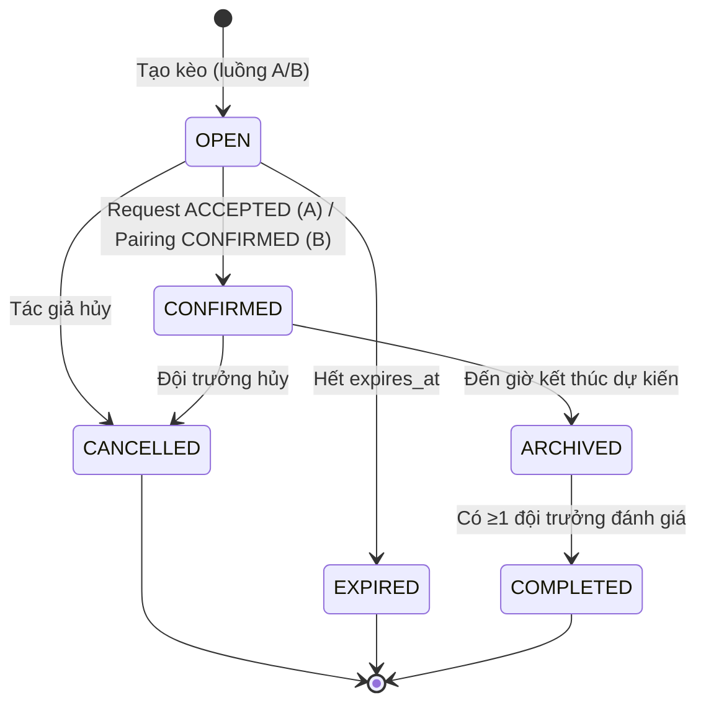
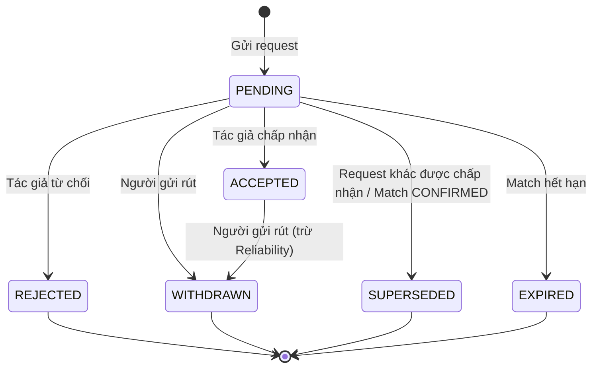
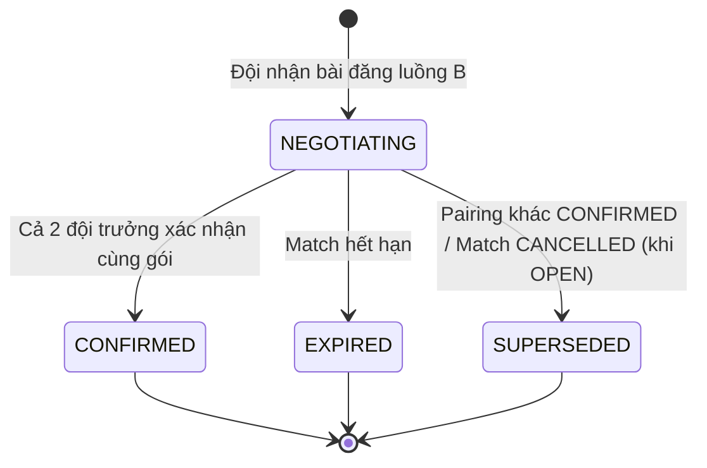
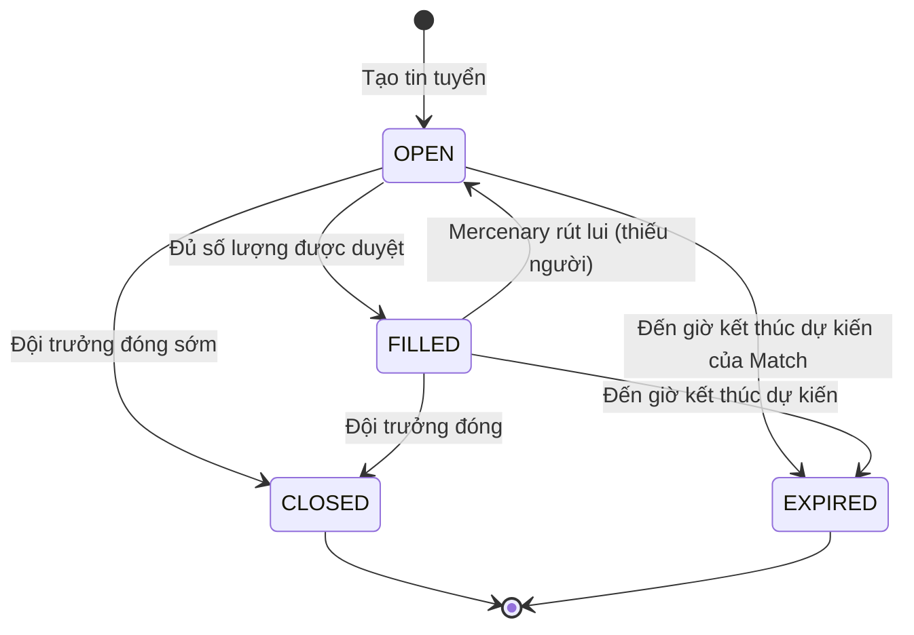
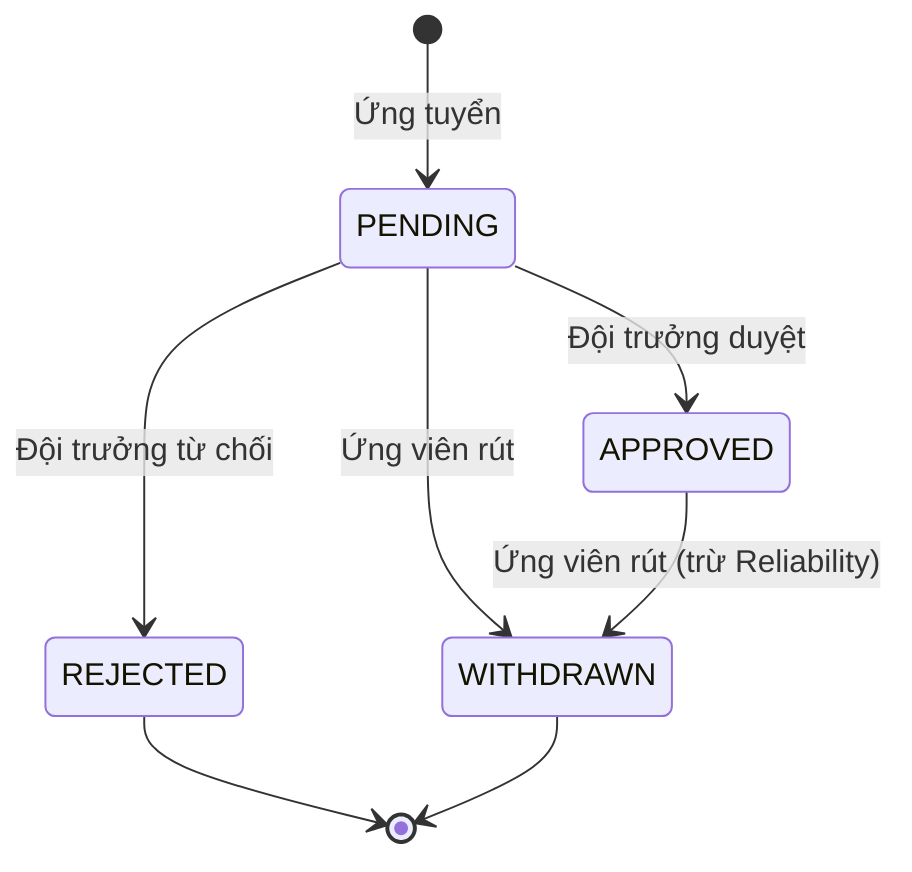
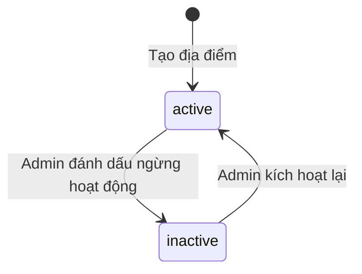

# Business Rules — ArenaFlow System

> Quy tắc nghiệp vụ, validation, state transitions, calculations, constraints, authorization.

---

## 1. Validation Rules

| Rule ID | Mô tả | Khi nào áp dụng |
|---|---|---|
| **USER** | | |
| BR-U01 | Số điện thoại phải là số VN (10 chữ số, bắt đầu 0) | Khi User đăng ký qua Phone OTP hoặc link phone |
| BR-U02 | Email phải hợp lệ (format email chuẩn); email được chuyển về chữ thường trước khi nhận diện tài khoản — khác hoa/thường không tạo tài khoản mới; email có khoảng trắng đầu/cuối không hợp lệ (2026-11-04) | Khi User đăng ký qua Google/Facebook |
| BR-U03 | Tên hiển thị không được để trống, tối đa 100 ký tự | Khi User cập nhật hồ sơ |
| BR-U04 | Ngày sinh phải trong quá khứ và User ≥13 tuổi | Khi User cập nhật hồ sơ |
| BR-U05 | Khu vực phải chọn từ danh mục Vietnam Administrative Units (phường/xã) | Khi User cập nhật hồ sơ |
| BR-U06 | Vị trí chơi ưa thích chọn từ 4 vị trí: Thủ môn, Hậu vệ, Tiền vệ, Tiền đạo | Khi User cập nhật hồ sơ |
| **TEAM** | | |
| BR-T01 | Tên đội không được để trống, tối đa 100 ký tự (cho phép trùng) | Khi tạo/sửa đội |
| BR-T02 | Trình độ đội: chọn tối đa 3 trong 9 nhãn | Khi tạo/sửa đội |
| BR-T03 | Đội trưởng chỉ có thể chuyển quyền cho thành viên đang active | Khi chuyển quyền đội trưởng |
| BR-T04 | Người được mời phải chấp nhận lời mời để trở thành thành viên | Khi mời vào đội |
| BR-T05 | Chuyển đội trưởng: người được chọn bắt buộc nhận (không có quyền từ chối) | Khi chuyển quyền |
| BR-T06 | **Sửa bởi `USER-002`:** trước khi xóa tài khoản, đội trưởng phải chuyển quyền hoặc giải tán mọi đội chưa giải tán, kể cả khi là người duy nhất — chi tiết `USER-002/Business_Rules.md` | Khi User xóa tài khoản |
| **MATCH** | | |
| BR-M01 | Giờ đá phải trong tương lai (≥ thời điểm hiện tại + 1 giờ) | Khi tạo Match |
| BR-M02 | Thời hạn bài đăng luồng A: `expires_at ≤ scheduled_start_time` (giờ bắt đầu trận). Không cho đổi ngày trận sau khi Match OPEN; muốn đổi phải hủy và tạo lại. | Khi tạo Match luồng A |
| BR-M03 | Luồng B: 1–5 lựa chọn địa điểm và 1–5 khung giờ (hai danh sách riêng). Thời hạn bài đăng: sau thời điểm hiện tại, không muộn hơn giờ bắt đầu sớm nhất trong các khung giờ và không sớm hơn giờ bắt đầu sớm nhất − 7 ngày (2026-11-10) | Khi tạo Match luồng B |
| BR-M04 | Match CONFIRMED không được sửa giờ/sân/trình độ | Khi cố gắng sửa Match CONFIRMED |
| BR-M05 | Hủy Match OPEN: phải từ chối tất cả Match_Request PENDING trước | Khi hủy Match OPEN |
| BR-M06 | Tối đa 1 Match_Request ACCEPTED mỗi Match (ràng buộc dữ liệu) | Khi chấp nhận Match_Request |
| BR-M07 | Pairing confirmation: cả 2 đội trưởng phải xác nhận qua UI riêng (không phải chat). Xác nhận áp cho **gói** đang hiển thị (BR-M19); Pairing chưa có phương án chốt → không xác nhận được (2026-11-10) | Khi xác nhận Pairing |
| BR-M08 | Luồng B có thể có nhiều Pairing đồng thời (Match vẫn OPEN trong lúc trao đổi) | Khi tạo Pairing |
| BR-M09 | Hủy Match CONFIRMED hoặc rút Match_Request đã ACCEPTED: chỉ **đội** thực hiện bị trừ Reliability Score của đội; không trừ điểm cá nhân của đội trưởng; đội còn lại không bị trừ (2026-11-09) | Khi hủy Match CONFIRMED, rút request ACCEPTED |
| BR-M10 | Mức trừ tính theo khoảng cách từ lúc hủy/rút đến giờ bắt đầu trận: từ đủ 24 giờ trở lên → -2; từ đủ 4 giờ đến dưới 24 giờ → -5; dưới 4 giờ → -10 (hủy đúng 24 giờ trước → -2; đúng 4 giờ trước → -5) (2026-11-09) | Khi hủy Match CONFIRMED, rút request ACCEPTED |
| BR-M11 | Không được hủy Match CONFIRMED hoặc rút Match_Request đã ACCEPTED khi trận đã bắt đầu (đã đến giờ bắt đầu); hệ thống báo "Trận đã bắt đầu, không thể hủy" (2026-11-09) | Khi hủy/rút |
| BR-M12 | Đội đã ghép rút Match_Request đã ACCEPTED = đội đó hủy kèo: Match chuyển CANCELLED, request chuyển WITHDRAWN, chỉ đội rút bị trừ (BR-M09, BR-M10). Đội đã ghép chọn "Hủy kèo" cho cùng kết quả. Mỗi lần hủy chỉ trừ điểm một lần (2026-11-09) | Khi đội đã ghép rút request / hủy kèo |
| BR-M13 | Khi hủy kèo hoặc rút request, hệ thống so với trạng thái mà đội trưởng **đang thấy** trên màn hình (kèo: đang mở / đã ghép; request: đang chờ / đã được chấp nhận), kể cả khi màn hình đã cũ từ trước lúc bấm. Trạng thái hiện tại khác (vd kèo đang mở đã được ghép; request đang chờ đã được chấp nhận) → hệ thống từ chối, báo "Trạng thái đã thay đổi, vui lòng tải lại", không hủy/rút và không trừ điểm (2026-11-09) | Khi hủy kèo, rút request |
| BR-M14 | Đội tạo kèo hoặc đội gửi request đang tạm ngưng (INACTIVE) hoặc đã giải tán: Match OPEN của đội tạo kèo không hiển thị trong tìm kèo; không gửi được request mới; không chấp nhận được request (cả khi đội gửi không còn hoạt động). Hệ thống không tự hủy Match; Match OPEN hết hạn theo thời hạn bài đăng, Match CONFIRMED tiếp tục vòng đời. Đội tạm ngưng vẫn được hủy kèo, từ chối và rút request (2026-11-09). **Luồng B (2026-11-11):** xem thương lượng, nhắn tin và đánh dấu đã đọc luôn được phép. Đội của mình đang tạm ngưng → không nhận kèo, không chốt phương án, không sửa chi phí, không xác nhận ("Đội đang tạm ngưng hoạt động"). Đội còn lại của thương lượng không còn hoạt động → không nhận kèo, không xác nhận ("Đội đối phương hiện không hoạt động"); vẫn chốt phương án và sửa chi phí được | Khi tìm kèo, gửi/chấp nhận/từ chối/rút request, hủy kèo; luồng B: nhận kèo, chốt phương án, sửa chi phí, xác nhận, nhắn tin |
| BR-M15 | Chỉ tạo kèo cho bộ môn đang bật. Bộ môn bị tắt: Match OPEN của bộ môn không hiển thị trong tìm kèo, không gửi/chấp nhận được request; không tự hủy; Match CONFIRMED tiếp tục vòng đời (2026-11-09). **Luồng B (2026-11-11):** bộ môn của kèo bị tắt → không ai nhận kèo hay xác nhận được ("Bộ môn hiện không được hỗ trợ"); chốt phương án, sửa chi phí, xem và nhắn tin vẫn được | Khi tạo kèo, tìm kèo, gửi/chấp nhận request, Admin tắt bộ môn; luồng B: nhận kèo, xác nhận |
| BR-M16 | Giới hạn khi tạo kèo: giờ kết thúc dự kiến sau giờ bắt đầu và không quá 12 giờ; trình độ mong muốn tối đa 3 trong 9 nhãn, không chọn = nhận mọi trình độ; ghi chú độ tuổi ≤100 ký tự; tính chất trận ≤200 ký tự. Lý do hủy/từ chối/rút ≤500 ký tự; bắt buộc nhập lý do khi hủy Match CONFIRMED hoặc rút request ACCEPTED (2026-11-09) | Khi tạo kèo, hủy kèo, từ chối/rút request |
| BR-M17 | Match OPEN đã quá thời hạn bài đăng được hiển thị là EXPIRED ngay khi có người xem, kể cả trước lần cập nhật định kỳ; mọi thao tác trên Match đó (gửi/chấp nhận/từ chối/rút request, hủy, sửa chi phí; luồng B: nhận kèo, chốt phương án, sửa chi phí của Pairing, xác nhận, nhắn tin) bị từ chối với thông báo "Kèo đã hết hạn" và Match chuyển EXPIRED ngay, kể cả trước lần cập nhật định kỳ; luồng B: các Pairing NEGOTIATING của Match cũng chuyển EXPIRED ngay (2026-11-09, luồng B 2026-11-11) | Khi xem/thao tác trên Match quá hạn |
| BR-M18 | Hai đội khác nhau có cùng một đội trưởng vẫn được gửi/chấp nhận request cho nhau; hệ thống không kiểm trùng lịch thi đấu giữa các Match của một đội (2026-11-09) | Khi gửi/chấp nhận request |
| BR-M19 | **Gói thương lượng** (luồng B) = phương án chốt + thỏa thuận chi phí + tiền cọc (kể cả khoản tự nhập) của một Pairing; mỗi Pairing có gói riêng. Phương án chốt = 1 địa điểm trong danh sách lựa chọn địa điểm + 1 khung giờ trong danh sách khung giờ của Match; một trong hai đội trưởng chốt khi Pairing NEGOTIATING. Mỗi lần gói đổi (chốt phương án khác, lưu chi phí) → **xoá xác nhận của cả hai bên**; chốt lại đúng phương án đang có không làm đổi gói. Chốt phương án, lưu chi phí và xác nhận chỉ áp cho gói mà đội trưởng đang thấy: gói đã đổi → từ chối "Phương án đã thay đổi, vui lòng tải lại", đội trưởng xem gói mới rồi tự thao tác lại (2026-11-10) | Khi chốt phương án, lưu chi phí, xác nhận Pairing |
| BR-M20 | Địa điểm đã ngừng hoạt động không chốt được làm phương án và không xác nhận được phương án đang chứa địa điểm đó ("Địa điểm đã ngừng hoạt động"); hai bên chốt lại địa điểm khác rồi xác nhận lại — nhất quán luồng A (2026-11-10) | Khi chốt phương án, xác nhận Pairing |
| BR-M21 | Mỗi đội chỉ có một Pairing cho một Match. Không có thao tác rút hay kết thúc Pairing; Pairing chỉ kết thúc khi CONFIRMED, SUPERSEDED hoặc EXPIRED (2026-11-10) | Khi nhận kèo luồng B |
| **REPUTATION** | | |
| BR-R01 | Mỗi cặp (Match, đội đánh giá, đội được đánh giá) chỉ được đánh giá 1 lần | Khi đánh giá đối phương |
| BR-R02 | Chỉ hiển thị Completion Rate khi ≥5 trận đã chốt; trước đó hiển thị "Mới tham gia X/5 trận" | Khi hiển thị Completion Rate |
| BR-R03 | Reliability Score chặn trong [0, 100] | Khi cập nhật Reliability Score |
| BR-R04 | Verification Badge yêu cầu đủ 4 điều kiện: (1) có số điện thoại — đội: đội trưởng hiện tại có số điện thoại trong tài khoản; cá nhân: tài khoản có số điện thoại; (2) >5 trận hoàn thành (số trận tính vào tử số Completion Rate — §3.3); (3) sao trung bình nhận được >3 (đánh giá "đội kia không đến" không có sao, không tính vào trung bình); (4) Reliability ≥70. Thời điểm cấp/thu hồi: §8.2 (user chốt 2026-11-12) | Khi cấp/thu hồi Verification Badge |
| BR-R05 | Report bùng có tranh chấp trong 24h; quá 24h tự xác nhận | Khi bị report bùng |
| BR-R06 | Report khác (chơi xấu, giao tiếp tệ, không đúng trình độ) tự động chấp nhận ngay | Khi report |
| BR-R07 | Trận được report: Match ARCHIVED hoặc COMPLETED → cả 4 loại; Match CANCELLED **sau khi đã CONFIRMED** (hủy kèo đã ghép / rút request đã ACCEPTED) → chỉ "giao tiếp tệ"; Match OPEN, CONFIRMED, EXPIRED hoặc CANCELLED khi còn OPEN → không report được (user chốt 2026-11-12) | Khi report |
| BR-R08 | Người là đội trưởng của **cả hai đội** trong trận (BR-M18) không được đánh giá và không được report trận đó (user chốt 2026-11-12) | Khi đánh giá, report |
| BR-R09 | Giới hạn độ dài và bắt buộc nhập: nhận xét khi đánh giá không bắt buộc, nếu có ≤500 ký tự; lý do report bắt buộc, 1–1000 ký tự; bằng chứng tranh chấp bắt buộc, chỉ văn bản (không đính kèm ảnh/tệp), 1–1000 ký tự; ghi chú lý do quyết định của Admin bắt buộc, 1–500 ký tự (user chốt 2026-11-13) | Khi đánh giá, report, tranh chấp, Admin xử lý tranh chấp |
| BR-R10 | Đội của đội trưởng thực hiện thao tác phải đang hoạt động (ACTIVE) khi đánh giá, xem đánh giá của trận, report, xem report của đội; đội bị report phải ACTIVE khi tranh chấp. Đội INACTIVE hoặc DISBANDED không thực hiện được các thao tác này. Trạng thái của đội được đánh giá / bị report không ảnh hưởng — đội đối phương INACTIVE hoặc DISBANDED vẫn bị đánh giá / report được (user chốt 2026-11-13) | Khi đánh giá, xem đánh giá, report, xem report, tranh chấp |
| **MERCENARY** | | |
| BR-ME01 | Chỉ có thể tuyển mercenary sau khi Match đã CONFIRMED | Khi tạo tin tuyển |
| BR-ME02 | Tin tuyển tự động EXPIRED khi đến giờ kết thúc dự kiến của Match | Khi hết hạn |
| BR-ME03 | Tìm kèo mercenary: GPS ưu tiên (bán kính mặc định 3km); không có GPS → dùng khu vực hồ sơ | Khi tìm kèo |
| BR-ME04 | Không hiển thị tọa độ chính xác; chỉ hiển thị khoảng cách và khu vực chung | Khi hiển thị kèo |
| **VENUE** | | |
| BR-V01 | Tên địa điểm không được để trống, tối đa 200 ký tự | Khi thêm/sửa địa điểm |
| BR-V02 | Ảnh sân: tối đa 5 ảnh mỗi địa điểm | Khi upload ảnh |
| BR-V03 | Chỉ 1 ảnh is_primary=true mỗi venue | Khi upload ảnh hoặc đổi ảnh chính |
| BR-V04 | Report địa điểm không tự ẩn địa điểm; cần admin xác minh | Khi report địa điểm |
| BR-V05 | Loại sân (không bắt buộc) chỉ nhận: sân 5, sân 7, sân 11 | Khi thêm/sửa địa điểm |
| BR-V06 | Chỉ người tạo địa điểm hoặc Admin được sửa thông tin địa điểm và xóa ảnh sân; địa điểm đã ngừng hoạt động chỉ Admin được sửa | Khi sửa địa điểm, xóa ảnh |
| BR-V07 | Mọi user đã đăng nhập được thêm ảnh và đổi ảnh chính; địa điểm đã ngừng hoạt động chỉ Admin được thêm/đổi ảnh chính/xóa ảnh | Khi upload ảnh, đổi ảnh chính, xóa ảnh |
| BR-V08 | Xóa ảnh chính khi địa điểm còn ảnh khác → ảnh còn lại có thứ tự hiển thị nhỏ nhất thành ảnh chính | Khi xóa ảnh |
| BR-V09 | Mỗi user chỉ có tối đa 1 report chờ xử lý cho mỗi (địa điểm, lý do); không report địa điểm đã ngừng hoạt động | Khi report địa điểm |
| BR-V10 | Kèo chỉ tham chiếu địa điểm; luôn hiển thị thông tin địa điểm mới nhất (không lưu bản sao) | Khi sửa địa điểm, hiển thị kèo |
| **COST** | | |
| BR-C01 | Tiền tệ mặc định VND trong MVP | Khi nhập thỏa thuận chi phí |
| BR-C02 | Số tiền phải > 0 | Khi nhập thỏa thuận chi phí |
| BR-C03 | Luồng A: chỉ đội trưởng đội tạo kèo nhập/sửa thỏa thuận chi phí, và chỉ khi Match đang OPEN; mỗi lần lưu thay toàn bộ thỏa thuận cũ (kể cả danh sách khoản tự nhập) (2026-11-09) | Khi nhập thỏa thuận chi phí luồng A |
| BR-C04 | Loại chi phí chỉ gồm: tiền sân, tiền nước, hoặc cả hai (không có loại "tùy chỉnh"). Khoản tự nhập là danh sách riêng, tối đa 10 khoản; tên khoản ≤100 ký tự; mọi số tiền > 0 và ≤ 1.000.000.000 VND. Cách chia "đội thua trả toàn bộ tiền nước" chỉ chọn được khi có tiền nước (2026-11-09) | Khi nhập thỏa thuận chi phí |
| BR-C05 | Luồng B: thỏa thuận chi phí thuộc Pairing trong lúc thương lượng; hai đội trưởng của Pairing đều nhập/sửa được khi Pairing NEGOTIATING; mỗi lần lưu thay toàn bộ thỏa thuận cũ (kể cả khoản tự nhập) và xoá xác nhận của cả hai bên (BR-M19). Tiền cọc (chỉ luồng B): số tiền cọc 1..1.000.000.000 VND hoặc không có cọc; "ai giữ tiền cọc" (văn bản ≤100 ký tự) chỉ nhập khi có số tiền cọc; không chia tiền cọc. Khi Pairing CONFIRMED, chi phí + tiền cọc + khoản tự nhập được **chép** sang Match (Pairing giữ nguyên thỏa thuận của mình) (2026-11-10, chép khoản tự nhập 2026-11-11) | Khi nhập thỏa thuận chi phí luồng B, khi ghép kèo luồng B |
| **NOTIFICATION** | | |
| BR-N01 | Chat lưu 90 ngày sau khi Match kết thúc (COMPLETED/ARCHIVED/CANCELLED/EXPIRED) — vd kèo luồng B hết hạn 12/11/2026 → chat của các thương lượng trên kèo đó bị xóa ngày 10/02/2027 (EXPIRED bổ sung 2026-11-11) | Khi lưu chat |
| BR-N02 | Notification lưu 30 ngày | Khi tạo notification |
| BR-N03 | Tin nhắn chat (luồng B): nội dung 1..1000 ký tự. Mỗi tin hiển thị tên đội gửi (tên hiện tại của đội) + tên và ảnh của **người thực sự đã gửi**; tin cũ giữ người gửi lúc đó dù đội đã chuyển quyền đội trưởng; người gửi đã xóa tài khoản → "Người dùng đã xóa", không ảnh. Đầu phòng chat hiển thị tên hai đội + đội trưởng hiện tại của mỗi đội (2026-11-10) | Khi gửi và hiển thị tin nhắn |

---

## 2. State Transitions

### 2.1. Match Lifecycle



**Quy tắc chuyển trạng thái Match:**

| Từ | Đến | Điều kiện | Actor | Ghi chú |
|---|---|---|---|---|
| — | OPEN | Tạo kèo luồng A hoặc B | Team Captain | Khởi tạo |
| OPEN | CONFIRMED | 1 Match_Request ACCEPTED (A) hoặc 1 Pairing CONFIRMED (B) | Team Captain | Không sửa giờ/sân/trình độ sau CONFIRMED |
| OPEN | EXPIRED | `expires_at` ≤ now | System | Scheduled job + lazy check (BR-M17) |
| OPEN | CANCELLED | Tác giả hủy (phải từ chối mọi request PENDING trước) | Team Captain | Không trừ uy tín |
| CONFIRMED | ARCHIVED | `scheduled_end_time` ≤ now | System | Gửi push cho 2 đội trưởng: "Trận đấu hôm nay thế nào? Hãy nhập tỷ số và đánh giá đồng đội!" |
| CONFIRMED | CANCELLED | Đội trưởng đội tạo kèo hoặc đội đã ghép hủy, hoặc đội đã ghép rút request đã ACCEPTED (BR-M12); chỉ trước giờ bắt đầu trận (BR-M11) | Team Captain | Trừ Reliability của đội hủy theo khoảng cách giờ trận (BR-M09, BR-M10) |
| ARCHIVED | COMPLETED | ≥1 đội trưởng đánh giá, kể cả đánh giá "đội kia không đến" (user chốt 2026-11-12) | Team Captain | Đội trưởng còn lại vẫn có thể đánh giá sau, không giới hạn |

**Trạng thái terminal:** CANCELLED, EXPIRED, COMPLETED

---

### 2.2. Match_Request Lifecycle



**Quy tắc chuyển trạng thái Match_Request:**

| Từ | Đến | Điều kiện | Actor | Ghi chú |
|---|---|---|---|---|
| — | PENDING | Đội gửi request cho Match OPEN | Team Captain | Khởi tạo |
| PENDING | ACCEPTED | Tác giả chấp nhận | Team Captain (tác giả) | Tối đa 1 request ACCEPTED mỗi Match |
| PENDING | REJECTED | Tác giả từ chối | Team Captain (tác giả) | Không ảnh hưởng uy tín |
| PENDING | WITHDRAWN | Người gửi rút | Team Captain (người gửi) | Không trừ uy tín khi PENDING |
| PENDING | SUPERSEDED | Request khác được ACCEPTED hoặc Match chuyển CONFIRMED/CANCELLED | System | Tự động khi có request thắng |
| PENDING | EXPIRED | Match hết hạn | System | Theo expires_at của Match |
| ACCEPTED | WITHDRAWN | Người gửi rút, hoặc đội gửi hủy Match (BR-M12); chỉ trước giờ bắt đầu trận (BR-M11) | Team Captain (người gửi) | Match chuyển CANCELLED; trừ Reliability của đội gửi: -2/-5/-10 (BR-M09, BR-M10) |

**Trạng thái terminal:** REJECTED, WITHDRAWN, SUPERSEDED, EXPIRED

---

### 2.3. Pairing Lifecycle



**Quy tắc chuyển trạng thái Pairing:**

| Từ | Đến | Điều kiện | Actor | Ghi chú |
|---|---|---|---|---|
| — | NEGOTIATING | Đội nhận bài đăng luồng B (mỗi đội một Pairing cho một Match — BR-M21) | Team Captain | Khởi tạo; mở chat |
| NEGOTIATING | CONFIRMED | Cả 2 đội trưởng xác nhận cùng gói qua UI riêng; Pairing đã có phương án chốt (BR-M07, BR-M19) | Team Captain (cả 2) | Match chuyển CONFIRMED |
| NEGOTIATING | EXPIRED | Match hết hạn (`expires_at` ≤ now) | System | Theo expires_at của Match |
| NEGOTIATING | SUPERSEDED | Pairing khác của Match CONFIRMED, hoặc Match bị hủy khi OPEN | System | Race condition: Pairing hoàn tất trước thắng (xem dưới). Pairing không có trạng thái CANCELLED; đội tạo kèo không phải đóng Pairing trước khi hủy (BC-M04) |

**Race condition:** Nếu 2 pairing của cùng Match được hoàn tất gần đồng thời, pairing **hoàn tất trước** (lần xác nhận của bên thứ hai được ghi nhận trước) thắng; thời điểm hoàn tất được lưu trên pairing thắng. Pairing kia chuyển SUPERSEDED; lần xác nhận của nó bị từ chối với "Thương lượng đã kết thúc".

> **Implementation note:** FE gửi `revision` (phiên bản gói) đang hiển thị khi chốt phương án, lưu chi phí, xác nhận; lệch → từ chối "Phương án đã thay đổi, vui lòng tải lại". Pairing cập nhật bằng CAS trên trạng thái + `revision`, Match bằng CAS trên version; retry tối đa 3 lần khi xung đột (ADR-0003 Sửa đổi 2026-11-10).

**Trạng thái terminal:** CONFIRMED, EXPIRED, SUPERSEDED

---

### 2.4. Mercenary Posting Lifecycle



**Quy tắc chuyển trạng thái tin tuyển:**

| Từ | Đến | Điều kiện | Actor |
|---|---|---|---|
| — | OPEN | Tạo tin tuyển sau khi Match CONFIRMED | Team Captain |
| OPEN | FILLED | Đủ số lượng ứng viên APPROVED | System |
| OPEN | EXPIRED | Đến `Match.scheduled_end_time` | System |
| OPEN | CLOSED | Đội trưởng đóng tin sớm | Team Captain |
| FILLED | OPEN | Mercenary rút lui → thiếu người | System |
| FILLED | EXPIRED | Đến `Match.scheduled_end_time` | System |

**Trạng thái terminal:** CLOSED, EXPIRED

---

### 2.5. Mercenary Application Lifecycle



**Quy tắc chuyển trạng thái đơn ứng tuyển:**

| Từ | Đến | Điều kiện | Actor | Ghi chú |
|---|---|---|---|---|
| — | PENDING | Cá nhân ứng tuyển | User | Khởi tạo |
| PENDING | APPROVED | Đội trưởng duyệt | Team Captain | |
| PENDING | REJECTED | Đội trưởng từ chối | Team Captain | Không ảnh hưởng uy tín |
| PENDING | WITHDRAWN | Ứng viên rút | User | Không trừ uy tín khi PENDING |
| APPROVED | WITHDRAWN | Ứng viên rút | User | Trừ Reliability cá nhân: -1/-3/-5 theo khoảng cách giờ trận |

**Trạng thái terminal:** REJECTED, WITHDRAWN

---

### 2.6. Venue Status



**Quy tắc:**
- Địa điểm `inactive` bị loại khỏi gợi ý mặc định
- Match cũ giữ tham chiếu đến địa điểm `inactive`
- Admin cảnh báo 1 lần khi địa điểm không được chọn trong 180 ngày hoặc có báo cáo ngừng hoạt động

---

## 3. Calculation Rules

### 3.1. Reliability Score

**Thang điểm:** 0–100, điểm khởi đầu 80

**Công thức cập nhật:**
```
newScore = Math.max(0, Math.min(100, currentScore + delta))
```

**Các thay đổi điểm (delta):**

| Sự kiện | Delta | Điều kiện |
|---|---|---|
| **Cộng điểm** | | |
| Hoàn thành trận | +2 | Match chuyển COMPLETED: cả hai đội +2; nếu đánh giá làm Match chuyển COMPLETED là "đội kia không đến" → đội đánh giá +2, đội vắng 0 (user chốt 2026-11-12) |
| Chuỗi trận sạch chạm bội số của 5 (trừ bội số của 10) | +5 bonus | Lặp ở trận sạch thứ 5, 15, 25…; cộng dồn với +2 → +7 (user chốt 2026-11-12) |
| Chuỗi trận sạch chạm bội số của 10 | +10 bonus | Lặp ở trận sạch thứ 10, 20, 30…; cộng dồn với +2 → +12 (user chốt 2026-11-12) |
| Nhận đánh giá 5 sao (sao nguyên 1–5) | +1 | Nhận đánh giá từ đối phương (user chốt 2026-11-12) |
| **Trừ điểm** | | |
| Hủy Match CONFIRMED (≥24 giờ trước) | -2 | Tính từ lúc hủy đến giờ bắt đầu trận |
| Hủy Match CONFIRMED (4-24 giờ) | -5 | |
| Hủy Match CONFIRMED (<4 giờ) | -10 | |
| Rút Match_Request đã ACCEPTED (≥24 giờ) | -2 | |
| Rút Match_Request đã ACCEPTED (4-24 giờ) | -5 | |
| Rút Match_Request đã ACCEPTED (<4 giờ) | -10 | |
| Mercenary rút sau khi APPROVED (≥24 giờ) | -1 | Chỉ trừ Reliability cá nhân |
| Mercenary rút sau khi APPROVED (4-24 giờ) | -3 | |
| Mercenary rút sau khi APPROVED (<4 giờ) | -5 | |
| Bị report (xem bảng §3.2) | -1 đến -15 | Tăng dần theo số lần |

Admin xác nhận report bùng đúng qua tranh chấp **không** trừ thêm — giữ nguyên mức đã trừ lúc report (user chốt 2026-11-12).

**Trận sạch (user chốt 2026-11-12):**
- Xét lúc Match chuyển COMPLETED: đội không bị report nào (chưa bị Admin bác) trong trận → chuỗi trận sạch +1; có → chuỗi về 0. Điểm +2 và bonus chuỗi chốt tại thời điểm này.
- Đội bị report ở bất kỳ trận nào, kể cả sau khi trận đã COMPLETED → chuỗi về 0; +2 và bonus đã cộng **không** bị thu hồi.
- Hủy Match CONFIRMED hoặc rút Match_Request đã ACCEPTED → chuỗi của đội hủy về 0.
- Đánh giá "đội kia không đến" (không kèm report bùng) không đổi chuỗi của đội vắng (không +1, không về 0); chỉ report bùng mới cắt chuỗi.
- Admin bác report không khôi phục chuỗi đã bị cắt.
- Mercenary rút sau khi APPROVED → không phải trận sạch (cá nhân).

**Reset số lần bị report:** Sau khi hoàn thành 5 trận sạch liên tiếp, tất cả bộ đếm số lần bị report được reset về 0.

**Mức hiển thị:**
- 95–100: Lời khen / badge đặc biệt
- 70–94: Không có cảnh báo đặc biệt
- 50–69: Cảnh báo (vd: màu vàng, icon warning)
- 0–49: Cảnh báo mạnh (vd: màu đỏ)
- Mức hiển thị chỉ để hiển thị, không hạn chế chức năng (2026-11-12)

---

### 3.2. Report Penalty

**Mức trừ Reliability Score tăng dần theo số lần bị report từng loại:**

| Loại report | Lần 1 | Lần 2 | Lần 3 | Lần 4+ |
|---|---|---|---|---|
| Bùng | -5 | -8 | -12 | -15 |
| Chơi xấu | -3 | -5 | -8 | -10 |
| Giao tiếp tệ | -2 | -4 | -6 | -8 |
| Không đúng trình độ | -1 | -2 | -3 | -4 |

**Ghi chú:**
- Mỗi loại report đếm số lần riêng
- Ví dụ: bị report bùng 2 lần và chơi xấu 1 lần → áp dụng mức lần 2 cho bùng (-8), lần 1 cho chơi xấu (-3)
- **Giao tiếp tệ bao gồm:** chửi bới/thiếu tôn trọng trong chat, không phản hồi tin nhắn sau khi ghép kèo, thái độ thiếu hợp tác, ngôn từ khiếm nhã

---

### 3.3. Completion Rate

**Công thức:**
```
Completion Rate = (Tử số / Mẫu số) × 100%
```

**Tính khi hiển thị, không lưu** (user chốt 2026-11-12). Tính riêng cho từng đội.

**Mẫu số (trận được tính) — sửa 2026-11-12 (user chốt):**
- Match COMPLETED của đội
- Match CANCELLED sau khi đã CONFIRMED mà hủy **dưới 24 giờ** trước giờ bắt đầu trận — **chỉ tính cho đội hủy** (gồm cả đội rút Match_Request đã ACCEPTED); đội còn lại không tính trận này
- Match ARCHIVED (chưa ai đánh giá) mà đội bị report bùng (chưa bị Admin bác)

Không tính: Match CONFIRMED chưa đá, EXPIRED, CANCELLED khi còn OPEN, CANCELLED từ đủ 24 giờ trở lên trước trận, ARCHIVED mà đội không bị report bùng.

**Tử số (trận hoàn thành) — sửa 2026-11-12 (user chốt):** Match COMPLETED mà đội **không** bị report bùng (chưa bị Admin bác).
- Report bùng loại trận khỏi tử số **ngay khi report** (kể cả trong lúc chờ tranh chấp); Admin bác report → trận được tính lại vào tử số.
- Đội bị đánh giá "đội kia không đến" nhưng không bị report bùng → trận vẫn tính vào tử số của đội đó.

**Hiển thị:**
- Nếu mẫu số < 5: "Mới tham gia X/5 trận" (vd: "Mới tham gia 2/5 trận")
- Nếu mẫu số ≥ 5: hiển thị phần trăm (vd: "Completion Rate: 87%")

**Áp dụng:**
- Completion Rate áp dụng riêng cho đội và cá nhân
- Completion Rate cá nhân chỉ tính các trận cá nhân tham gia với vai trò mercenary
- Đội bùng không làm giảm uy tín cá nhân thành viên

---

## 4. Constraints (Ràng buộc nghiệp vụ)

| Constraint ID | Mô tả |
|---|---|
| **USER & TEAM** | |
| BC-U01 | User ≥13 tuổi mới được đăng ký |
| BC-U02 | Soft-delete tài khoản: giữ mãi trong DB, có thể khôi phục; endpoint thường hiển thị "Người dùng đã xóa" và ảnh `null`. Ngoại lệ: mọi endpoint `/api/v1/admin/**` trả tên thật; trả ảnh thật nếu response đã có field ảnh user và còn đường dẫn. Mỗi field tên user có cờ `is…Deleted`; FE Admin gắn nhãn "đã xóa" theo cờ. Không tự thêm field ảnh user vào response chưa có field đó. Quy tắc xét theo path, không theo role: endpoint ngoài `/api/v1/admin/**` vẫn che, kể cả khi người gọi là Admin (user chốt 2026-11-11, mở rộng 2026-11-12). |
| BC-T01 | Tên đội được phép trùng (không có unique constraint) |
| BC-T02 | **Sửa bởi `USER-002`:** chỉ admin khoá đội (INACTIVE); đội trưởng giải tán đội (UC-T06); hệ thống không tự chuyển trạng thái đội — chi tiết `USER-002/Business_Rules.md` |
| BC-T03 | Chuyển đội trưởng: người được chọn bắt buộc nhận, không có quyền từ chối |
| BC-T04 | Lưu lịch sử thành viên; không xóa cứng quan hệ cá nhân–đội |
| BC-T05 | Lưu lịch sử chuyển quyền đội trưởng |
| **MATCH** | |
| BC-M01 | Match CONFIRMED: không được sửa giờ/sân/trình độ; muốn thay đổi phải hủy |
| BC-M02 | Hủy Match OPEN: phải từ chối mọi Match_Request PENDING trước khi Match có thể chuyển CANCELLED |
| BC-M03 | Tối đa 1 Match_Request ACCEPTED mỗi Match (ràng buộc dữ liệu: unique constraint hoặc check) |
| BC-M04 | Khi Match chuyển CONFIRMED: mọi Pairing đang NEGOTIATING khác và mọi Match_Request PENDING tự chuyển SUPERSEDED. Khi Match bị hủy lúc OPEN (luồng B): mọi Pairing đang NEGOTIATING tự chuyển **SUPERSEDED**; đội tạo kèo không phải đóng Pairing trước khi hủy. **Làm rõ 2026-11-09:** Match_Request không có trạng thái CANCELLED; luồng A không còn request PENDING khi Match bị hủy (OPEN phải từ chối hết trước — BR-M05; CONFIRMED đã không còn request PENDING). **Sửa 2026-11-10:** Pairing không có trạng thái CANCELLED |
| BC-M05 | Thời gian lưu theo UTC trong DB; frontend convert theo timezone thiết bị |
| BC-M06 | Pairing hết hạn theo `expires_at` của bài đăng |
| BC-M07 | Match_Request hết hạn theo `expires_at` của bài đăng; không có timeout riêng |
| **REPUTATION** | |
| BC-R01 | Reliability Score chặn trong [0, 100] |
| BC-R02 | Mỗi cặp (Match, rater_type, rater_id, ratee_type, ratee_id) chỉ được đánh giá 1 lần (unique constraint) |
| BC-R03 | Rating không hiển thị cho bên được đánh giá trước khi bên đánh giá gửi đánh giá của mình |
| BC-R04 | Không hiển thị trạng thái "đối phương đã/chưa đánh giá"; bên nào đã đánh giá mới được xem rating đối phương dành cho mình |
| BC-R05 | Đội bị report bùng (chưa bị Admin bác) → Match tính vào mẫu số của đội đó (kể cả khi ARCHIVED) nhưng không tính tử số Completion Rate, ngay từ lúc report (§3.3 — user chốt 2026-11-12) |
| BC-R06 | Reset số lần report sau 5 trận sạch liên tiếp |
| BC-R07 | Verification Badge: đủ 4 điều kiện BR-R04 — số điện thoại (đội: đội trưởng hiện tại có số điện thoại; cá nhân: tài khoản có số điện thoại) + >5 trận hoàn thành (tử số Completion Rate) + sao trung bình >3 + Reliability ≥70 |
| **MERCENARY** | |
| BC-ME01 | Chỉ có thể tuyển mercenary sau khi Match đã CONFIRMED |
| BC-ME02 | Tin tuyển tự động EXPIRED khi đến giờ kết thúc dự kiến của Match |
| BC-ME03 | Không hiển thị tọa độ chính xác; chỉ hiển thị khoảng cách (vd "2.3 km từ bạn") và khu vực chung (vd "Quận 1") |
| BC-ME04 | GPS ưu tiên; không có GPS → dùng khu vực hồ sơ (phường/xã) |
| BC-ME05 | Truy cập GPS dựa vào quyền hệ điều hành; không lưu consent riêng trong DB |
| **VENUE** | |
| BC-V01 | Ảnh sân tối đa 5 mỗi địa điểm |
| BC-V02 | Chỉ 1 ảnh is_primary=true mỗi venue (unique constraint hoặc check) |
| BC-V03 | Report địa điểm không tự ẩn địa điểm; admin xác minh rồi đánh dấu ngừng hoạt động |
| BC-V04 | Địa điểm ngừng hoạt động bị loại khỏi gợi ý mặc định; Match cũ giữ tham chiếu |
| BC-V05 | Admin cảnh báo 1 lần khi địa điểm không được chọn trong 180 ngày hoặc có báo cáo ngừng hoạt động; không nhắc định kỳ. Luồng B: địa điểm "được chọn" = địa điểm của phương án đã chốt, tính tại lúc kèo được ghép (không tính các lựa chọn địa điểm lúc tạo kèo) (2026-11-10) |
| BC-V06 | Chỉ người tạo địa điểm hoặc Admin được sửa địa điểm và xóa ảnh; người khác dùng report "thông tin sai" |
| BC-V07 | Không trùng report chờ xử lý cho cùng (user, địa điểm, lý do) |
| **COST** | |
| BC-C01 | ArenaFlow chỉ lưu thỏa thuận để hiển thị; không thu/giữ tiền hay xử lý thanh toán |
| BC-C02 | Tiền tệ mặc định VND trong MVP |
| **NOTIFICATION & CHAT** | |
| BC-N01 | Chat lưu 90 ngày sau khi Match kết thúc (COMPLETED, ARCHIVED, CANCELLED hoặc EXPIRED) |
| BC-N02 | Notification lưu 30 ngày |
| BC-N03 | Thời điểm bắt đầu retention chat: khi Match chuyển sang COMPLETED, ARCHIVED, CANCELLED (tính từ lúc hủy) hoặc EXPIRED (tính từ lúc hết hạn — bổ sung 2026-11-11) |

---

## 5. Authorization Rules (Quyền)

### 5.1. User (Individual)

| Có thể | Không thể |
|---|---|
| Quản lý hồ sơ cá nhân | Xem/sửa hồ sơ của người khác |
| Tạo đội (trở thành đội trưởng) | Tham gia đội mà chưa được mời |
| Chấp nhận/Từ chối lời mời vào đội | Mời người khác vào đội (chỉ đội trưởng) |
| Rời đội | Giải tán đội (chỉ đội trưởng — `USER-002`); xóa cứng đội |
| Ứng tuyển mercenary | Duyệt ứng viên mercenary (chỉ đội trưởng) |
| Đánh giá đội sau trận mercenary (1-5 sao) | Đánh giá đội khác khi không tham gia trận |
| Report đội sau trận mercenary | Report đội khác khi không tham gia trận |
| Xóa tài khoản (soft-delete) | Hard-delete tài khoản (để sau, có chính sách retention) |
| Thêm địa điểm, thêm ảnh sân, đổi ảnh chính | Sửa địa điểm / xóa ảnh của địa điểm do người khác tạo |
| Sửa địa điểm và xóa ảnh của địa điểm do mình tạo | — |
| Report địa điểm đang hoạt động | Report trùng khi report cùng lý do còn chờ xử lý; report địa điểm đã ngừng hoạt động |

### 5.2. Team Captain

| Có thể | Không thể |
|---|---|
| Tất cả quyền của User | — |
| Mời thành viên vào đội | Bắt buộc người khác tham gia (phải chấp nhận lời mời) |
| Quản lý đội (sửa tên, avatar, trình độ); giải tán đội của mình (`USER-002` UC-T06) | Xóa cứng đội; kích hoạt lại đội đã giải tán |
| Chuyển quyền đội trưởng cho thành viên khác | Chuyển cho người không phải thành viên |
| Tạo kèo (luồng A hoặc B) | Tạo kèo cho đội khác |
| Gửi Match Request cho kèo của đội khác | Chấp nhận request cho kèo của đội khác |
| Chấp nhận/Từ chối Match Request cho kèo của mình | Chấp nhận nhiều request (tối đa 1 ACCEPTED) |
| Tạo Pairing (luồng B) | Tạo Pairing cho kèo của đội mình; tạo Pairing thứ hai cho cùng kèo (BR-M21) |
| Chốt phương án, nhập/sửa thỏa thuận chi phí + tiền cọc của Pairing mà đội mình tham gia, khi Pairing NEGOTIATING — cả đội tạo kèo lẫn đội nhận (luồng B — BR-M19, BR-C05) | Thao tác trên Pairing mà đội mình không tham gia |
| Xác nhận Pairing (cả 2 bên phải xác nhận) | Xác nhận 1 bên (cần cả 2) |
| Hủy kèo đội mình tạo (OPEN hoặc CONFIRMED) hoặc kèo đội mình đã ghép (CONFIRMED), trước giờ bắt đầu trận (BR-M11) | Hủy kèo không liên quan đến đội mình |
| Nhập/sửa thỏa thuận chi phí kèo đội mình tạo khi kèo đang OPEN (luồng A — BR-C03) | Sửa thỏa thuận chi phí kèo của đội khác |
| Tuyển mercenary (sau khi Match CONFIRMED) | Tuyển trước khi Match CONFIRMED |
| Duyệt/Từ chối ứng viên mercenary | Duyệt ứng viên cho đội khác |
| Đánh giá đối phương sau trận (1-5 sao hoặc "không đến") | Đánh giá nhiều lần cùng Match |
| Report đối phương sau trận | Report đội chưa từng thi đấu |
| Đánh giá mercenary sau trận | — |

### 5.3. Team Member (không phải đội trưởng)

| Có thể | Không thể |
|---|---|
| Xem thông tin đội | Quản lý đội (chỉ đội trưởng) |
| Rời đội | Mời/xóa thành viên (chỉ đội trưởng) |
| Được chọn làm đội trưởng mới (bắt buộc nhận) | Từ chối khi được chuyển quyền |
| — | Tạo kèo, duyệt request, đánh giá (chỉ đội trưởng) |

### 5.4. Admin

| Có thể | Không thể |
|---|---|
| Bật/tắt bộ môn qua admin panel (ảnh hưởng: BR-M15) | Tạo kèo cho User |
| Đánh dấu đội INACTIVE | Xóa cứng đội |
| Thêm địa điểm sân | Xóa cứng địa điểm |
| Sửa mọi địa điểm, xóa mọi ảnh sân | — |
| Xem chi tiết report địa điểm | Tự xóa địa điểm khi có report (phải xác minh trước); report địa điểm (dùng sửa/đánh dấu ngừng hoạt động trực tiếp) |
| Xác minh report địa điểm và đánh dấu ngừng hoạt động | — |
| Xử lý tranh chấp report bùng (quyết định cuối cùng) | Tự report thay User |
| Xem thống kê hệ thống | Sửa Reliability Score thủ công (chỉ qua tranh chấp) |

### 5.5. System (Tự động)

| Có thể | Không thể |
|---|---|
| Cập nhật trạng thái hết hạn (Match, Request, Pairing, tin tuyển) | Tạo kèo/đội/user |
| Gửi notification | Xóa notification trước retention |
| Tính Reliability Score | Sửa Reliability Score ngoài quy tắc |
| Tính Completion Rate | — |
| Chuyển Match sang ARCHIVED khi đến giờ kết thúc dự kiến | Chuyển sang COMPLETED (phải có đánh giá) |
| Gửi push notification "Trận đấu hôm nay thế nào?" | — |
| Tự động chấp nhận report và trừ Reliability Score | Tự bác report (chỉ admin qua tranh chấp) |
| Chuyển Pairing/Request PENDING sang SUPERSEDED khi Match CONFIRMED; chuyển Pairing NEGOTIATING sang SUPERSEDED khi Match bị hủy lúc OPEN (BC-M04) | — |
| Xóa chat/notification hết retention | Xóa trước retention |
| Reset bộ đếm số lần report sau 5 trận sạch | — |
| Cấp/thu hồi Verification Badge | — |

---

## 6. Report Types & Handling

### 6.1. Report Types

| Loại | Mô tả | Xử lý | Tranh chấp |
|---|---|---|---|
| **Bùng** | Đội không đến trận đã CONFIRMED | Tự động chấp nhận và trừ điểm; Match bị loại khỏi tử số Completion Rate của đội bị report ngay khi report (§3.3) | ✅ Có (trong 24h) |
| **Chơi xấu** | Đá xấu, cố ý phạm lỗi nguy hiểm, gây chấn thương | Tự động chấp nhận và trừ điểm | ❌ Không |
| **Giao tiếp tệ** | Chửi bới, thiếu tôn trọng trong chat, không phản hồi sau ghép kèo, thái độ thiếu hợp tác, ngôn từ khiếm nhã | Tự động chấp nhận và trừ điểm | ❌ Không |
| **Không đúng trình độ** | Trình độ thực tế không khớp với trình độ đăng ký (quá cao hoặc quá thấp) | Tự động chấp nhận và trừ điểm | ❌ Không |

### 6.2. Report Workflow

**Luồng report thông thường (chơi xấu, giao tiếp tệ, không đúng trình độ):**
1. Team Captain report đối phương sau trận
2. System tự động chấp nhận report
3. System tra số lần bị report loại này của đội bị report
4. System trừ Reliability Score theo mức tăng dần (xem §3.2)
5. System gửi notification cho đội bị report
6. **Không có tranh chấp**

**Luồng report bùng:**
1. Team Captain report đối phương bùng kèo
2. System tự động chấp nhận report và trừ điểm
3. System gửi notification cho đội bị report: "Đội [X] report bạn bùng kèo. Bạn có 24h để tranh chấp."
4a. **Nếu đội bị report KHÔNG phản hồi trong 24h:** report được xác nhận tự động; Match tiếp tục không tính tử số Completion Rate (đã loại từ lúc report — §3.3)
4b. **Nếu đội bị report phản hồi trong 24h:** tranh chấp được chuyển admin xem xét
5. Admin xem bằng chứng từ cả 2 bên và đưa ra quyết định cuối cùng:
   - **Xác nhận report đúng:** giữ nguyên mức trừ Reliability, không trừ thêm; Match không tính tử số Completion Rate (user chốt 2026-11-12)
   - **Bác report:** hoàn đúng số điểm đã thực trừ của report đó (có thể ít hơn mức trong bảng §3.2 nếu lúc trừ điểm đã chạm 0) và giảm 1 lần bị report bùng; Match tính lại vào tử số Completion Rate (nếu đã COMPLETED); chuỗi trận sạch đã bị cắt **không** được khôi phục (user chốt 2026-11-12)
6. System gửi notification cho cả 2 bên về quyết định

---

## 7. Reliability Score Detailed Rules

### 7.1. Thang điểm & Khởi đầu

- **Thang:** 0–100
- **Khởi đầu:** 80 (khi tạo đội hoặc tài khoản cá nhân)
- **Chặn:** `Math.max(0, Math.min(100, currentScore + delta))`

### 7.2. Các sự kiện cộng điểm

| Sự kiện | Delta | Ghi chú |
|---|---|---|
| Hoàn thành trận | +2 | Match chuyển COMPLETED: cả hai đội +2; nếu đánh giá làm Match chuyển COMPLETED là "đội kia không đến" → đội đánh giá +2, đội vắng 0 (user chốt 2026-11-12) |
| Chuỗi trận sạch chạm bội số của 5 (trừ bội số của 10) | +5 | Lặp ở trận sạch thứ 5, 15, 25…; cộng dồn với +2 → +7 (user chốt 2026-11-12) |
| Chuỗi trận sạch chạm bội số của 10 | +10 | Lặp ở trận sạch thứ 10, 20, 30…; cộng dồn với +2 → +12 (user chốt 2026-11-12) |
| Nhận đánh giá 5 sao (sao nguyên 1–5) | +1 | Nhận đánh giá từ đối phương (user chốt 2026-11-12) |

**Trận sạch:** xem §3.1 (user chốt 2026-11-12).

### 7.3. Các sự kiện trừ điểm

| Sự kiện | Delta | Khoảng cách đến giờ trận |
|---|---|---|
| **Hủy Match CONFIRMED** | -2 | ≥24 giờ |
| | -5 | 4-24 giờ |
| | -10 | <4 giờ |
| **Rút Match_Request ACCEPTED** | -2 | ≥24 giờ |
| | -5 | 4-24 giờ |
| | -10 | <4 giờ |
| **Mercenary rút sau APPROVED** (cá nhân) | -1 | ≥24 giờ |
| | -3 | 4-24 giờ |
| | -5 | <4 giờ |
| **Report** (mọi loại, kể cả bùng) | Xem §3.2 | Mức trừ tăng dần theo số lần; Admin xác nhận report bùng đúng không trừ thêm (user chốt 2026-11-12) |

**Bên bị trừ và biên khung giờ (2026-11-09, `MATCH-001`):** hủy Match CONFIRMED và rút Match_Request ACCEPTED trừ Reliability của **đội** thực hiện, không trừ cá nhân đội trưởng (BR-M09); chuỗi trận sạch của đội hủy về 0 (user chốt 2026-11-12). Khoảng cách = giờ bắt đầu trận − thời điểm hủy/rút; "≥24 giờ" = từ đủ 24 giờ trở lên, "4-24 giờ" = từ đủ 4 giờ đến dưới 24 giờ, "<4 giờ" = dưới 4 giờ (BR-M10). Không hủy/rút khi trận đã bắt đầu (BR-M11).

### 7.4. Reset bộ đếm số lần report

Sau khi hoàn thành **5 trận sạch liên tiếp**, tất cả bộ đếm số lần bị report được reset về 0. Lần report tiếp theo sẽ áp dụng mức trừ "Lần 1".

---

## 8. Quyết định bổ sung đã chốt

### 8.1. Cost Agreement (Luồng B)
- **Quyết định:** Một trong hai đội trưởng nhập/sửa thỏa thuận chi phí trên Pairing, bên kia xem trên màn hình thương lượng. Không cần xác nhận riêng; sửa chi phí xoá xác nhận của cả hai bên (BR-C05, BR-M19 — sửa 2026-11-10).
- **Lý do:** Xác nhận Pairing đã là đồng ý cả gói (giờ/sân/chi phí/tiền cọc). Thêm bước xác nhận riêng cho chi phí làm phức tạp UX không cần thiết.

### 8.2. Verification Badge Revocation
- **Quyết định:** Thu hồi badge ngay lập tức khi điều kiện không còn đủ (Reliability <70, sao trung bình ≤3, không có số điện thoại, hoặc ≤5 trận hoàn thành — BR-R04).
- **Đội:** badge được cấp/thu hồi ngay sau mỗi đánh giá, report, quyết định tranh chấp liên quan đến đội. Các thay đổi sau chỉ được cập nhật ở lần đối soát hằng ngày (trễ tối đa khoảng 1 ngày): đội bị trừ điểm do hủy kèo đã ghép hoặc rút Match_Request đã ACCEPTED; đổi đội trưởng; đội trưởng thêm/bỏ số điện thoại.
- **Cá nhân:** thời điểm cấp/thu hồi khi thay đổi số điện thoại sẽ do MERCENARY-001 xác định; không suy rộng quy tắc đội sang cá nhân.
- **Lý do:** Badge phản ánh trạng thái hiện tại. Thu hồi ngay làm hệ thống minh bạch và đơn giản.

### 8.3. GPS Permission Revocation
- **Quyết định:** Khi User thu hồi GPS permission trong Settings, hệ thống fallback sang khu vực hồ sơ (phường/xã) ngay lập tức để tìm kèo mercenary.
- **Lý do:** Không block tính năng. Hiển thị thông báo "Bật GPS để tìm kèo gần bạn hơn" nhắc user bật lại nếu muốn kết quả chính xác hơn.

### 8.4. Report Cooldown
- **Quyết định:** Không giới hạn số lần report trong 1 khoảng thời gian.
- **Lý do:** Mỗi report gắn với trận cụ thể; một trận chỉ report đối phương 1 lần mỗi loại. Đủ để chống spam mà không cản user hợp lệ (user chơi nhiều trận/ngày có thể gặp nhiều vấn đề).

### 8.5. Hard-Delete Policy
- **Quyết định:** Tài khoản soft-deleted giữ mãi trong DB, không bao giờ hard-delete.
- **Lý do:** Đơn giản (không cần scheduled job purge), lịch sử/đánh giá luôn khả dụng. Dung lượng DB tăng theo thời gian nhưng không đáng kể cho hầu hết quy mô.

### 8.6. Push Notification
- **Quyết định:** Sử dụng FCM (Android) + APNs (iOS), push tất cả 11 loại notification quan trọng.
- **Lý do:** FCM/APNs miễn phí 100%, backend chỉ gọi REST API. App xin quyền lúc cài đặt; user chấp nhận → nhận push; từ chối → chỉ in-app notification.
- **11 loại push:** Match request nhận, request chấp nhận/từ chối, Match confirmed, Match cancelled, Pairing mới, reminder trước trận, Match completed, rating nhận, report nhận, mercenary application, invitation vào đội.
