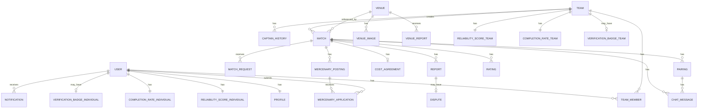

# Data Model (Conceptual) — ArenaFlow System

> Mô hình dữ liệu **NGHIỆP VỤ** — entity, quan hệ, lifecycle. KHÔNG có DB schema/SQL/kiểu dữ liệu kỹ thuật.

---

## 1. Entity Overview

| Entity | Mô tả | Lifecycle | Phạm vi uy tín |
|---|---|---|---|
| **User** | Người dùng cá nhân | active / soft-deleted | Cá nhân (mercenary) |
| **Profile** | Hồ sơ cá nhân (1:1 với User) | Tồn tại khi User tồn tại | — |
| **Team** | Đội bóng | active / INACTIVE | Đội (Match) |
| **Team_Member** | Quan hệ cá nhân–đội | Lịch sử, không xóa cứng | — |
| **Captain_History** | Lịch sử chuyển quyền đội trưởng | Lưu mãi | — |
| **Match** | Kèo thi đấu (luồng A hoặc B) | OPEN → CONFIRMED → ARCHIVED → COMPLETED / EXPIRED / CANCELLED | Tính Reliability & Completion |
| **Match_Request** | Yêu cầu ghép kèo (luồng A) | PENDING → ACCEPTED/REJECTED/WITHDRAWN/SUPERSEDED/EXPIRED | Ảnh hưởng Reliability khi rút ACCEPTED |
| **Pairing** | Thương lượng ghép kèo (luồng B) | NEGOTIATING → CONFIRMED/SUPERSEDED/EXPIRED | — |
| **Chat_Message** | Tin nhắn giữa 2 đội trưởng (luồng B) | Lưu 90 ngày sau Match kết thúc | — |
| **Venue** | Địa điểm sân | active / inactive | — |
| **Venue_Image** | Ảnh sân (tối đa 5) | Tồn tại khi Venue tồn tại | — |
| **Venue_Report** | Report địa điểm | Lưu mãi, admin xác minh | — |
| **Cost_Agreement** | Thỏa thuận chi phí | Gắn với Match | — |
| **Mercenary_Posting** | Tin tuyển mercenary | OPEN → FILLED/EXPIRED/CLOSED | — |
| **Mercenary_Application** | Đơn ứng tuyển | PENDING → APPROVED/REJECTED/WITHDRAWN | Ảnh hưởng Reliability cá nhân khi rút APPROVED |
| **Rating** | Đánh giá sau trận (đội/cá nhân) | Lưu mãi | Tính vào rating trung bình |
| **Report** | Report sau trận (4 loại) | Lưu mãi | Trừ Reliability theo số lần |
| **Dispute** | Tranh chấp report bùng | pending → resolved | Admin quyết định cuối |
| **Notification** | Thông báo (11 loại) | Lưu 30 ngày | — |
| **Reliability_Score** | Điểm uy tín (0-100) | Cập nhật liên tục | Đội & cá nhân độc lập |
| **Completion_Rate** | Tỉ lệ hoàn thành | Cập nhật liên tục | Đội & cá nhân độc lập |
| **Verification_Badge** | Badge xác minh | Cấp/thu hồi tự động | Đội & cá nhân |

---

## 2. Entity Details

### 2.1. USER DOMAIN

#### User (Tài khoản)

**Attributes:**
- ID
- Email (nếu OAuth Google/Facebook)
- Phone (nếu OAuth Phone OTP)
- OAuth provider (Google, Facebook, Phone)
- OAuth ID (từ provider)
- Trạng thái (active, soft-deleted)
- Ngày tạo
- Ngày xóa (nếu soft-deleted)

**Relationships:**
- 1 User có 1 Profile (1:1)
- 1 User có nhiều Team_Member (N) — quan hệ nhiều-nhiều với Team
- 1 User có nhiều Mercenary_Application (N)
- 1 User có nhiều Rating (N, khi đánh giá hoặc bị đánh giá)
- 1 User có nhiều Report (N, khi report hoặc bị report)
- 1 User có 1 Reliability_Score (cá nhân) (1:1)
- 1 User có 1 Completion_Rate (cá nhân) (1:1)
- 1 User có 1 Verification_Badge (cá nhân) (0..1)

**Lifecycle:** active → soft-deleted (giữ mãi, có thể khôi phục)

---

#### Profile (Hồ sơ cá nhân, 1:1 với User)

**Attributes:**
- User ID (khóa ngoại)
- Tên hiển thị
- Ảnh đại diện
- Tiểu sử
- Vị trí chơi ưa thích (Thủ môn, Hậu vệ, Tiền vệ, Tiền đạo)
- Ngày sinh
- Giới tính
- Khu vực (phường/xã, từ danh mục Vietnam Administrative Units)
- Ngày cập nhật

**Relationships:**
- 1 Profile thuộc về 1 User (1:1)

---

### 2.2. TEAM DOMAIN

#### Team (Đội)

**Attributes:**
- ID
- Tên
- Avatar/Logo
- Mô tả/Giới thiệu
- Người tạo (User ID)
- Ngày tạo
- Trạng thái (active, INACTIVE, đã giải tán — `USER-002`)
- Trình độ (tối đa 3 trong 9 nhãn: Chill, Nhiệt tình, Máu lửa, Vui chơi, Rèn luyện, Thi đấu, Mới bắt đầu, Đã có kinh nghiệm, Lão làng)

**Relationships:**
- 1 Team có nhiều Team_Member (N) — quan hệ nhiều-nhiều với User
- 1 Team có nhiều Match (N, khi tạo hoặc tham gia)
- 1 Team có nhiều Captain_History (N)
- 1 Team có nhiều Mercenary_Posting (N)
- 1 Team có nhiều Rating (N, khi đánh giá hoặc bị đánh giá)
- 1 Team có nhiều Report (N, khi report hoặc bị report)
- 1 Team có 1 Reliability_Score (đội) (1:1)
- 1 Team có 1 Completion_Rate (đội) (1:1)
- 1 Team có 1 Verification_Badge (đội) (0..1)

**Lifecycle:** **Sửa bởi `USER-002`:** active ⇄ INACTIVE (admin khoá / kích hoạt lại) → đã giải tán (đội trưởng, vĩnh viễn) — `USER-002/Business_Rules.md` §2

---

#### Team_Member (Quan hệ cá nhân–đội, nhiều-nhiều)

**Attributes:**
- User ID (khóa ngoại)
- Team ID (khóa ngoại)
- Vai trò (CAPTAIN, MEMBER)
- Ngày tham gia
- Ngày rời (nếu đã rời)
- Trạng thái (active, left)

**Relationships:**
- N Team_Member thuộc về 1 User
- N Team_Member thuộc về 1 Team

**Ghi chú:** Giữ lịch sử thành viên, không xóa cứng quan hệ.

---

#### Captain_History (Lịch sử chuyển quyền đội trưởng)

**Attributes:**
- ID
- Team ID
- Đội trưởng cũ (User ID)
- Đội trưởng mới (User ID)
- Ngày chuyển
- Lý do (tùy chọn)

**Relationships:**
- N Captain_History thuộc về 1 Team

**Ghi chú:** Lưu mãi, không xóa.

---

### 2.3. MATCH DOMAIN

#### Match (Kèo thi đấu)

**Attributes:**
- ID
- Loại (luồng A: đã có sân, luồng B: chưa có sân)
- Đội tạo (Team ID)
- Trạng thái (OPEN, CONFIRMED, ARCHIVED, COMPLETED, EXPIRED, CANCELLED)
- Định dạng (5v5, 7v7, 11v11)
- Trình độ mong muốn (tùy chọn, chọn từ 9 nhãn)
- Tuổi (văn bản tự do, vd: "U23")
- Tính chất trận (văn bản tự do, vd: "Giao hữu")
- Thời hạn bài đăng (`expires_at`)
- Ngày tạo
- Ngày cập nhật
- **Luồng A:**
  - Địa điểm sân (Venue ID)
  - Giờ bắt đầu
  - Giờ kết thúc dự kiến (`scheduled_end_time`)
- **Luồng B:**
  - Nhiều lựa chọn địa điểm (danh sách Venue ID)
  - Nhiều lựa chọn giờ (danh sách thời gian)
  - Địa điểm/giờ cuối cùng được chốt (sau khi Pairing CONFIRMED)
  - Giờ kết thúc dự kiến cuối cùng (`scheduled_end_time`, sau khi chốt)
- Lý do hủy (nếu CANCELLED)

**Relationships:**
- 1 Match thuộc về 1 Team (đội tạo)
- 1 Match có 1 Team (đội tham gia, sau khi CONFIRMED)
- 1 Match có nhiều Match_Request (N, luồng A)
- 1 Match có nhiều Pairing (N, luồng B)
- 1 Match có nhiều Chat_Message (N, luồng B)
- 1 Match có 1 Cost_Agreement (0..1)
- 1 Match có nhiều Mercenary_Posting (N)
- 1 Match có nhiều Rating (N)
- 1 Match có nhiều Report (N)
- 1 Match tham chiếu 1 hoặc nhiều Venue

**Lifecycle:** Xem Business_Rules.md §2.1

---

#### Match_Request (Yêu cầu ghép kèo, luồng A)

**Attributes:**
- ID
- Match ID (khóa ngoại)
- Đội gửi (Team ID)
- Trạng thái (PENDING, ACCEPTED, REJECTED, WITHDRAWN, SUPERSEDED, EXPIRED)
- Ngày gửi
- Ngày cập nhật
- Lý do từ chối (nếu REJECTED)
- Lý do rút (nếu WITHDRAWN)

**Relationships:**
- N Match_Request thuộc về 1 Match
- 1 Match_Request thuộc về 1 Team (đội gửi)

**Lifecycle:** Xem Business_Rules.md §2.2

**Ghi chú:** Tối đa 1 request ACCEPTED mỗi Match (ràng buộc dữ liệu).

---

#### Pairing (Thương lượng ghép kèo, luồng B)

**Attributes:**
- ID
- Match ID (khóa ngoại)
- Đội nhận (Team ID, đội nhận bài đăng)
- Trạng thái (NEGOTIATING, CONFIRMED, SUPERSEDED, EXPIRED)
- Ngày tạo
- Đội tạo đã xác nhận (boolean)
- Đội nhận đã xác nhận (boolean)
- Timestamp xác nhận đội tạo
- Timestamp xác nhận đội nhận
- Timestamp xác nhận cuối (max của 2 timestamp trên, dùng để xử lý race condition)

**Relationships:**
- N Pairing thuộc về 1 Match
- 1 Pairing thuộc về 1 Team (đội nhận)
- 1 Pairing có nhiều Chat_Message (N)

**Lifecycle:** Xem Business_Rules.md §2.3

**Ghi chú:** Race condition — pairing có timestamp xác nhận cuối sớm hơn thắng.

> **Implementation note:** Optimistic Lock với JPA `@Version` trên entity Match, retry max 3 lần khi conflict. Frontend không gửi version; backend tự đọc version hiện tại khi xử lý request.

---

#### Chat_Message (Tin nhắn, luồng B)

**Attributes:**
- ID
- Match ID (khóa ngoại)
- Pairing ID (khóa ngoại)
- Người gửi (User ID, đội trưởng)
- Người nhận (User ID, đội trưởng)
- Nội dung
- Timestamp
- Trạng thái đọc (boolean)

**Relationships:**
- N Chat_Message thuộc về 1 Match
- N Chat_Message thuộc về 1 Pairing

**Ghi chú:** Lưu 90 ngày sau khi Match kết thúc (COMPLETED/ARCHIVED/CANCELLED).

> **Implementation note:** Chat real-time dùng WebSocket + SockJS (Spring Boot `.withSockJS()`). SockJS tự động fallback Long Polling nếu WebSocket bị firewall chặn.

---

### 2.4. VENUE DOMAIN

#### Venue (Địa điểm sân)

**Attributes:**
- ID
- Tên
- Địa chỉ
- Tọa độ (latitude, longitude)
- Loại sân (không bắt buộc): sân 5, sân 7, sân 11 — bộ môn thuộc về kèo, không thuộc địa điểm
- Điện thoại
- Website
- Người tạo (User ID hoặc Admin ID)
- Ngày tạo
- Ngày cập nhật
- Lần chọn gần nhất (timestamp)
- Trạng thái (active, inactive)

**Relationships:**
- 1 Venue có nhiều Venue_Image (N, tối đa 5)
- 1 Venue có nhiều Venue_Report (N)
- 1 Venue được tham chiếu bởi nhiều Match (N)

**Lifecycle:** active → inactive (admin đánh dấu ngừng hoạt động)

---

#### Venue_Image (Ảnh sân)

**Attributes:**
- ID
- Venue ID (khóa ngoại)
- Image URL
- Là ảnh chính (`is_primary`, boolean)
- Thứ tự hiển thị (`display_order`)
- Người upload (User ID)
- Ngày tạo

**Relationships:**
- N Venue_Image thuộc về 1 Venue

**Ghi chú:** Tối đa 5 ảnh mỗi venue; chỉ 1 ảnh `is_primary=true`. Người tạo địa điểm hoặc Admin xóa được ảnh; xóa ảnh chính → ảnh còn lại có thứ tự hiển thị nhỏ nhất thành ảnh chính.

---

#### Venue_Report (Report địa điểm)

**Attributes:**
- ID
- Venue ID (khóa ngoại)
- Người report (User ID)
- Lý do (ngừng hoạt động, thông tin sai, khác)
- Chi tiết
- Ngày report
- Trạng thái (pending, verified, rejected)
- Admin xử lý (Admin ID, nếu đã xử lý)
- Ngày xử lý

**Relationships:**
- N Venue_Report thuộc về 1 Venue

**Ghi chú:** Report không tự ẩn địa điểm; admin xác minh rồi đánh dấu ngừng hoạt động. Mỗi (người report, địa điểm, lý do) có tối đa 1 report đang pending.

---

### 2.5. COST DOMAIN

#### Cost_Agreement (Thỏa thuận chi phí)

**Attributes:**
- ID
- Match ID (khóa ngoại, 1:1)
- Loại chi phí (tiền sân, tiền nước, hoặc cả hai)
- Số tiền sân (VND)
- Số tiền nước (VND)
- Cách chia (50-50, 70-30 chủ nhà bao 70%, 70-30 thua bao 70%, thua trả toàn bộ tiền nước)
- Thỏa thuận cọc (boolean, chỉ luồng B)
- Số tiền cọc (VND, nếu có)
- Ai giữ tiền cọc (văn bản, vd: "Đội chủ nhà")
- Khoản tự nhập (danh sách, mỗi khoản có tên + số tiền)

**Relationships:**
- 1 Cost_Agreement thuộc về 1 Match (0..1)

**Ghi chú:** ArenaFlow chỉ lưu để hiển thì; không thu/giữ tiền.

---

### 2.6. MERCENARY DOMAIN

#### Mercenary_Posting (Tin tuyển mercenary)

**Attributes:**
- ID
- Match ID (khóa ngoại)
- Team ID (khóa ngoại, đội tuyển)
- Vị trí (Thủ môn, Hậu vệ, Tiền vệ, Tiền đạo)
- Số lượng cần
- Số lượng đã duyệt
- Trạng thái (OPEN, FILLED, EXPIRED, CLOSED)
- Ngày tạo
- Ngày cập nhật

**Relationships:**
- N Mercenary_Posting thuộc về 1 Match
- N Mercenary_Posting thuộc về 1 Team
- 1 Mercenary_Posting có nhiều Mercenary_Application (N)

**Lifecycle:** Xem Business_Rules.md §2.4

**Ghi chú:** Tự động EXPIRED khi đến `Match.scheduled_end_time`.

---

#### Mercenary_Application (Đơn ứng tuyển)

**Attributes:**
- ID
- Mercenary_Posting ID (khóa ngoại)
- User ID (khóa ngoại, ứng viên)
- Trạng thái (PENDING, APPROVED, REJECTED, WITHDRAWN)
- Ngày ứng tuyển
- Ngày cập nhật
- Lý do từ chối (nếu REJECTED)
- Lý do rút (nếu WITHDRAWN)

**Relationships:**
- N Mercenary_Application thuộc về 1 Mercenary_Posting
- 1 Mercenary_Application thuộc về 1 User

**Lifecycle:** Xem Business_Rules.md §2.5

---

### 2.7. REPUTATION DOMAIN

#### Rating (Đánh giá sau trận)

**Attributes:**
- ID
- Match ID (khóa ngoại)
- Rater type (TEAM, INDIVIDUAL)
- Rater ID (Team ID hoặc User ID)
- Ratee type (TEAM, INDIVIDUAL)
- Ratee ID (Team ID hoặc User ID)
- Score (1-5 sao)
- Comment (tùy chọn)
- Ngày tạo

**Relationships:**
- N Rating thuộc về 1 Match
- Rating liên kết đến Team hoặc User (qua rater_type/rater_id, ratee_type/ratee_id)

**Ghi chú:** Unique constraint trên (`match_id`, `rater_type`, `rater_id`, `ratee_type`, `ratee_id`).

---

#### Report (Report sau trận)

**Attributes:**
- ID
- Match ID (khóa ngoại)
- Reporter type (TEAM, INDIVIDUAL)
- Reporter ID (Team ID hoặc User ID)
- Reportee type (TEAM, INDIVIDUAL)
- Reportee ID (Team ID hoặc User ID)
- Loại (bùng, chơi xấu, giao tiếp tệ, không đúng trình độ)
- Lý do chi tiết
- Trạng thái (auto_accepted, disputed, confirmed, rejected)
- Ngày report
- Ngày cập nhật

**Relationships:**
- N Report thuộc về 1 Match
- Report liên kết đến Team hoặc User (qua reporter_type/reporter_id, reportee_type/reportee_id)
- 1 Report có 0..1 Dispute (nếu loại bùng và bị tranh chấp)

**Ghi chú:** Tự động chấp nhận ngay khi tạo; trừ Reliability Score theo số lần.

---

#### Dispute (Tranh chấp report bùng)

**Attributes:**
- ID
- Report ID (khóa ngoại, 1:1)
- Bằng chứng từ đội bị report
- Ngày tranh chấp
- Trạng thái (pending, resolved)
- Admin xử lý (Admin ID)
- Quyết định (confirmed, rejected)
- Lý do quyết định
- Ngày xử lý

**Relationships:**
- 1 Dispute thuộc về 1 Report (0..1)

**Ghi chú:** Chỉ report bùng có tranh chấp; trong 24h.

---

#### Reliability_Score (Điểm uy tín, 0-100)

**Attributes:**
- ID
- Loại (team, individual)
- Entity ID (Team ID hoặc User ID)
- Điểm hiện tại (0-100, khởi đầu 80)
- Số trận sạch liên tiếp
- Bộ đếm số lần bị report (4 bộ đếm: bùng, chơi xấu, giao tiếp tệ, không đúng trình độ)
- Ngày cập nhật

**Relationships:**
- 1 Reliability_Score thuộc về 1 Team hoặc 1 User (1:1)

**Ghi chú:** Chặn trong [0, 100]; reset bộ đếm sau 5 trận sạch.

---

#### Completion_Rate (Tỉ lệ hoàn thành)

**Attributes:**
- ID
- Loại (team, individual)
- Entity ID (Team ID hoặc User ID)
- Tử số (số Match COMPLETED không bị report bùng)
- Mẫu số (số Match CONFIRMED, loại trừ CANCELLED ≥24h và ARCHIVED)
- Phần trăm (tử số / mẫu số × 100%)
- Ngày cập nhật

**Relationships:**
- 1 Completion_Rate thuộc về 1 Team hoặc 1 User (1:1)

**Ghi chú:** Chỉ hiển thị khi mẫu số ≥5; trước đó hiển thị "Mới tham gia X/5 trận".

---

#### Verification_Badge (Badge xác minh)

**Attributes:**
- ID
- Loại (team, individual)
- Entity ID (Team ID hoặc User ID)
- Có badge (boolean)
- Ngày cấp
- Ngày thu hồi (nếu đã thu hồi)

**Relationships:**
- 1 Verification_Badge thuộc về 1 Team hoặc 1 User (0..1)

**Ghi chú:** Yêu cầu: phone linked + >5 trận + rating >3 sao + Reliability ≥70.

---

### 2.8. NOTIFICATION DOMAIN

#### Notification (Thông báo)

**Attributes:**
- ID
- User ID (khóa ngoại, người nhận)
- Loại (11 loại: Match request nhận, request chấp nhận/từ chối, Match confirmed, Match cancelled, Pairing mới, reminder trước trận, Match completed, rating nhận, report nhận, mercenary application, invitation vào đội)
- Nội dung
- Liên kết (vd: Match ID, Team ID)
- Trạng thái đọc (boolean)
- Timestamp
- Ngày hết hạn (timestamp + 30 ngày)

**Relationships:**
- N Notification thuộc về 1 User

**Ghi chú:** Lưu 30 ngày; sau đó xóa.

---

## 3. Entity Relationship Diagram (High-Level)

---

## 4. Key Relationships

### 4.1. Many-to-Many

| Bên A | Bên B | Qua | Ghi chú |
|---|---|---|---|
| User | Team | Team_Member | Một User có nhiều đội; một đội có nhiều thành viên; giữ lịch sử |

### 4.2. One-to-Many

| Một | Nhiều | Ghi chú |
|---|---|---|
| User | Profile | 1:1 (hồ sơ cá nhân) |
| Team | Match | Một đội tạo nhiều kèo |
| Match | Match_Request | Một kèo nhận nhiều request (luồng A) |
| Match | Pairing | Một kèo có nhiều pairing (luồng B) |
| Match | Chat_Message | Một kèo có nhiều tin nhắn (luồng B) |
| Match | Rating | Một trận có nhiều đánh giá (đội/cá nhân) |
| Match | Report | Một trận có nhiều report (đội/cá nhân) |
| Match | Mercenary_Posting | Một kèo có nhiều tin tuyển |
| Mercenary_Posting | Mercenary_Application | Một tin tuyển có nhiều đơn ứng tuyển |
| Venue | Venue_Image | Một địa điểm có nhiều ảnh (tối đa 5) |
| Venue | Venue_Report | Một địa điểm có nhiều report |
| Report | Dispute | Một report bùng có tối đa 1 tranh chấp (0..1) |
| User | Notification | Một User nhận nhiều notification |

### 4.3. One-to-One

| Bên A | Bên B | Ghi chú |
|---|---|---|
| User | Profile | Hồ sơ cá nhân |
| Match | Cost_Agreement | Thỏa thuận chi phí (0..1) |
| Team | Reliability_Score | Đội có 1 điểm uy tín |
| User | Reliability_Score | Cá nhân có 1 điểm uy tín (mercenary) |
| Team | Completion_Rate | Đội có 1 tỉ lệ hoàn thành |
| User | Completion_Rate | Cá nhân có 1 tỉ lệ hoàn thành (mercenary) |
| Team | Verification_Badge | Đội có 0..1 badge |
| User | Verification_Badge | Cá nhân có 0..1 badge |

---

## 5. Lifecycle Summary

| Entity | Khởi tạo | Terminal States | Có thể quay lại? |
|---|---|---|---|
| User | Đăng ký OAuth | soft-deleted | ✅ (khôi phục) |
| Team | User tạo đội | Đã giải tán (`USER-002`) | ❌ Đã giải tán · ✅ INACTIVE: admin kích hoạt lại |
| Match | Đội trưởng tạo kèo | CANCELLED, EXPIRED, COMPLETED | ❌ |
| Match_Request | Đội gửi request | REJECTED, WITHDRAWN, SUPERSEDED, EXPIRED | ❌ |
| Pairing | Đội nhận bài đăng | CONFIRMED, SUPERSEDED, EXPIRED | ❌ |
| Mercenary_Posting | Đội trưởng tạo tin | CLOSED, EXPIRED | ❌ |
| Mercenary_Application | User ứng tuyển | REJECTED, WITHDRAWN | ❌ |
| Venue | Admin/User thêm | inactive | ✅ (admin kích hoạt lại) |
| Notification | System tạo | (xóa sau 30 ngày) | ❌ |
| Chat_Message | User gửi | (xóa sau 90 ngày từ Match kết thúc) | ❌ |

---

## 6. Data Retention

| Entity | Retention | Thời điểm bắt đầu | Hành động sau retention |
|---|---|---|---|
| Chat_Message | 90 ngày | Khi Match chuyển COMPLETED/ARCHIVED/CANCELLED | Xóa |
| Notification | 30 ngày | Khi tạo notification | Xóa |
| User (soft-deleted) | Giữ mãi | — | **[cần xác nhận: hard-delete policy]** |
| Team_Member (left) | Giữ mãi | — | Không xóa (lịch sử) |
| Captain_History | Giữ mãi | — | Không xóa (lịch sử) |
| Rating | Giữ mãi | — | Không xóa |
| Report | Giữ mãi | — | Không xóa |
| Dispute | Giữ mãi | — | Không xóa |
| Match (terminal) | Giữ mãi | — | Không xóa |
| Venue_Report | Giữ mãi | — | Không xóa |

---

## 7. Conceptual Constraints

| Entity | Constraint | Enforcement |
|---|---|---|
| User | Email hoặc Phone phải có (tùy OAuth provider) | Application logic |
| Team | Tên cho phép trùng | Không có unique |
| Team_Member | Một User không thể là CAPTAIN của 2 đội cùng lúc **[cần xác nhận]** | Application logic hoặc DB constraint |
| Match | Tối đa 1 Match_Request ACCEPTED mỗi Match | Unique constraint hoặc check |
| Match | CONFIRMED không được sửa giờ/sân/trình độ | Application logic (reject update) |
| Match_Request | Request hết hạn theo Match `expires_at` | System job + lazy check |
| Pairing | Cả 2 đội trưởng phải xác nhận | Application logic |
| Pairing | Race condition: timestamp xác nhận cuối sớm hơn thắng | **[cần xác nhận: optimistic lock / DB constraint]** |
| Venue_Image | Tối đa 5 ảnh mỗi venue | Check trước khi insert |
| Venue_Image | Chỉ 1 ảnh `is_primary=true` | Unique constraint hoặc trigger |
| Rating | Unique trên (`match_id`, `rater_type`, `rater_id`, `ratee_type`, `ratee_id`) | Unique constraint |
| Reliability_Score | Chặn trong [0, 100] | Application logic |
| Completion_Rate | Chỉ hiển thị khi mẫu số ≥5 | Application logic (view layer) |
| Verification_Badge | 4 điều kiện: phone + >5 trận + rating >3 + Reliability ≥70 | System tự động kiểm tra và cấp/thu hồi |

---

## 8. GPS & Location

### Khu vực hồ sơ (Profile)
- User chọn khu vực đến cấp **phường/xã** từ danh mục chuẩn **Vietnam Administrative Units**.
- Dùng khi: dự phòng không có GPS, gợi ý kèo, hiển thị trên hồ sơ.

### GPS thời điểm
- App yêu cầu GPS khi: (1) tìm kèo mercenary, (2) tạo kèo luồng B.
- Không lưu consent riêng trong DB; truy cập GPS dựa vào quyền hệ điều hành.
- Dữ liệu GPS/địa chỉ đã lưu (trong Match luồng B) được giữ; không cần làm mờ.

### Bảo vệ vị trí
- Không hiển thị tọa độ chính xác (latitude/longitude) trên UI.
- Chỉ hiển thị: **khoảng cách** (vd: "2.3 km từ bạn") và **khu vực chung** (vd: "Quận 1").

---

## 9. Quyết định bổ sung đã chốt

1. **Cost agreement (luồng B):** Một bên đề xuất, bên kia xem. Không cần xác nhận riêng.
2. **Verification Badge revocation:** Thu hồi ngay lập tức khi điều kiện không đủ.
3. **GPS permission revocation:** Fallback sang khu vực hồ sơ ngay. Thông báo "Bật GPS để tìm kèo gần bạn hơn".
4. **Report cooldown:** Không giới hạn. Mỗi trận chỉ report 1 lần/loại.
5. **Hard-delete policy:** Giữ mãi, không hard-delete. Lịch sử luôn khả dụng.
6. **Push notification:** FCM + APNs (miễn phí), push tất cả 11 loại. Device token được lưu khi user cấp quyền.
7. **Chat read receipt:** Boolean `is_read` đơn giản (không cần timestamp đọc chi tiết trong MVP).
8. **Team Captain uniqueness:** Một User có thể là CAPTAIN của nhiều đội cùng lúc (không có unique constraint).
9. **Rating aggregation:** Rating trung bình tính on-the-fly từ bảng Rating (không denormalize trong MVP).
10. **Reliability Score history:** Chỉ lưu giá trị hiện tại (không lưu lịch sử thay đổi trong MVP).
11. **Notification push delivery status:** Không lưu delivery status (sent/delivered/failed) trong MVP. FCM/APNs có log riêng nếu cần debug.

> **Implementation notes đã chốt:**
> - Match luồng B: JSONB fields `location_option_ids` (array of venue IDs) và `time_options` (array of objects `[{"start": "...", "end": "..."}]`)
> - Concurrent pairing: Optimistic Lock với JPA `@Version`, retry max 3 lần
> - Chat: WebSocket + SockJS, fallback Long Polling

---

## 10. Trạng thái mô hình

**Trạng thái:** ✅ **Hoàn chỉnh** — Mô hình dữ liệu nghiệp vụ đã đầy đủ, không còn [cần xác nhận]  
**Sẵn sàng cho:** Thiết kế schema kỹ thuật (DB schema design với kiểu dữ liệu, constraints, indexes)
