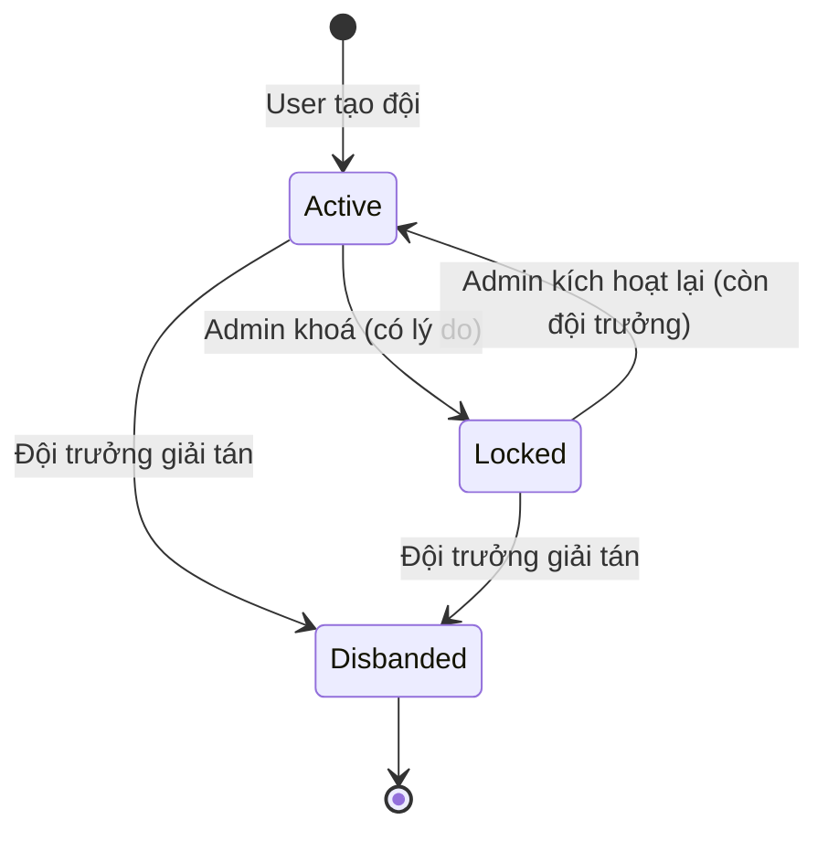

# Business Rules — Giải tán đội & quy tắc xoá tài khoản đội trưởng (USER-002)

> Mã tiếp nối SYSTEM-001 (BR-T01..T06, BC-T01..T05). Quy tắc SYSTEM-001 không nhắc ở đây giữ nguyên.

## 1. Validation Rules

| Rule ID | Mô tả | Khi nào áp dụng |
|---|---|---|
| BR-T06 (sửa) | Trước khi xoá tài khoản, User phải **chuyển quyền hoặc giải tán** mọi đội chưa giải tán mà mình là đội trưởng — **kể cả khi là người duy nhất** và kể cả đội đang bị admin khoá. Đội đã giải tán không tính. | Khi User xoá tài khoản |
| BR-T07 | Chỉ đội trưởng **đang hoạt động** của đội được giải tán đội. Thành viên thường, người được mời và admin không giải tán được. | Khi giải tán đội |
| BR-T08 | Lý do giải tán **tuỳ chọn**; khoảng trắng đầu/cuối được bỏ đi; bỏ trống (kể cả chỉ gồm khoảng trắng) → ghi "Đội trưởng giải tán đội". Độ dài tối đa **100 ký tự**. | Khi giải tán đội |
| BR-T09 | Giải tán là **vĩnh viễn**: không ai kích hoạt lại được, kể cả admin. | Sau khi giải tán |
| BR-T10 | Khi giải tán: mọi thành viên đang hoạt động (kể cả đội trưởng) → đã rời đội (ghi ngày rời); mọi lời mời đang chờ → bị từ chối. Lịch sử thành viên, lịch sử đội trưởng, đánh giá giữ nguyên. | Khi giải tán đội |
| BR-T11 | Đội đã giải tán **chặn mọi thao tác**: sửa thông tin, mời, chấp nhận/từ chối lời mời, chuyển quyền, rời đội, giải tán lại, admin khoá, admin kích hoạt lại. | Mọi thao tác trên đội |
| BR-T12 | Đội **đang bị admin khoá** vẫn được đội trưởng giải tán. Lý do khoá của admin **giữ nguyên** (không bị ghi đè), lý do giải tán ghi riêng. | Khi giải tán đội bị khoá |
| BR-T13 | Đội đã giải tán vẫn xem được và được đánh dấu "Đã giải tán"; User có thể xem chi tiết và lịch sử đội trưởng, chỉ Admin được xem lịch sử thành viên (Admin xem được lịch sử thành viên của đội ở mọi trạng thái; lịch sử gồm người đã từng tham gia, không gồm lời mời). Danh sách đội mặc định chỉ hiện đội đang hoạt động; lọc theo trạng thái thì thấy đội đã giải tán. | Khi xem đội |
| BR-T14 | Khi User xoá tài khoản (sau khi thoả BR-T06): tư cách thành viên đang hoạt động → đã rời đội; lời mời đang chờ gửi tới User → bị từ chối. Không đội nào bị tự chuyển trạng thái. | Khi User xoá tài khoản |

## 2. State Transitions (Chuyển trạng thái)

### Team Lifecycle (thay thế "Lifecycle" của Team trong SYSTEM-001)

| Từ | Đến | Điều kiện | Actor |
|---|---|---|---|
| Hoạt động | Bị khoá | Có lý do (UC-T05) | Admin |
| Bị khoá | Hoạt động | Đội còn đội trưởng đang hoạt động | Admin |
| Hoạt động | Đã giải tán | BR-T07 | Đội trưởng |
| Bị khoá | Đã giải tán | BR-T07, BR-T12 | Đội trưởng |
| Đã giải tán | — | Trạng thái cuối (BR-T09) | — |

> "Bị khoá" = INACTIVE do admin (SYSTEM-001). "Đã giải tán" là trạng thái mới; cả hai đều chặn thao tác ghi, chỉ "Bị khoá" mở lại được.

### Team_Member khi đội giải tán

| Từ | Đến | Điều kiện | Actor |
|---|---|---|---|
| Đang hoạt động (CAPTAIN / MEMBER) | Đã rời đội | Đội giải tán (BR-T10) | System |
| Đang chờ (lời mời) | Bị từ chối | Đội giải tán (BR-T10) | System |

## 3. Calculation Rules

Không có.

## 4. Constraints

| Constraint ID | Mô tả |
|---|---|
| BC-T02 (sửa) | Chỉ admin **khoá** đội. **Bỏ** ngoại lệ "đội trưởng duy nhất xoá tài khoản → đội tự INACTIVE". Đội trưởng **giải tán** đội theo UC-T06. Hệ thống không tự chuyển trạng thái đội. |
| BC-T06 | Mỗi đội chưa giải tán luôn có đúng một đội trưởng đang hoạt động (hệ quả của BR-T06 sửa). |

## 5. Authorization Rules (thay thế các dòng tương ứng trong SYSTEM-001 §5)

| Actor | Có thể | Không thể |
|---|---|---|
| User | Rời đội | Giải tán đội (chỉ đội trưởng) |
| Team Captain | Giải tán đội của mình (cả khi đội bị admin khoá) | Giải tán đội khác; kích hoạt lại đội đã giải tán |
| Admin | Khoá đội; kích hoạt lại đội bị khoá | Giải tán đội; kích hoạt lại đội đã giải tán; xoá cứng đội |

## 6. Danh sách [cần xác nhận]

Xem `Acceptance_Criteria.md` §5.
